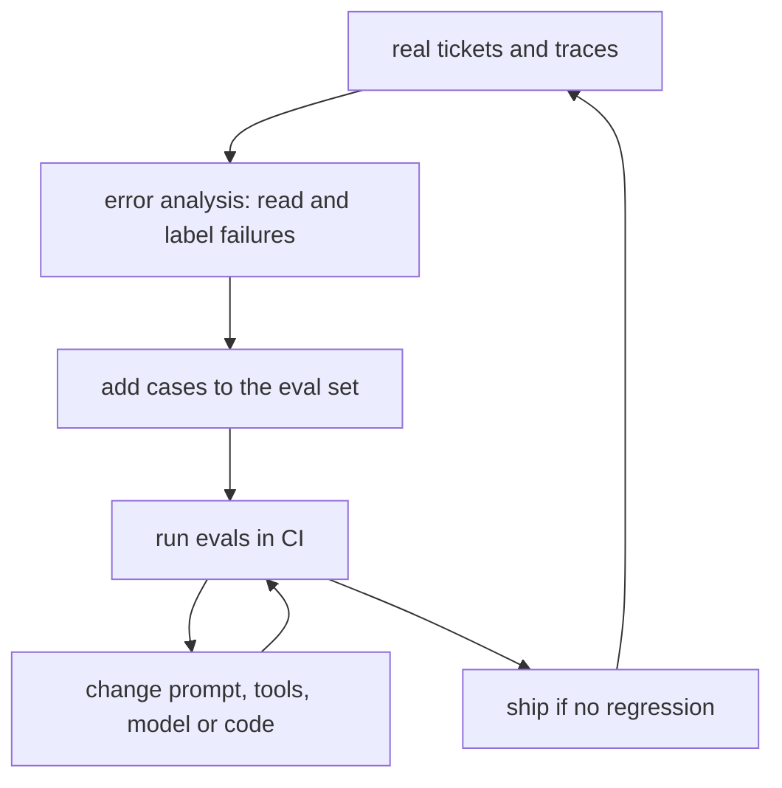

# Evals: the skill that sets you apart

The field guide found evaluation explicitly required in 39.6% of AI-first postings and calls it the biggest differentiator in take-homes (one reviewer: "Red flag if candidate doesn't start with evals"). Know the layers:

| Layer | Examples | Cost |
|---|---|---|
| **Code checks** | valid JSON, the right enum, a citation present, no PII in output, under N steps | free, run on every commit |
| **Labelled datasets** | expected category and action per ticket; accuracy, recall on escalations | cheap |
| **LLM-as-judge** | reply helpfulness, tone, faithfulness to sources, checked against human labels | moderate |
| **Human review** | sample real traffic weekly, read traces, label failures | expensive, essential |
| **Online metrics** | approval rate of drafts, edits made by agents, escalation rate, cost per ticket | from production |

**Agent-specific metrics:** task success, tool-selection accuracy, steps and tokens per task, and the rate of unsafe actions blocked. Read more from practitioners: Hamel Husain's [Your AI Product Needs Evals](https://hamel.dev/blog/posts/evals/) and Eugene Yan's [Patterns for building LLM-based systems](https://eugeneyan.com/writing/llm-patterns/).
