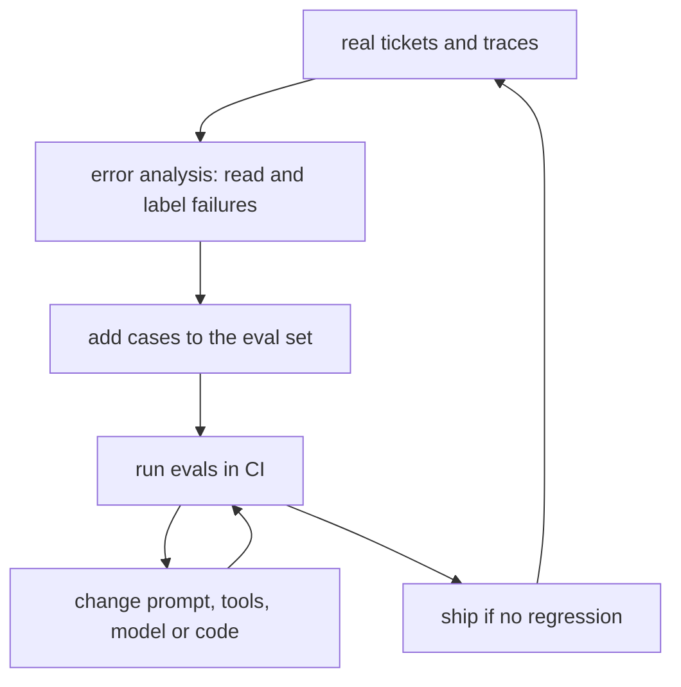

# Evals: the skill that sets you apart

The field guide found evaluation explicitly required in 39.6% of AI-first postings and calls it the biggest differentiator in take-homes (one reviewer: "Red flag if candidate doesn't start with evals"). Know the layers:

| Layer | Examples | Cost |
|---|---|---|
| **Code checks** | valid JSON, the right enum, a citation present, no PII in output, under N steps | free, run on every commit |
| **Labelled datasets** | expected category and action per ticket; accuracy, recall on escalations | cheap |
| **LLM-as-judge** | reply helpfulness, tone, faithfulness to sources, checked against human labels | moderate |
| **Human review** | sample real traffic weekly, read traces, label failures | expensive, essential |
| **Online metrics** | approval rate of drafts, edits made by agents, escalation rate, cost per ticket | from production |

**Agent-specific metrics:** task success, tool-selection accuracy, steps and tokens per task, and the rate of unsafe actions blocked. Read more from practitioners: Hamel Husain's [Your AI Product Needs Evals](https://hamel.dev/blog/posts/evals/) and Eugene Yan's [Patterns for building LLM-based systems](https://eugeneyan.com/writing/llm-patterns/).

## Making LLM-as-judge trustworthy

A judge is a model, so it needs its own evaluation. What practitioners recommend:

- **Binary pass/fail per criterion** ("does the reply cite a source?") beats a 1 to 10 score: it's easier to agree on and to act on.
- **Calibrate against people:** label 100 or so outputs yourself, run the judge, and measure agreement separately on passes and fails (how often it catches real failures, how often it fails good answers). Improve the judge prompt until agreement is high, then trust it for that one criterion only.
- **Know the biases:** judges prefer longer answers, the first option in a pair (position bias) and outputs from their own model family. Swap positions, and use a different model as judge where you can.
- **Write the criteria from real failures**, found in error analysis, not from a generic list of "helpfulness, harmlessness".

Tools exist for running and tracking evals (open-source ones like promptfoo, DeepEval, Ragas and Inspect, and hosted ones like Langfuse, LangSmith, Braintrust and Arize Phoenix), but say the idea first: "a versioned dataset, a runner, scores per case, a comparison against the last run".

## Optional videos

The lesson above is complete on its own. These go deeper, if you like learning by watching.

**Why AI evals are the hottest new skill (Hamel Husain and Shreya Shankar, Lenny's Podcast)**

https://www.youtube.com/watch?v=BsWxPI9UM4c

**Lessons From A Year Building With LLMs (AI Engineer)**

https://www.youtube.com/watch?v=qBHfQT3YtyY
