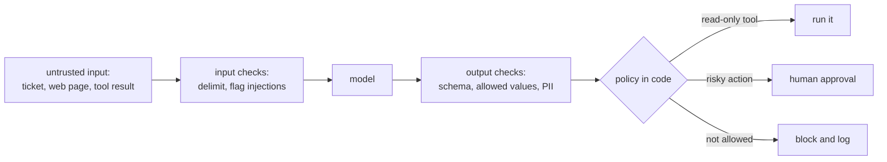

# Safety: prompt injection, PII and tools

The [OWASP Top 10 for LLM Applications 2025](https://genai.owasp.org/llm-top-10/) is the checklist security-minded interviewers expect: **LLM01 Prompt Injection, LLM02 Sensitive Information Disclosure, LLM03 Supply Chain, LLM04 Data and Model Poisoning, LLM05 Improper Output Handling, LLM06 Excessive Agency, LLM07 System Prompt Leakage, LLM08 Vector and Embedding Weaknesses, LLM09 Misinformation, LLM10 Unbounded Consumption.**

## Defences that actually work (in layers)

No prompt fully stops injection, so limit what a successful injection can do:

- Treat tickets, documents and web pages as **data**: delimit them, and say so in the system prompt.
- **Least privilege:** read-only tools by default; no tool for irreversible actions without a human (excessive agency).
- **Validate outputs** before using them: schemas, allowed values, never run generated code or SQL unchecked (improper output handling).
- **Policies in code** that the model can't override.
- **Redact PII** before logging; don't send more personal data to the model than the task needs.
- **Budgets:** step limits, token limits, rate limits (unbounded consumption).
- **Test attacks** in your eval set, every commit.

## The lethal trifecta

Simon Willison's name (2025) for the most dangerous agent setup: an agent that has all three of **access to private data**, **exposure to untrusted content** (emails, web pages, tickets, tool results) and **a way to send data out** (email, web requests, even an image URL in markdown). With all three, one injected instruction can leak your data. Remove at least one leg for any task that doesn't need it.

**Practice question:** *"Our agent reads customer emails and can send emails. What could go wrong, and what would you change?"* Name the trifecta, then the fixes: drafts instead of sending, an allow-list of recipients, no links or images in outgoing mail without review, and injection cases in the eval set.
