# Observability: traces, metrics and alerts

You can't fix what you can't see, and LLM systems fail quietly: a worse answer throws no exception. Observability is how you find out.

## Traces

A **trace** is the record of one request: every step as a **span** with its inputs, outputs, timing, tokens and cost.

```mermaid
gantt
    dateFormat X
    axisFormat %L ms
    section request
    whole request          :0, 2400
    section steps
    rewrite query (small model) :0, 300
    hybrid search          :300, 420
    rerank                 :420, 650
    generate answer (stream)    :650, 2350
    check citations        :2350, 2400
```

This one trace shows at a glance that generation is 70% of the time, so streaming and a shorter context matter more than a faster search.

**OpenTelemetry** is the open standard for traces, and it has semantic conventions for generative AI (attribute names such as `gen_ai.request.model` and token counts), so LLM spans can go to the same back end as the rest of your system. LLM-specific tools (Langfuse, LangSmith, Arize Phoenix, Helicone, and others) add prompt views, eval scores on traces, and datasets built from real traffic.

## What to measure

| Kind | Examples |
|---|---|
| **Health** | error rate, timeouts, p50 and p95 latency, time to first token |
| **Cost** | tokens and dollars per request, per feature, per customer |
| **Quality** | eval scores on sampled traffic, citation rate, "I don't know" rate, user thumbs and edits |
| **Safety** | blocked tool calls, injection flags, PII redactions |
| **Agents** | steps per task, tool errors, tasks that hit the step limit |

## Alerts and the habit

Alert on what needs a person now (error rate, cost spike, a safety block surge); put the rest on a dashboard. And keep the habit from error analysis: every week, **read 20 to 50 real traces**. That is where new failure categories come from.

**Privacy:** traces contain user data. Redact PII before storing, limit who can read traces, and delete them on a schedule.

## Practice questions

*What would you log for every LLM call? Users say answers got worse last week but nothing errors: how do you investigate? How do you trace an agent across several tools and services?*
