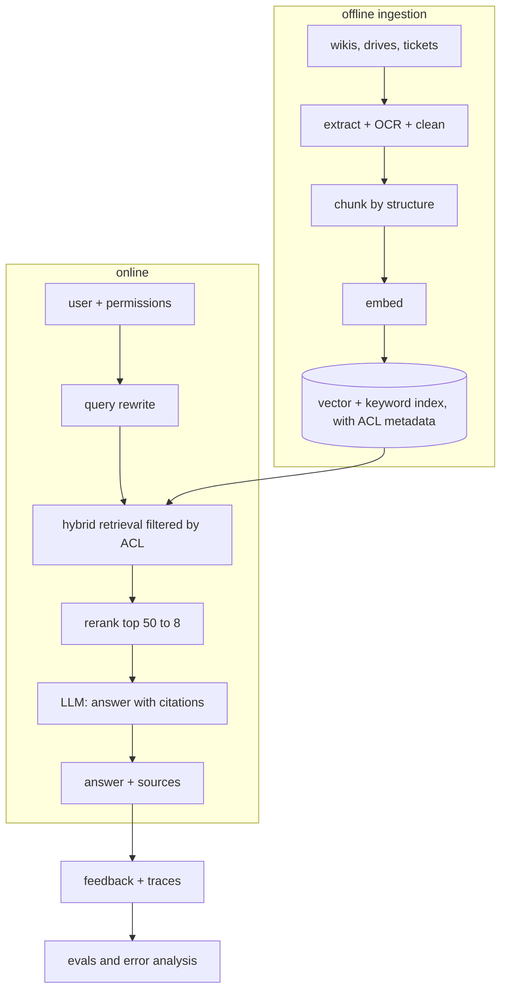

# Worked example: document Q&A for a whole company

**Prompt:** *Design an assistant that answers employees' questions from 10 million internal documents (policies, wikis, tickets), with access control.*

**1. Frame it.** 20,000 employees, a few thousand questions per hour at peak; answers in under 5 s (first token under 1.5 s); answers must cite sources; users only see documents they're allowed to; quality measured by a golden set per department plus thumbs up/down and escalations to humans.

**3. Deep dive.** Incremental ingestion (only changed documents) through a queue; ACL tags stored on every chunk and applied as a filter inside the search; an approximate nearest-neighbour index (HNSW) sharded by department; a cross-encoder reranker on the top 50; the prompt demands citations and a refusal; an eval set per department; dashboards for p95 latency, cost per question, refusal rate and feedback.

**4. Trade-offs and failure modes.** Stale index vs ingestion cost (event-driven updates for hot sources); reranker quality vs +200 to 400 ms; a big model for hard questions only (route by a classifier); what if the vector store is down (keyword-only fallback); prompt injection in documents (data delimiting, no tools with side effects); PII in logs (redaction).

**5. Wrap up.** Pilot with one department, measure, expand; next: query analytics to find content gaps.
