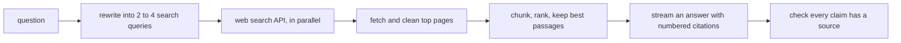

# Practice prompts

Real prompts collected in the field guide. Do one a week, timed to 45 minutes, on a whiteboard or paper, ideally with a friend asking follow-ups:

1. Design an AI chatbot like ChatGPT or Claude.
2. Design a document Q&A assistant (RAG) for a bank's policies.
3. Design an AI coding assistant like GitHub Copilot.
4. Design ChatGPT's cross-conversation memory feature.
5. Design a multi-step agent that schedules meetings from email.
6. Design a content/policy violation detection system.
7. Design a real-time LLM-powered search engine like Perplexity.
8. Scale an AI chat feature to 1M daily users: the trade-offs.
9. Design a system to process 10K uploaded payslips and IDs a month.
10. Design a hospital voice assistant (noise, privacy, latency).

## How to start three of them

You won't have time for all ten in this lesson, so here are first moves for three. Use them to check your own attempts.

**Design a document Q&A assistant for a bank's policies (2).** Ask: how many documents, how often they change, who may read what, and whether a wrong answer could cause legal harm. Then: ingestion with layout parsing and versioning; hybrid search with **permission filters at retrieval time**; answers with mandatory citations and an "I don't know" path; a golden set reviewed by compliance; logging without PII.

**Design ChatGPT-style memory across conversations (4).** Ask: what may be remembered, can users see and delete it, how is it used. Then: an extraction step after conversations that proposes facts; a store with user id, fact, source and time; retrieval of relevant memories at the start of a chat; rules for sensitive topics; evals for both "remembered what helps" and "didn't bring up what it shouldn't".

**Design a real-time search engine like Perplexity (7).**

Deep-dive topics: latency budget per step (search and fetching dominate, so run in parallel and stream early), caching popular queries, source quality and freshness, injection from web pages, and cost per answer.

For each prompt, end with the two risks you'd watch most and the metric that would tell you.
