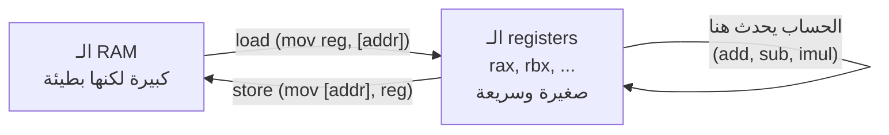

# كيف ينفّذ المعالج برنامجك

Assembly أقرب لغة لما يفعله المعالج فعلًا. كل برنامج بـ C أو C++ أو Rust أو بايثون ينتهي في الآخر قائمة طويلة من instructions الآلة الصغيرة. في هذا الكورس ستكتب هذه الـ instructions بنفسك، لمعالجات **x86-64** الموجودة في أغلب اللابتوبات والسيرفرات، على **Linux**، بالـ assembler **NASM**.

لا تحتاج أن تكون تعلمت C قبلها، لكنها تساعد. لو أخذت كورس C فسترى أخيرًا ما هي الـ pointers واستدعاء الـ functions والـ stack في الحقيقة.

## ما تحتاجه

- كمبيوتر Linux، أو WSL على ويندوز (Ubuntu من متجر مايكروسوفت)، أو جهاز Linux افتراضي.
- ثبّت الأدوات مرة واحدة:

```bash
sudo apt install nasm gcc gdb
```

أجهزة ماك بمعالجات Apple تستخدم معالجًا مختلفًا (ARM)، فاستخدم هناك جهاز Linux افتراضيًا أو جهاز Linux مجانيًا على الإنترنت.

## البتات والبايتات والنظام الست عشري

المعالج لا يتعامل إلا مع أرقام **ثنائية** (أساس 2): كل خانة **بت (bit)**، إما 0 أو 1.

- كل 8 بتات تكوّن **بايت (byte)**. البايت يحمل من 0 إلى 255.
- الأرقام الثنائية طويلة، فنستخدم **النظام الست عشري (hex)** (أساس 16): الأرقام من 0 إلى 9، ثم الحروف من A إلى F للقيم من 10 إلى 15.
- كل خانة hex تساوي 4 بتات بالضبط، فالبايت دائمًا خانتان hex.

```text
decimal   binary      hex
   5      0000 0101   0x05
  10      0000 1010   0x0A
  15      0000 1111   0x0F
 255      1111 1111   0xFF
  65      0100 0001   0x41   (the letter 'A' in ASCII)
```

`0x` في البداية معناها "هذا رقم hex". ويقبل NASM أيضًا الكتابة `0FFh` والثنائي مثل `0b1010`.

## الـ registers: variables المعالج نفسه

الذاكرة (RAM) كبيرة لكنها بطيئة. وداخل المعالج أماكن تخزين قليلة وسريعة جدًا اسمها **الـ registers**. في x86-64 يوجد 16 register للأغراض العامة، كل واحد 64 بت (8 بايت):

<!-- diagram -->


```text
rax  rbx  rcx  rdx  rsi  rdi  rbp  rsp
r8   r9   r10  r11  r12  r13  r14  r15
```

أغلب الشغل يتم هكذا: تحمّل الأرقام من الذاكرة إلى الـ registers، وتحسب عليها، ثم تخزّن النتيجة في الذاكرة.

مسجّلان لهما وضع خاص:

- **rsp** (stack pointer) يشير إلى قمة الـ stack. ستقابله في الوحدة 4.
- **rip** (instruction pointer) يحمل address الـ instruction التالية. لا تكتب فيه مباشرة أبدًا؛ الـ jumps والاستدعاءات هي التي تغيّره.

## البرنامج نفسه أرقام أيضًا

instruction مثل `mov eax, 60` ("ضع 60 في eax") تُخزّن في الذاكرة كبايتات: `B8 3C 00 00 00`. المعالج يجلب البايتات الموجودة عند rip، ويفك شفرتها، وينفّذها، وينقل rip إلى الـ instruction التالية، ويكرر. مليارات المرات في الثانية.

**الـ assembler** وهو NASM يحوّل النص الذي تقرؤه إلى هذه البايتات. و**الـ linker** وهو ld يجمع القطع في برنامج يستطيع Linux تشغيله.

```text
hello.asm  --nasm-->  hello.o  --ld-->  hello  --run-->  output
 (text)              (machine code)   (program)
```

## أول برنامج لك بالـ Assembly

هذا البرنامج لا يفعل شيئًا إلا أن ينتهي بأدب برمز خروج 7. احفظه باسم `exit.asm`:

```nasm
global _start

section .text
_start:
    mov rax, 60     ; 60 = the "exit" system call
    mov rdi, 7      ; the exit code
    syscall         ; ask Linux to do it
```

ابنِه وشغّله:

```bash
nasm -f elf64 exit.asm -o exit.o
ld exit.o -o exit
./exit
echo $?
```

الأمر `echo $?` يطبع رمز خروج آخر برنامج، فسترى `7`.

معنى كل جزء:

- `;` تبدأ تعليقًا.
- `global _start` تجعل العلامة `_start` ظاهرة للـ linker. و`_start` هي المكان الذي يبدأ منه Linux تشغيل البرنامج الذي لا يستخدم C.
- `section .text` مكان الكود.
- `syscall` تسلّم التحكم لنواة Linux، التي تنظر في rax لتعرف ماذا تريد.

غيّر 7 إلى 42، وابنِ من جديد، وتأكد أن `echo $?` يعرض 42. لقد تحكمت في المعالج مباشرة.

## الخلاصة

- في x86-64 يوجد 16 register عامًا بحجم 64 بت؛ وrsp وrip لهما وضع خاص.
- الـ hex طريقة مختصرة لكتابة الثنائي: خانتان لكل بايت.
- NASM يُجمِّع، وld يربط، و`syscall` تطلب من Linux أشياء مثل إنهاء البرنامج.

## فيديوهات اختيارية

الدرس أعلاه كامل وحده. هذه الفيديوهات للتعمق إن كنت تحب التعلم بالمشاهدة. الفيديوهات المكتوب بجانبها (بالإنجليزية) يمكنك تشغيل الترجمة لها (**CC**)، ثم **الإعدادات ← الترجمة ← ترجمة تلقائية ← العربية**.

**How do CPUs read machine code? (Ben Eater) (بالإنجليزية)**

https://www.youtube.com/watch?v=yl8vPW5hydQ

**Modern x64 Assembly 1: Beginning Assembly Programming (Creel) (بالإنجليزية)**

https://www.youtube.com/watch?v=rxsBghsrvpI
