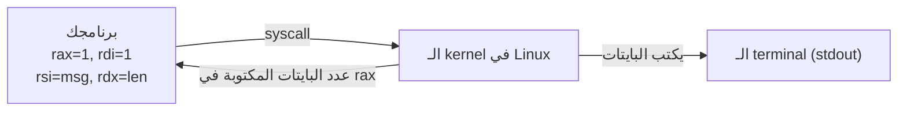

# أهلًا يا عالم: البيانات وsystem calls

لكي يطبع البرنامج نصًا، يطلب ذلك من نظام التشغيل. وفي Assembly تفعل ذلك مباشرة بـ **system call**.

## الأقسام

برنامج NASM مقسّم إلى **أقسام (sections)**:

- `section .data` فيه بيانات لها قيم بداية (نصوص، أرقام).
- `section .bss` يحجز مساحة فارغة (سنستخدمه لاحقًا).
- `section .text` فيه الـ instructions.

## system call write

system calls Linux تأخذ رقمها في **rax** ومدخلاتها في **rdi وrsi وrdx** (ثم r10 وr8 وr9):

<!-- diagram -->


| الاستدعاء | rax | rdi | rsi | rdx |
|---|---|---|---|---|
| write | 1 | أين تكتب (1 = الشاشة) | address النص | عدد البايتات |
| exit | 60 | رمز الخروج | | |

والنتيجة ترجع في rax.

## أهلًا يا عالم

```nasm
global _start

section .data
msg:    db "Hello, world!", 10    ; the text, then byte 10 = newline
len:    equ $ - msg               ; length = here minus the start of msg

section .text
_start:
    mov rax, 1          ; write
    mov rdi, 1          ; to the screen (standard output)
    mov rsi, msg        ; address of the text
    mov rdx, len        ; number of bytes
    syscall

    mov rax, 60         ; exit
    xor rdi, rdi        ; exit code 0
    syscall
```

```output
Hello, world!
```

ابنِه بنفس الطريقة السابقة (`nasm -f elf64 hello.asm -o hello.o && ld hello.o -o hello && ./hello`).

الأشياء الجديدة هنا:

- `msg:` **علامة (label)**: اسم لـ address. و`mov rsi, msg` تضع address النص في rsi، لا النص نفسه.
- `db` معناها "عرّف بايتات". النص بين علامات التنصيص يصبح بايتات ASCII الخاصة به. و`10` هو حرف السطر الجديد.
- `equ $ - msg`: الرمز `$` معناه "الـ address الحالي". الـ address الحالي ناقص بداية msg يساوي عدد البايتات بينهما. و`len` ثابت يحسبه NASM، وليس شيئًا مخزّنًا في الذاكرة.
- `xor rdi, rdi` تجعل rdi صفرًا. أي شيء XOR نفسه يساوي 0، وهذه الـ instruction أقصر من `mov rdi, 0`، فستراها في كل مكان.

## سطران

تستطيع طباعة عدة أجزاء بعدة استدعاءات write:

```nasm
global _start

section .data
line1:  db "Assembly is", 10
len1:   equ $ - line1
line2:  db "not magic.", 10
len2:   equ $ - line2

section .text
_start:
    mov rax, 1
    mov rdi, 1
    mov rsi, line1
    mov rdx, len1
    syscall

    mov rax, 1          ; rax holds the result of the last call, so set it again
    mov rdi, 1
    mov rsi, line2
    mov rdx, len2
    syscall

    mov rax, 60
    xor rdi, rdi
    syscall
```

```output
Assembly is
not magic.
```

لماذا `mov rax, 1` مرة أخرى؟ بعد `syscall` يحمل rax **النتيجة** (هنا عدد البايتات التي كُتبت). والنواة تغيّر أيضًا rcx وr11. لا تفترض أبدًا أن register احتفظ بقيمته بعد system call إلا لو كانت القواعد تقول ذلك.

## عندما يحدث خطأ

- **Segmentation fault** في النهاية: نسيت استدعاء exit. بدونه يكمل المعالج في تنفيذ أي بايتات تأتي بعد ذلك.
- **حروف غريبة**: الطول خطأ. استخدم `equ $ - label` بعد النص مباشرة.
- `ld: cannot find entry symbol _start`: نسيت `global _start` أو كتبت العلامة خطأ.

## سكريبت بناء مفيد

كتابة ثلاثة أوامر كل مرة مملة. احفظ هذا باسم `run.sh` واجعله قابلًا للتشغيل بـ `chmod +x run.sh`:

```bash
#!/bin/sh
# usage: ./run.sh hello   (builds hello.asm and runs it)
nasm -f elf64 "$1.asm" -o "$1.o" && ld "$1.o" -o "$1" && "./$1"
```

## الخلاصة

- رقم system call في rax، والمدخلات في rdi وrsi وrdx، ثم `syscall`.
- write رقمه 1، وexit رقمه 60.
- العلامة address؛ و`db` تخزّن بايتات؛ و`equ $ - label` تقيس طول نص.

## فيديوهات اختيارية

الدرس أعلاه كامل وحده. هذه الفيديوهات للتعمق إن كنت تحب التعلم بالمشاهدة. الفيديوهات المكتوب بجانبها (بالإنجليزية) يمكنك تشغيل الترجمة لها (**CC**)، ثم **الإعدادات ← الترجمة ← ترجمة تلقائية ← العربية**.

**Modern x64 Assembly 1: Beginning Assembly Programming (Creel) (بالإنجليزية)**

https://www.youtube.com/watch?v=rxsBghsrvpI

**x86 Assembly Crash Course (Hack@UCF) (بالإنجليزية)**

https://www.youtube.com/watch?v=75gBFiFtAb8
