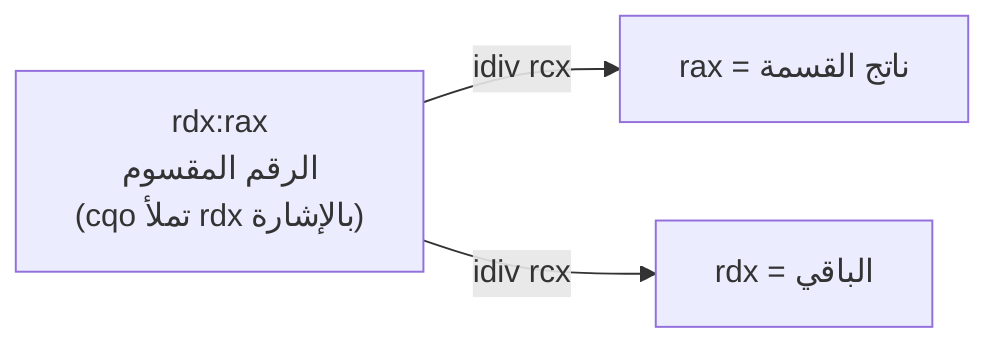

# نقل البيانات والحساب

أغلب الـ instructions لها الشكل `instruction الوجهة, المصدر`. والنتيجة تذهب إلى الطرف **الأيسر**.

## mov

```nasm
mov rax, 5        ; rax = 5          (a constant)
mov rbx, rax      ; rbx = rax        (copy a register)
mov rcx, [num]    ; rcx = the 8 bytes stored at address num
mov [num], rbx    ; store rbx into memory at num
```

الأقواس المربعة معناها "الذاكرة الموجودة في هذا الـ address". وبدونها تحصل على الـ address نفسه. قاعدة واحدة: **لا** تستطيع النقل من ذاكرة إلى ذاكرة في instruction واحدة؛ مرّ عبر register.

## طباعة الأرقام (نمط تنسخه الآن)

طباعة رقم بsystem calls تعني تحويله إلى خانات أولًا (وهذا هو المشروع الأخير). وحتى ذلك الحين سنستعير `printf` من لغة C. انسخ هذا النمط؛ والوحدة 4 تشرح كل سطر فيه.

```nasm
default rel
global main
extern printf

section .data
fmt:    db "%ld", 10, 0        ; printf format: a number, newline, end of text

section .text
main:
    push rbp                   ; keeps the stack lined up for printf

    mov rax, 6
    add rax, 4                 ; rax = 10

    lea rdi, [fmt]             ; 1st argument: the format
    mov rsi, rax               ; 2nd argument: the number
    xor eax, eax               ; printf rule: say "no float arguments"
    call printf

    pop rbp
    xor eax, eax               ; main returns 0
    ret
```

```output
10
```

هذا البرنامج يستخدم `main` بدل `_start`، فاربطه بـ gcc، الذي يضيف مكتبة C:

```bash
nasm -f elf64 add.asm -o add.o
gcc -no-pie add.o -o add
./add
```

قد تطبع الـ linkers الأحدث تحذيرًا عن `.note.GNU-stack`. لا ضرر منه. ولإخفائه أضف هذا السطر في آخر الملف:

```nasm
section .note.GNU-stack noalloc noexec nowrite progbits
```

## العمليات الحسابية

```nasm
add rax, rbx     ; rax = rax + rbx
sub rax, 3       ; rax = rax - 3
inc rcx          ; rcx = rcx + 1
dec rcx          ; rcx = rcx - 1
neg rax          ; rax = -rax
imul rax, rbx    ; rax = rax * rbx   (signed multiply)
imul rax, rbx, 4 ; rax = rbx * 4
```

هذا حساب صغير: سعر 3 أكواب قهوة بـ 45 للكوب، زائد 10 للتوصيل:

```nasm
default rel
global main
extern printf

section .data
fmt:    db "Total: %ld", 10, 0
price:  dq 45                 ; dq = define a quadword (8 bytes)

section .text
main:
    push rbp

    mov rax, [price]          ; rax = 45
    imul rax, rax, 3          ; rax = 135
    add rax, 10               ; rax = 145

    lea rdi, [fmt]
    mov rsi, rax
    xor eax, eax
    call printf

    pop rbp
    xor eax, eax
    ret
```

```output
Total: 145
```

## القسمة مختلفة

`idiv` (القسمة بإشارة) تستخدم registers ثابتة. فهي تقسم الرقم ذا الـ 128 بت الموجود في **rdx:rax** على ما تعطيه لها:

<!-- diagram -->


- خارج القسمة يذهب إلى **rax**
- والباقي يذهب إلى **rdx**

قبل القسمة املأ rdx بإشارة rax باستخدام `cqo`. نسيان `cqo` هو الخطأ الكلاسيكي: أي شيء كان في rdx يصبح جزءًا من الرقم.

```nasm
default rel
global main
extern printf

section .data
fmt:    db "%ld r %ld", 10, 0

section .text
main:
    push rbp

    mov rax, 47
    mov rcx, 5
    cqo                 ; rdx:rax = 47 (rdx = 0 because 47 is positive)
    idiv rcx            ; rax = 9, rdx = 2

    lea rdi, [fmt]
    mov rsi, rax        ; quotient
    ; rdx already holds the remainder, and rdx is the 3rd argument
    xor eax, eax
    call printf

    pop rbp
    xor eax, eax
    ret
```

```output
9 r 2
```

الباقي هو طريقة الحصول على آخر خانة في رقم (`n % 10`)، وستستخدمه في المشروع.

## lea: حساب addresses بدون قراءة الذاكرة

`lea` معناها "حمّل الـ address الفعلي". تحسب تعبير الـ address لكنها لا تقرأ الذاكرة. ويستخدمها الناس أيضًا كآلة حاسبة سريعة:

```nasm
lea rax, [rbx + rbx*2]   ; rax = rbx * 3
lea rax, [rcx + 8]       ; rax = rcx + 8
```

## الخلاصة

- `mov dst, src`؛ الأقواس معناها ذاكرة؛ ولا نقل من ذاكرة إلى ذاكرة.
- add وsub وinc وdec وneg وimul تفعل ما تقوله أسماؤها.
- idiv تقسم rdx:rax؛ الخارج في rax والباقي في rdx؛ استخدم `cqo` أولًا.

## فيديوهات اختيارية

الدرس أعلاه كامل وحده. هذه الفيديوهات للتعمق إن كنت تحب التعلم بالمشاهدة. الفيديوهات المكتوب بجانبها (بالإنجليزية) يمكنك تشغيل الترجمة لها (**CC**)، ثم **الإعدادات ← الترجمة ← ترجمة تلقائية ← العربية**.

**x86 Assembly Crash Course (Hack@UCF) (بالإنجليزية)**

https://www.youtube.com/watch?v=75gBFiFtAb8
