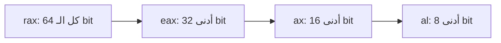

# أحجام البيانات والـ registers داخل الـ registers

الـ registers بحجم 64 بت، لكن البيانات غالبًا ليست كذلك. الحرف بايت واحد؛ و`int` في C أربعة بايتات.

## الأحجام

| الاسم | بايت | بت | بيانات NASM | كلمة الحجم |
|---|---|---|---|---|
| byte | 1 | 8 | `db` | `byte` |
| word | 2 | 16 | `dw` | `word` |
| doubleword | 4 | 32 | `dd` | `dword` |
| quadword | 8 | 64 | `dq` | `qword` |

## أسماء أصغر لنفس الـ register

لكل register أسماء لأجزائه السفلى:

<!-- diagram -->


```text
64 bits  rax                     r8
32 bits        eax               r8d
16 bits             ax           r8w
 8 bits                 al       r8b

|<-------------- rax -------------->|
                  |<---- eax ------>|
                           |<- ax ->|
                               |al  |
```

ونفس الشيء لـ rbx/ebx/bx/bl، وrcx/ecx/cx/cl، وrdx/edx/dx/dl، وrsi/esi/si/sil، وrdi/edi/di/dil.

## القاعدة التي تفاجئ الجميع

- الكتابة في register **32 بت** تمسح الـ 32 بت العليا من الـ register كله. `mov eax, 1` تجعل rax يساوي 1 بالضبط.
- الكتابة في register **8 أو 16 بت** تترك باقي البتات كما هي.

ولهذا `xor eax, eax` هي الطريقة المعتادة لتصفير rax: أقصر من `xor rax, rax` والنتيجة واحدة.

```nasm
default rel
global main
extern printf

section .data
fmt:    db "rax = %lx", 10, 0      ; %lx prints in hex

section .text
main:
    push rbp

    mov rax, -1          ; all 64 bits set: ffffffffffffffff
    mov al, 0x12         ; only the lowest byte changes
    mov rsi, rax
    lea rdi, [fmt]
    xor eax, eax
    call printf

    mov rax, -1
    mov eax, 0x12        ; 32-bit write: the top half is cleared
    mov rsi, rax
    lea rdi, [fmt]
    xor eax, eax
    call printf

    pop rbp
    xor eax, eax
    ret
```

```output
rax = ffffffffffffff12
rax = 12
```

## أخبر NASM بالحجم

عندما لا يكون أي من الطرفين register، لا يستطيع NASM تخمين الحجم:

```nasm
mov [count], 5          ; error: operation size not specified
mov dword [count], 5    ; store 5 as 4 bytes
mov byte [flag], 1      ; store 1 as 1 byte
```

## تكبير القيم الصغيرة: movzx وmovsx

لتحميل قيمة صغيرة في register كبير، قل كيف تُملأ البتات الزائدة:

- `movzx` تملؤها **بأصفار** (للقيم بدون إشارة مثل الحروف).
- `movsx` تنسخ **بت الإشارة** (للقيم بإشارة). و`movsxd` تفعل ذلك من 32 بت.

```nasm
default rel
global main
extern printf

section .data
fmt:    db "%ld %ld %ld", 10, 0
small:  db -3               ; one byte: 0xFD
temp:   dd -20              ; four bytes

section .text
main:
    push rbp

    movzx rsi, byte [small] ; as unsigned: 253
    movsx rdx, byte [small] ; as signed: -3
    movsxd rcx, dword [temp]; as signed: -20

    lea rdi, [fmt]
    xor eax, eax
    call printf

    pop rbp
    xor eax, eax
    ret
```

```output
253 -3 -20
```

نفس البايت 0xFD يساوي 253 أو -3 حسب طريقة قراءته. المعالج لا يعرف ماذا تقصد؛ **أنت** تختار باختيار الـ instruction. ولهذا أيضًا توجد أزواج مثل `mul` و`imul`، و`div` و`idiv`.

## الأرقام السالبة باختصار

الأرقام السالبة تستخدم **المتمم الثنائي (two's complement)**: اقلب كل البتات وأضف 1. في بايت واحد، -1 تساوي 0xFF، و-3 تساوي 0xFD، و127 أكبر رقم موجب. والجميل أن `add` و`sub` تعملان بنفس الطريقة للأرقام بإشارة وبدون إشارة.

## حجز مساحة

`section .bss` يحجز مساحة مصفّرة بدون تخزينها في ملف البرنامج:

```nasm
section .bss
buffer:  resb 64     ; 64 bytes
counts:  resq 10     ; 10 quadwords (80 bytes)
```

## الخلاصة

- byte وword وdword وqword تساوي 1 و2 و4 و8 بايت.
- eax وax وal أجزاء سفلى من rax؛ والكتابة في 32 بت تمسح النصف الأعلى.
- استخدم كلمات الحجم عندما لا يعرف NASM، وmovzx وmovsx لتوسيع القيم.

## فيديوهات اختيارية

الدرس أعلاه كامل وحده. هذه الفيديوهات للتعمق إن كنت تحب التعلم بالمشاهدة. الفيديوهات المكتوب بجانبها (بالإنجليزية) يمكنك تشغيل الترجمة لها (**CC**)، ثم **الإعدادات ← الترجمة ← ترجمة تلقائية ← العربية**.

**Twos complement: negative numbers in binary (Ben Eater) (بالإنجليزية)**

https://www.youtube.com/watch?v=4qH4unVtJkE
