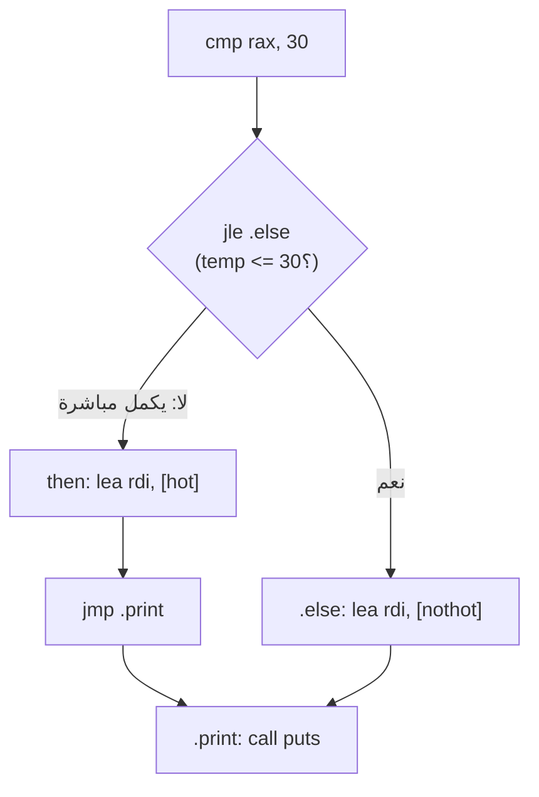

# القرارات والـ loops: الـ flags والـ jumps

Assembly ليس فيها `if` ولا `while` ولا `for`. فيها شيئان أبسط: **المقارنة** و**القفز**. وكل loop وكل قرار في كل لغة مبني منهما.

## الـ flags

بعد أغلب العمليات الحسابية، يضبط المعالج بتات في register خاص اسمه **الـ flags** تصف النتيجة:

- **ZF** (علم الصفر): النتيجة كانت 0.
- **SF** (علم الإشارة): النتيجة كانت سالبة.
- **CF** (علم الحمل): نتيجة بدون إشارة لم تتسع.
- **OF** (علم الفيضان): نتيجة بإشارة لم تتسع.

`cmp a, b` تحسب `a - b`، وتضبط الـ flags، وترمي النتيجة. ثم تنظر **الـ jump المشروطة** في الـ flags.

## الـ jumps

`jmp label` تقفز دائمًا. والمشروطة تقفز فقط لو تحقق شرطها بعد `cmp a, b`:

| الـ jump | معناها | النوع |
|---|---|---|
| `je` / `jne` | a == b / a != b | أي نوع |
| `jl` / `jle` | a < b / a <= b | بإشارة |
| `jg` / `jge` | a > b / a >= b | بإشارة |
| `jb` / `jae` | a < b / a >= b | بدون إشارة ("below" و"above") |

الخلط بين jumps الإشارة وبدونها خطأ حقيقي: -1 هو أكبر رقم بدون إشارة.

## if / else

هذا الكود بلغة C:

<!-- diagram -->


```c
if (temp > 30) puts("hot"); else puts("not hot");
```

يصبح "اقفز فوق الجزء الذي لا تريده":

```nasm
default rel
global main
extern puts

section .data
hot:     db "hot", 0
nothot:  db "not hot", 0
temp:    dq 34

section .text
main:
    push rbp

    mov rax, [temp]
    cmp rax, 30
    jle .else          ; the opposite test: skip the "then" part
    lea rdi, [hot]
    jmp .print
.else:
    lea rdi, [nothot]
.print:
    call puts          ; puts prints a text and a newline

    pop rbp
    xor eax, eax
    ret
```

```output
hot
```

العلامات التي تبدأ بنقطة (`.else`) **محلية**: تتبع آخر علامة عادية (`main`)، فيمكن لـ function أخرى أن يكون لها `.else` خاص بها.

لاحظ الحيلة: تختبر الشرط **العكسي** (`jle` بمعنى "ليس أكبر") وتقفز فوق كود "then".

## loop عدّ

مجموع 1 + 2 + ... + 10:

```nasm
default rel
global main
extern printf

section .data
fmt:    db "sum = %ld", 10, 0

section .text
main:
    push rbp

    xor eax, eax        ; sum = 0
    mov rcx, 1          ; i = 1
.loop:
    cmp rcx, 10
    jg .done            ; while i <= 10
    add rax, rcx        ; sum += i
    inc rcx             ; i++
    jmp .loop
.done:
    lea rdi, [fmt]
    mov rsi, rax
    xor eax, eax
    call printf

    pop rbp
    xor eax, eax
    ret
```

```output
sum = 55
```

شكل أقصر يضع الاختبار في الأسفل ويعدّ تنازليًا إلى الصفر، لأن `dec` تضبط ZF بنفسها:

```nasm
    mov rcx, 10
.loop:
    add rax, rcx
    dec rcx
    jnz .loop          ; jump if not zero
```

الـ compilers تحب هذا الشكل. استخدم الأوضح بالنسبة لك.

## عدة شروط: FizzBuzz

اطبع من 1 إلى 15، لكن "Fizz" لمضاعفات 3، و"Buzz" لمضاعفات 5، و"FizzBuzz" لمضاعفاتهما معًا.

```nasm
default rel
global main
extern printf

section .data
fnum:   db "%ld", 10, 0
ffizz:  db "Fizz", 10, 0
fbuzz:  db "Buzz", 10, 0
fboth:  db "FizzBuzz", 10, 0

section .text
main:
    push rbx            ; rbx keeps its value across printf (module 4 explains)
    mov rbx, 1
.loop:
    cmp rbx, 15
    jg .done
    mov rax, rbx
    cqo
    mov rcx, 15
    idiv rcx
    test rdx, rdx       ; test sets ZF if rdx is 0
    jz .both
    mov rax, rbx
    cqo
    mov rcx, 3
    idiv rcx
    test rdx, rdx
    jz .fizz
    mov rax, rbx
    cqo
    mov rcx, 5
    idiv rcx
    test rdx, rdx
    jz .buzz
    lea rdi, [fnum]
    mov rsi, rbx
    jmp .print
.both:
    lea rdi, [fboth]
    jmp .print
.fizz:
    lea rdi, [ffizz]
    jmp .print
.buzz:
    lea rdi, [fbuzz]
.print:
    xor eax, eax
    call printf
    inc rbx
    jmp .loop
.done:
    pop rbx
    xor eax, eax
    ret
```

```output
1
2
Fizz
4
Buzz
Fizz
7
8
Fizz
Buzz
11
Fizz
13
14
FizzBuzz
```

لماذا `push rbx` هنا وليس `push rbp`؟ الاثنان يحافظان على ترتيب الـ stack. نستخدم rbx كعدّاد لأن printf مسموح لها بتغيير rcx وrdx وغيرهما لكن يجب أن تترك rbx كما هو. المزيد عن ذلك في الوحدة 4.

`test a, b` مثل `and` لكنها تضبط الـ flags فقط. و`test rdx, rdx` الطريقة المعتادة لسؤال "هل rdx يساوي صفرًا؟".

## الخلاصة

- `cmp` تضبط الـ flags؛ والـ jumps المشروطة تقرؤها.
- بإشارة: jl وjg. بدون إشارة: jb وja. التساوي: je وjne.
- if/else: اقفز بالشرط العكسي. الـ loops: علامة واختبار وjump للخلف.

## فيديوهات اختيارية

الدرس أعلاه كامل وحده. هذه الفيديوهات للتعمق إن كنت تحب التعلم بالمشاهدة. الفيديوهات المكتوب بجانبها (بالإنجليزية) يمكنك تشغيل الترجمة لها (**CC**)، ثم **الإعدادات ← الترجمة ← ترجمة تلقائية ← العربية**.

**x86 Assembly Crash Course (Hack@UCF) (بالإنجليزية)**

https://www.youtube.com/watch?v=75gBFiFtAb8
