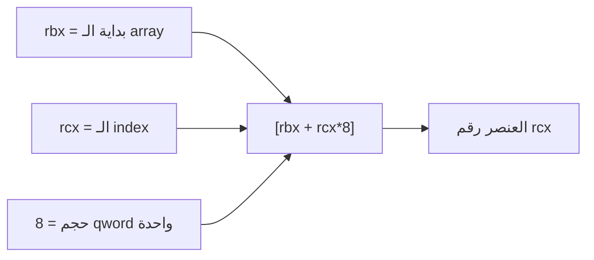

# الذاكرة والـ arrays والنصوص

حتى الآن خزّنّا أرقامًا مفردة. والبرامج الحقيقية تتعامل مع قوائم من الأشياء في الذاكرة.

## عنونة الذاكرة

تسمح x86-64 بكتابة الـ address كمعادلة صغيرة داخل الأقواس:

<!-- diagram -->


```text
[ base + index*scale + displacement ]
```

- **base**: register يحمل address
- **index**: register يحمل موضعًا
- **scale**: 1 أو 2 أو 4 أو 8 (حجم كل عنصر)
- **displacement**: ثابت

```nasm
mov rax, [rbx]            ; the 8 bytes at rbx
mov rax, [rbx + 16]       ; 16 bytes further
mov rax, [rbx + rcx*8]    ; item number rcx of an array of qwords
mov eax, [rbx + rcx*4]    ; item rcx of an array of dwords (C ints)
```

الشكل الأخير هو بالضبط `a[i]` في C.

## جمع array

```nasm
default rel
global main
extern printf

section .data
fmt:    db "sum = %ld, max = %ld", 10, 0
nums:   dq 12, 7, 31, 4, 19, 25
count:  equ ($ - nums) / 8      ; 6 items of 8 bytes

section .text
main:
    push rbp

    lea r8, [nums]      ; r8 = address of the array
    xor ecx, ecx        ; i = 0
    xor esi, esi        ; sum = 0
    mov rdx, [r8]       ; max = nums[0]
.loop:
    cmp rcx, count
    jge .done
    mov rax, [r8 + rcx*8]    ; rax = nums[i]
    add rsi, rax
    cmp rax, rdx
    jle .next
    mov rdx, rax             ; new max
.next:
    inc rcx
    jmp .loop
.done:
    lea rdi, [fmt]      ; rsi = sum, rdx = max: already the 2nd and 3rd arguments
    xor eax, eax
    call printf

    pop rbp
    xor eax, eax
    ret
```

```output
sum = 98, max = 31
```

لاحظ `count: equ ($ - nums) / 8`. يحسب NASM عدد العناصر بنفسه، فإضافة رقم للقائمة لا تكسر الـ loop.

## النصوص arrays بايتات

نص بأسلوب C عبارة عن بايتات تنتهي ببايت قيمته 0. ولمعرفة طوله، امشِ حتى تصل إلى 0:

```nasm
default rel
global main
extern printf

section .data
fmt:    db "length = %ld", 10, 0
text:   db "Cairo is huge", 0

section .text
main:
    push rbp

    lea rdi, [text]
    xor eax, eax          ; length = 0
.loop:
    cmp byte [rdi + rax], 0
    je .done
    inc rax
    jmp .loop
.done:
    lea rdi, [fmt]
    mov rsi, rax
    xor eax, eax
    call printf

    pop rbp
    xor eax, eax
    ret
```

```output
length = 13
```

## تغيير نص في مكانه

الحروف الصغيرة من 'a' إلى 'z' قيمها من 97 إلى 122؛ والكبيرة من 65 إلى 90، أقل بـ 32 بالضبط. ولتحويل نص إلى حروف كبيرة، اطرح 32 من كل حرف صغير:

```nasm
default rel
global main
extern puts

section .data
text:   db "hello from assembly", 0

section .text
main:
    push rbp

    lea rdi, [text]
.loop:
    mov al, [rdi]
    test al, al         ; end of string?
    jz .done
    cmp al, 'a'
    jb .next            ; below 'a': not lowercase
    cmp al, 'z'
    ja .next            ; above 'z': not lowercase
    sub al, 32
    mov [rdi], al       ; write the changed byte back
.next:
    inc rdi             ; move the pointer to the next byte
    jmp .loop
.done:
    lea rdi, [text]
    call puts

    pop rbp
    xor eax, eax
    ret
```

```output
HELLO FROM ASSEMBLY
```

هنا حرّكنا **pointer** (`inc rdi`) بدل استخدام فهرس. الطريقتان صحيحتان؛ وهذه هي `p++` في C.

الحروف بدون إشارة، فهذا الكود يستخدم `jb` و`ja`، لا `jl` و`jg`. ويحوّل NASM `'a'` إلى رقمها بنفسه.

## الترتيب الصغير أولًا (little-endian)

تخزّن x86 الأرقام متعددة البايتات **بالبايت الأصغر أولًا**. الرقم 0x0102030405060708 يوضع في الذاكرة هكذا `08 07 06 05 04 03 02 01`. نادرًا ما تلاحظ ذلك، إلا عندما تنظر في الذاكرة الخام بأداة تصحيح، أو تقرأ dword كأربعة بايتات منفصلة.

## الخلاصة

- الـ addresses: `[base + index*scale + disp]`؛ و`[rbx + rcx*8]` هي `a[i]` لعناصر qword.
- النصوص بايتات تنتهي بـ 0؛ امشِ عليها بفهرس أو بpointer متحرك.
- الحروف بدون إشارة: قارنها بـ jb وja.

## فيديوهات اختيارية

الدرس أعلاه كامل وحده. هذه الفيديوهات للتعمق إن كنت تحب التعلم بالمشاهدة. الفيديوهات المكتوب بجانبها (بالإنجليزية) يمكنك تشغيل الترجمة لها (**CC**)، ثم **الإعدادات ← الترجمة ← ترجمة تلقائية ← العربية**.

**x86 Assembly Crash Course (Hack@UCF) (بالإنجليزية)**

https://www.youtube.com/watch?v=75gBFiFtAb8
