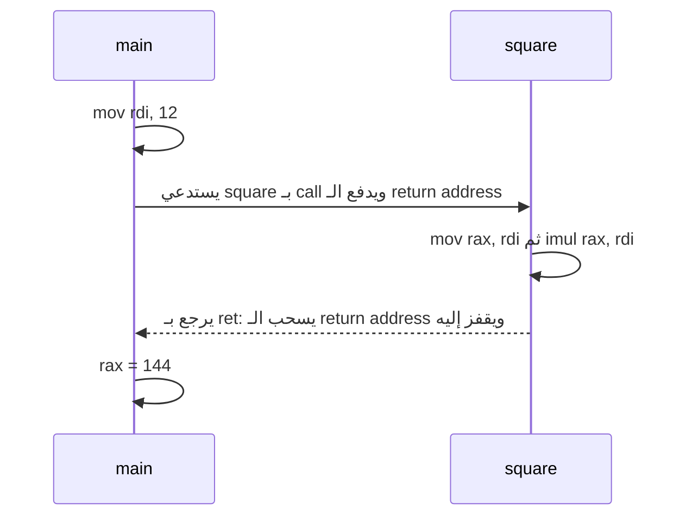

# الـ stack وcall وret

الـ functions في كل اللغات تعتمد على بنية واحدة بسيطة: **الـ stack**.

## الـ stack

الـ stack منطقة في الذاكرة تنمو **لأسفل**، نحو الـ addresses الأصغر. و**rsp** يشير دائمًا إلى العنصر الذي في القمة.

- `push rax`: ينزل rsp بمقدار 8، ثم يُخزّن rax في [rsp].
- `pop rax`: تُحمّل القيمة الموجودة في [rsp] إلى rax، ثم يصعد rsp بمقدار 8.

```text
before push rax      after push rax       after pop rbx
                     (rax = 42)           (rbx = 42)
 addr                 addr                 addr
 1000 | ...  | <-rsp  1000 | ...  |        1000 | ...  | <-rsp
  992 |      |         992 |  42  | <-rsp   992 |  42  |  (still there,
  984 |      |         984 |      |         984 |      |   just ignored)
```

الداخل أخيرًا يخرج أولًا، مثل كومة أطباق. ادفع بترتيب، واسحب بالترتيب العكسي:

```nasm
default rel
global main
extern printf

section .data
fmt:    db "%ld %ld %ld", 10, 0

section .text
main:
    push rbp
    push 1
    push 2
    push 3
    pop rsi          ; 3
    pop rdx          ; 2
    pop rcx          ; 1
    lea rdi, [fmt]
    xor eax, eax
    call printf
    pop rbp
    xor eax, eax
    ret
```

```output
3 2 1
```

## call وret

- `call label` تدفع address الـ instruction التالية (**return address**)، ثم تقفز إلى label.
- `ret` تسحب هذا الـ address وتقفز إليه.

<!-- diagram -->


هذا كل ما في استدعاء الـ function. وهذه function تربّع rdi وترجع النتيجة في rax:

```nasm
default rel
global main
extern printf

section .data
fmt:    db "%ld squared is %ld", 10, 0

section .text
square:                 ; in: rdi   out: rax
    mov rax, rdi
    imul rax, rdi
    ret

main:
    push rbp
    mov rdi, 12
    call square         ; rax = 144
    lea rdi, [fmt]
    mov rsi, 12
    mov rdx, rax
    xor eax, eax
    call printf
    pop rbp
    xor eax, eax
    ret
```

```output
12 squared is 144
```

لو دفعت function شيئًا ونسيت سحبه، تسحب `ret` القيمة الخطأ وتقفز إلى address لا معنى له: توقف فوري. **كل push تحتاج pop مقابلة قبل ret.**

## الـ variables المحلية وإطارات الـ stack

عندما تحتاج function ذاكرة لمتغيراتها الخاصة، تفسح لها مكانًا على الـ stack بإنزال rsp. الافتتاح والختام المعتادان اسمهما **الـ prologue** و**الـ epilogue**:

```nasm
myfunc:
    push rbp            ; save the caller's rbp
    mov rbp, rsp        ; rbp marks this function's frame
    sub rsp, 16         ; 16 bytes for local variables
    ; locals are at [rbp - 8] and [rbp - 16]
    ...
    mov rsp, rbp        ; throw the locals away
    pop rbp             ; give the caller its rbp back
    ret
```

```text
higher addresses
| return address |   <- pushed by call
| saved rbp      |   <- rbp points here
| local 1        |   [rbp - 8]
| local 2        |   [rbp - 16]  <- rsp
lower addresses
```

مثال: function تحتفظ بمجموع متراكم في variable محلي وهي تجمع من 1 إلى n:

```nasm
default rel
global main
extern printf

section .data
fmt:    db "1 + ... + %ld = %ld", 10, 0

section .text
sum_to:                     ; in: rdi = n   out: rax
    push rbp
    mov rbp, rsp
    sub rsp, 16
    mov qword [rbp - 8], 0  ; total = 0
    mov rcx, 1
.loop:
    cmp rcx, rdi
    jg .done
    add [rbp - 8], rcx      ; total += i
    inc rcx
    jmp .loop
.done:
    mov rax, [rbp - 8]
    mov rsp, rbp
    pop rbp
    ret

main:
    push rbp
    mov rdi, 100
    call sum_to
    lea rdi, [fmt]
    mov rsi, 100
    mov rdx, rax
    xor eax, eax
    call printf
    pop rbp
    xor eax, eax
    ret
```

```output
1 + ... + 100 = 5050
```

(الـ register كان سيكون أسرع هنا. الفكرة أن ترى variable محليًا يعيش على الـ stack. هناك تحفظ C الـ variables المحلية التي لا تتسع لها الـ registers.)

## الاستدعاء الذاتي يعمل مجانًا

لأن كل استدعاء يأخذ address رجوع خاصًا به وإطارًا خاصًا به، تستطيع الـ function أن تستدعي نفسها. المضروب (factorial):

```nasm
default rel
global main
extern printf

section .data
fmt:    db "10! = %ld", 10, 0

section .text
fact:                   ; in: rdi = n   out: rax = n!
    cmp rdi, 1
    jg .recurse
    mov eax, 1          ; 0! = 1! = 1
    ret
.recurse:
    push rdi            ; save n: the call below changes rdi
    dec rdi
    call fact           ; rax = (n-1)!
    pop rdi             ; n is back
    imul rax, rdi       ; n * (n-1)!
    ret

main:
    push rbp
    mov rdi, 10
    call fact
    lea rdi, [fmt]
    mov rsi, rax
    xor eax, eax
    call printf
    pop rbp
    xor eax, eax
    ret
```

```output
10! = 3628800
```

لو رأيت يومًا رسالة "stack overflow" من استدعاء ذاتي لا ينتهي: كل استدعاء يدفع المزيد، حتى تنفد مساحة الـ stack.

## الخلاصة

- الـ stack ينمو لأسفل؛ push تنزل rsp، وpop ترفعه.
- call تدفع return address؛ وret تسحبه. حافظ على توازن push وpop.
- الـ prologue `push rbp / mov rbp, rsp / sub rsp, N`؛ والـ variables المحلية في [rbp - ...].

## فيديوهات اختيارية

الدرس أعلاه كامل وحده. هذه الفيديوهات للتعمق إن كنت تحب التعلم بالمشاهدة. الفيديوهات المكتوب بجانبها (بالإنجليزية) يمكنك تشغيل الترجمة لها (**CC**)، ثم **الإعدادات ← الترجمة ← ترجمة تلقائية ← العربية**.

**Comparing C to machine language (Ben Eater) (بالإنجليزية)**

https://www.youtube.com/watch?v=yOyaJXpAYZQ
