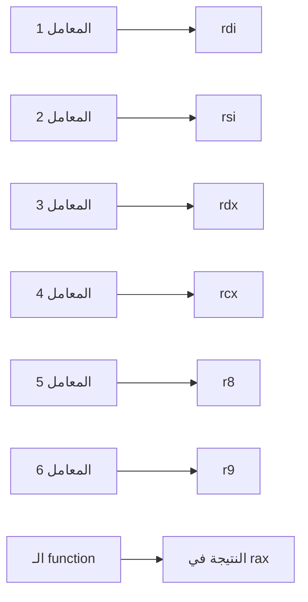

# calling convention: التحدث مع C

دوالك حتى الآن استخدمت أي registers أعجبتك. ولكي تستدعي functions C، أو تسمح لـ C باستدعاء دوالك، يجب أن يتبع الطرفان نفس القواعد. وفي Linux هذه القواعد اسمها **System V AMD64 ABI**.

## القواعد

**المعاملات** (الأرقام الصحيحة والـ pointers) تذهب بهذا الترتيب:

<!-- diagram -->


```text
1st   2nd   3rd   4th   5th   6th
rdi   rsi   rdx   rcx   r8    r9      (more go on the stack)
```

**القيمة المرجعة** ترجع في **rax**.

**من يحفظ ماذا:**

| تحفظها الـ function المستدعاة (يجب أن ترجعها بدون تغيير) | يحفظها المستدعي (الاستدعاء قد يغيّرها) |
|---|---|
| rbx, rbp, r12, r13, r14, r15, rsp | rax, rcx, rdx, rsi, rdi, r8, r9, r10, r11 |

إذن: لو احتجت قيمة تبقى بعد استدعاء، ضعها في rbx أو r12 إلى r15 (واحفظ هذا الـ register بنفسك أولًا)، أو ادفعها على الـ stack.

**محاذاة الـ stack:** قبل أي `call` مباشرة، يجب أن يكون rsp من مضاعفات 16. وعندما تبدأ function يكون الاستدعاء قد دفع 8 بايت للتو، فيكون rsp منحرفًا بمقدار 8. وpush واحدة (مثل `push rbp`) تصلح ذلك. وهذا هو السطر الغامض في كل `main` حتى الآن.

**الـ functions متغيرة المعاملات** مثل printf تريد أن يحمل **al** عدد معاملات الكسور في registers المتجهات. ونحن لا نمرر شيئًا منها، فنكتب `xor eax, eax`.

## الآن يصبح نمط printf مفهومًا

```nasm
default rel             ; addresses relative to rip: needed for modern Linux
global main             ; the C library calls main, so make it visible
extern printf           ; printf lives in the C library

section .data
fmt:    db "%s is %ld years old", 10, 0
name:   db "Mona", 0

section .text
main:
    push rbp            ; align the stack to 16
    lea rdi, [fmt]      ; 1st argument
    lea rsi, [name]     ; 2nd argument
    mov rdx, 27         ; 3rd argument
    xor eax, eax        ; no float arguments
    call printf
    pop rbp
    xor eax, eax        ; return 0 from main
    ret
```

```output
Mona is 27 years old
```

`default rel` و`lea` تجعلان الـ addresses نسبية إلى الـ instruction الحالية. البرامج التي تستخدم مكتبة C تُبنى بهذه الطريقة في أغلب أنظمة Linux اليوم؛ ونمرر أيضًا `-no-pie` لـ gcc لتبسيط الربط.

## استدعاء عدة functions من C

القيم التي تحتاجها بعد الاستدعاء تذهب في registers تحفظها الـ function المستدعاة. هذا البرنامج يستخدم `strlen` و`printf`، ويحتفظ بaddress النص في rbx:

```nasm
default rel
global main
extern printf
extern strlen

section .data
fmt:    db "'%s' has %ld characters", 10, 0
word1:  db "assembly", 0

section .text
main:
    push rbx            ; we'll use rbx, so save the caller's value (also aligns)
    lea rbx, [word1]
    mov rdi, rbx
    call strlen         ; rax = length; rdi, rsi... may now be anything
    lea rdi, [fmt]
    mov rsi, rbx        ; rbx survived the call
    mov rdx, rax
    xor eax, eax
    call printf
    pop rbx
    xor eax, eax
    ret
```

```output
'assembly' has 8 characters
```

## كتابة function تستطيع C استدعاءها

ضع الـ function في ملف خاص بها، واتبع القواعد، وعلّمها بـ `global`:

```nasm
; maxof.asm: long max_of(long *arr, long n)
global max_of

section .text
max_of:
    mov rax, [rdi]          ; best = arr[0]
    mov rcx, 1              ; i = 1
.loop:
    cmp rcx, rsi
    jge .done
    mov rdx, [rdi + rcx*8]
    cmp rdx, rax
    jle .next
    mov rax, rdx
.next:
    inc rcx
    jmp .loop
.done:
    ret

section .note.GNU-stack noalloc noexec nowrite progbits   ; tells the linker: no executable stack needed
```

<!-- skip -->
```c
// main.c
#include <stdio.h>

long max_of(long *arr, long n);   // written in assembly

int main(void) {
    long scores[] = {71, 94, 88, 65, 90};
    printf("best: %ld\n", max_of(scores, 5));
    return 0;
}
```

ابنِ الاثنين واربطهما معًا:

```bash
nasm -f elf64 maxof.asm -o maxof.o
gcc main.c maxof.o -o scores
./scores
```

```text
best: 94
```

الـ function تستخدم registers يحفظها المستدعي فقط (rax وrcx وrdx) ولا تستدعي أي شيء، فلا تحتاج prologue أصلًا.

## أعطال شائعة وأسبابها

- **توقف داخل printf**: الـ stack لم يكن محاذيًا. راجع عدد مرات push: عدد فردي من الدفعات ذات الـ 8 بايت قبل الاستدعاء (مع احتساب return address) هو الصحيح.
- **قيمة "تتغير عشوائيًا" بعد استدعاء**: كانت في register يحفظه المستدعي. انقلها إلى rbx أو r12 إلى r15.
- **المستدعي يتوقف بعد رجوع function**: غيّرت rbx أو rbp أو r12 إلى r15 بدون حفظها واسترجاعها.

## الخلاصة

- المعاملات: rdi وrsi وrdx وrcx وr8 وr9. والقيمة المرجعة: rax.
- اترك rbx وrbp وr12 إلى r15 بدون تغيير (استخدم push وpop لو استعملتها).
- rsp يجب أن يكون من مضاعفات 16 عند كل استدعاء؛ وal = 0 قبل printf.

## فيديوهات اختيارية

الدرس أعلاه كامل وحده. هذه الفيديوهات للتعمق إن كنت تحب التعلم بالمشاهدة. الفيديوهات المكتوب بجانبها (بالإنجليزية) يمكنك تشغيل الترجمة لها (**CC**)، ثم **الإعدادات ← الترجمة ← ترجمة تلقائية ← العربية**.

**Comparing C to machine language (Ben Eater) (بالإنجليزية)**

https://www.youtube.com/watch?v=yOyaJXpAYZQ

**Modern x64 Assembly 1: Beginning Assembly Programming (Creel) (بالإنجليزية)**

https://www.youtube.com/watch?v=rxsBghsrvpI
