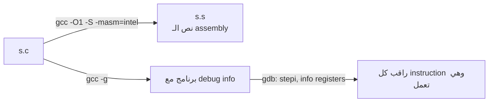

# قراءة ناتج الـ compiler واستخدام أداة التصحيح

مهارتان تحوّلان Assembly من مادة دراسية إلى أداة حقيقية: قراءة ما أنتجه الـ compiler، وتتبّع البرنامج instruction بinstruction.

## اطلب من gcc كود التجميع الخاص به

احفظ هذا باسم `s.c`:

<!-- diagram -->


```c
long square(long x) {
    return x * x;
}

long sum(long *a, long n) {
    long total = 0;
    for (long i = 0; i < n; i++)
        total += a[i];
    return total;
}
```

ثم:

```bash
gcc -O1 -S -masm=intel s.c -o s.s
```

- `-S` يتوقف بعد إنتاج كود التجميع (الملف `s.s`).
- `-masm=intel` يستخدم نفس ترتيب المعاملات الذي في NASM (الوجهة أولًا). وبدونه تحصل على صياغة AT&T التي تعكس المعاملات وتضيف `%` و`$` في كل مكان.
- `-O1` يشغّل التحسين الأساسي. مع `-O0` يكون الناتج طويلًا ويخزّن كل شيء على الـ stack؛ ومع `-O2` قد يصبح ذكيًا جدًا.

هذا هو الجزء المهم (بعد حذف التوجيهات التي تبدأ بـ `.`):

```text
square:
	imul	rdi, rdi
	mov	rax, rdi
	ret

sum:
	test	rsi, rsi
	jle	.L5
	mov	rax, rdi
	lea	rcx, [rdi+rsi*8]
	mov	edx, 0
.L4:
	add	rdx, QWORD PTR [rax]
	add	rax, 8
	cmp	rax, rcx
	jne	.L4
.L2:
	mov	rax, rdx
	ret
.L5:
	mov	edx, 0
	jmp	.L2
```

تستطيع الآن قراءة كل هذا:

- `square`: تصل x في rdi (المعامل الأول)؛ والنتيجة تخرج في rax. لا stack ولا إطار.
- `sum`: الـ array a في rdi، وn في rsi. و`test rsi, rsi / jle` تتعامل مع حالة n <= 0. ثم حوّل gcc loop الفهرس إلى **loop pointer**: rax يمشي من a إلى address النهاية `a + n*8` (في rcx)، وrdx يحمل المجموع. و`QWORD PTR [rax]` هي طريقة gcc في كتابة `qword [rax]` الخاصة بـ NASM.

الـ compiler أعاد كتابة loop `i` الخاصة بك إلى شيء مختلف لكنه مكافئ. وهذا معنى التحسين.

## Compiler Explorer

موقع [godbolt.org](https://godbolt.org) يفعل ذلك في المتصفح: C أو C++ أو Rust على اليسار، وكود التجميع على اليمين، مع تلوين الأسطر المتقابلة. اختر "x86-64 gcc"، وأضف `-O1` في خانة الخيارات، ومرّر الفأرة فوق أي instruction لترى شرحها. إنه أسرع طريقة لإجابة سؤال "كم يكلّف هذا السطر من C فعلًا؟".

جرّب هذه وتوقّع الناتج أولًا:

- `return x * 8;` (تلميح: ابحث عن إزاحة `shl` أو عن `lea`)
- `return x / 2;` لـ variable `long` بإشارة
- `switch` فيها حالات كثيرة (ابحث عن جدول jumps)

## gdb: شاهد المعالج وهو يعمل

ابنِ مع معلومات التصحيح. لبرنامج يبدأ من `_start`:

```bash
nasm -f elf64 -g -F dwarf hello.asm -o hello.o
ld hello.o -o hello
gdb ./hello
```

داخل gdb:

```text
(gdb) break _start        stop at the first instruction
(gdb) run
(gdb) layout asm          show the instructions (layout regs adds registers)
(gdb) stepi               run one instruction (si for short)
(gdb) info registers rax rdi rsi
(gdb) p/x $rax            print rax in hex
(gdb) x/s &msg            show memory at msg as a string
(gdb) x/4gx $rsp          show 4 qwords on the stack, in hex
(gdb) continue
(gdb) quit
```

الأمر `x` معناه "افحص الذاكرة": `/4gx` تعني 4 عناصر، كبيرة **g** (8 بايت)، بالـ he**x**؛ و`/s` نص؛ و`/8xb` تعني 8 بايتات.

## طريقة تصحيح تنجح

1. ضع نقطة توقف حيث ما زالت الأمور سليمة.
2. تقدّم بـ `stepi` في الكود، وقارن الـ registers بعد كل خطوة بما **تتوقعه**.
3. أول instruction يختلف فيها الواقع عن توقعك هي مكان الخطأ.

عندما يتوقف برنامج بعطل، شغّله داخل gdb بـ `run` فقط. سيقف عند الـ instruction التي سببت العطل؛ و`info registers` و`x` يبيّنان لك أي address كان خطأ، و`bt` يبيّن كيف وصلت إلى هناك.

## الخلاصة

- `gcc -O1 -S -masm=intel` تُظهر ما صنعه الـ compiler؛ وgodbolt.org يفعل ذلك مباشرة.
- تستطيع الآن قراءة registers المعاملات والـ loops والمشي بالـ pointers في ناتج compiler حقيقي.
- gdb: break وrun وstepi وinfo registers وx. قارن كل خطوة بما توقعته.

## فيديوهات اختيارية

الدرس أعلاه كامل وحده. هذه الفيديوهات للتعمق إن كنت تحب التعلم بالمشاهدة. الفيديوهات المكتوب بجانبها (بالإنجليزية) يمكنك تشغيل الترجمة لها (**CC**)، ثم **الإعدادات ← الترجمة ← ترجمة تلقائية ← العربية**.

**What Has My Compiler Done for Me Lately? (Matt Godbolt, CppCon 2017) (بالإنجليزية)**

https://www.youtube.com/watch?v=bSkpMdDe4g4

**Debugging: GDB tutorial (Chris Bourke) (بالإنجليزية)**

https://www.youtube.com/watch?v=bWH-nL7v5F4
