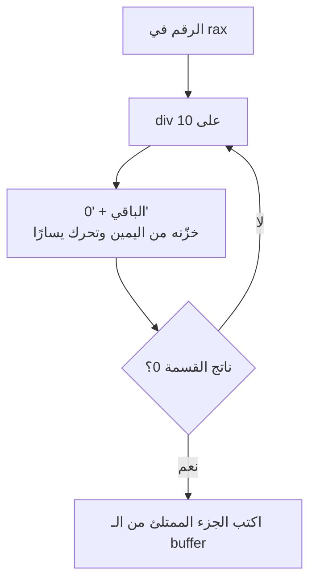

# مشروع: طباعة الأرقام بدون مكتبة C

حان وقت ترك printf. ستكتب طابعة أرقام خاصة بك باستخدام system calls فقط، بنفس طريقة أدنى طبقات البرمجيات.

## الخطة

لطباعة 4071 تحتاج البايتات `'4' '0' '7' '1'`. والخانات تخرج من الرقم **من آخر خانة أولًا**:

<!-- diagram -->


```text
4071 / 10 = 407  الباقي 1   -> '1'
 407 / 10 =  40  الباقي 7   -> '7'
  40 / 10 =   4  الباقي 0   -> '0'
   4 / 10 =   0  الباقي 4   -> '4'   توقف: الرقم أصبح 0
```

لذلك املأ مخزنًا مؤقتًا (buffer) **من طرفه الأيمن** متجهًا لليسار. والخانة d تصبح حرفها بـ `d + '0'` (أي 48).

الأرقام السالبة: تذكّر الإشارة، واعمل بالقيمة الموجبة، ثم ضع `'-'` في الأمام. والصفر لا يحتاج حالة خاصة لو كانت الـ loop تعمل مرة واحدة على الأقل (loop "do while").

## البرنامج كاملًا

```nasm
global _start

section .bss
buf:    resb 32                 ; room for the digits

section .text

; print_num: prints rdi as a signed number and a newline
print_num:
    push rbx
    mov rax, rdi                ; the number to split up
    lea rsi, [buf + 31]         ; start at the right end
    mov byte [rsi], 10          ; the last byte is a newline
    mov rbx, 10                 ; the divisor
    xor r8d, r8d                ; r8 = 1 if negative
    test rax, rax
    jns .digits                 ; jns: jump if the sign flag is clear (not negative)
    neg rax
    mov r8d, 1
.digits:
    xor edx, edx                ; unsigned divide: rdx must be 0
    div rbx                     ; rax = rax / 10, rdx = last digit
    add dl, '0'
    dec rsi
    mov [rsi], dl
    test rax, rax
    jnz .digits                 ; keep going while something is left
    test r8, r8
    jz .write
    dec rsi
    mov byte [rsi], '-'
.write:
    lea rdx, [buf + 32]
    sub rdx, rsi                ; length = end - start
    mov rax, 1                  ; write
    mov rdi, 1                  ; to the screen
    syscall                     ; rsi already points at the first character
    pop rbx
    ret

_start:
    mov rdi, 4071
    call print_num
    mov rdi, 0
    call print_num
    mov rdi, -42
    call print_num

    ; and something computed: 1 + 2 + ... + 1000
    xor edi, edi
    mov rcx, 1000
.sum:
    add rdi, rcx
    dec rcx
    jnz .sum
    call print_num

    mov rax, 60
    xor edi, edi
    syscall
```

```output
4071
0
-42
500500
```

ابنِه مثل البرامج الأولى، بـ ld وبدون مكتبة C:

```bash
nasm -f elf64 numbers.asm -o numbers.o
ld numbers.o -o numbers
./numbers
```

## شرح الخطوات

- `lea rsi, [buf + 31]` يشير إلى آخر بايت؛ وهناك يوضع السطر الجديد.
- في الـ loop، `div rbx` تقسم rdx:rax على 10. نستخدم `div` **بدون إشارة** لأن القيمة أصبحت موجبة، فنضع في rdx صفرًا ببساطة (بدون `cqo`).
- `dec rsi` ثم `mov [rsi], dl`: خطوة لليسار، ثم خزّن الخانة.
- في النهاية يشير rsi إلى أول حرف، و`buf + 32 - rsi` هو الطول. وهذه بالضبط المدخلات التي تحتاجها write، فلا نسخ.
- rbx تحفظه الـ function المستدعاة، فالـ function تدفعه وتسحبه.

تحقق منه في gdb: ضع نقطة توقف عند `.write` وشغّل `x/s $rsi` لترى النص الجاهز.

## دورك

اختر واحدًا أو أكثر:

1. **جدول الضرب.** اطبع 7 x 1 حتى 7 x 10، نتيجة في كل سطر، باستخدام print_num.
2. **بدون سطر جديد.** قسّم print_num إلى `print_num` (بدون سطر جديد) و`print_char`، ثم اطبع أسطرًا بالشكل `7 x 3 = 21`.
3. **قراءة المدخلات.** استخدم system call read (rax = 0، rdi = 0، rsi = المخزن، rdx = الحجم) لقراءة رقم يكتبه المستخدم، وحوّل الخانات إلى قيمة (`value = value*10 + (char - '0')`)، واطبع ضعفه.
4. **Hex.** اكتب `print_hex` التي تقسم على 16 وتأخذ الخانات `0123456789abcdef` من جدول: `mov dl, [hexdigits + rdx]`.

## إلى أين بعد ذلك

أنت تعرف الآن ما تتحول إليه برامج C وC++ وRust. التالي في مسار برمجة الأنظمة هو **C++**، وسترى فيها كيف تتحول الـ classes والـ references والـ destructors إلى نفس الـ registers والاستدعاءات وإطارات الـ stack التي استخدمتها للتو. أبقِ godbolt.org مفتوحًا وأنت تتعلمها.

## الخلاصة

- قسّم الرقم على 10 مرة بعد مرة؛ واملأ المخزن من اليمين.
- تعامل مع الإشارة وحدها؛ وloop do-while تتعامل مع الصفر مجانًا.
- مع write وexit لا تحتاج شيئًا من مكتبة C.

## فيديوهات اختيارية

الدرس أعلاه كامل وحده. هذه الفيديوهات للتعمق إن كنت تحب التعلم بالمشاهدة. الفيديوهات المكتوب بجانبها (بالإنجليزية) يمكنك تشغيل الترجمة لها (**CC**)، ثم **الإعدادات ← الترجمة ← ترجمة تلقائية ← العربية**.

**Twos complement: negative numbers in binary (Ben Eater) (بالإنجليزية)**

https://www.youtube.com/watch?v=4qH4unVtJkE
