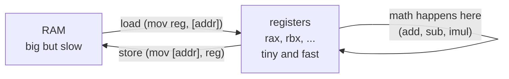

# How a CPU runs your program

Assembly is the language closest to what the processor actually does. Every C, C++, Rust or Python program ends up as a long list of tiny machine instructions. In this course you'll write those instructions yourself, for the **x86-64** processors in most laptops and servers, on **Linux**, with the **NASM** assembler.

You don't need to have learned C first, but it helps. If you took the C course, you'll finally see what pointers, function calls and the stack really are.

## What you need

- A Linux computer, or WSL on Windows (Ubuntu from the Microsoft Store), or a Linux virtual machine.
- Install the tools once:

```bash
sudo apt install nasm gcc gdb
```

Macs with Apple chips use a different processor (ARM), so use a Linux virtual machine or a free online Linux box there.

## Bits, bytes and hex

The CPU only works with numbers in **binary** (base 2): every digit is a **bit**, 0 or 1.

- 8 bits make a **byte**. A byte holds 0 to 255.
- Binary is long to write, so we use **hexadecimal** (base 16): digits 0 to 9, then A to F for 10 to 15.
- One hex digit is exactly 4 bits, so one byte is always two hex digits.

```text
decimal   binary      hex
   5      0000 0101   0x05
  10      0000 1010   0x0A
  15      0000 1111   0x0F
 255      1111 1111   0xFF
  65      0100 0001   0x41   (the letter 'A' in ASCII)
```

`0x` in front means "this is hex". NASM also accepts `0FFh` and binary like `0b1010`.

## Registers: the CPU's own variables

Memory (RAM) is big but slow. Inside the CPU there are a few very fast storage slots called **registers**. On x86-64 there are 16 general-purpose registers, each 64 bits (8 bytes):

<!-- diagram -->


```text
rax  rbx  rcx  rdx  rsi  rdi  rbp  rsp
r8   r9   r10  r11  r12  r13  r14  r15
```

Most work happens like this: load numbers from memory into registers, do math on the registers, store results back.

Two registers are special:

- **rsp** (stack pointer) points at the top of the stack. You'll meet it in module 4.
- **rip** (instruction pointer) holds the address of the next instruction. You never write to it directly; jumps and calls change it.

## The program is just numbers too

An instruction like `mov eax, 60` ("put 60 in eax") is stored in memory as bytes: `B8 3C 00 00 00`. The CPU fetches the bytes at rip, decodes them, does the work, moves rip to the next instruction, and repeats. Billions of times per second.

The **assembler** (NASM) turns text you can read into those bytes. The **linker** (ld) puts the pieces together into a program Linux can run.

```text
hello.asm  --nasm-->  hello.o  --ld-->  hello  --run-->  output
 (text)              (machine code)   (program)
```

## Your first assembly program

This program does nothing except end politely with exit code 7. Save it as `exit.asm`:

```nasm
global _start

section .text
_start:
    mov rax, 60     ; 60 = the "exit" system call
    mov rdi, 7      ; the exit code
    syscall         ; ask Linux to do it
```

Build and run it:

```bash
nasm -f elf64 exit.asm -o exit.o
ld exit.o -o exit
./exit
echo $?
```

`echo $?` prints the exit code of the last program, so you'll see `7`.

What each part means:

- `;` starts a comment.
- `global _start` makes the label `_start` visible to the linker. `_start` is where Linux begins running a program that doesn't use C.
- `section .text` is where code goes.
- `syscall` hands control to the Linux kernel, which looks at rax to see what you want.

Change the 7 to 42, build again, and check that `echo $?` shows 42. You just controlled the processor directly.

## Summary

- x86-64 has 16 general-purpose 64-bit registers; rsp and rip are special.
- Hex is a short way to write binary: two hex digits per byte.
- NASM assembles, ld links, and `syscall` asks Linux to do things like exit.

## Optional videos

The lesson above is complete on its own. These videos go deeper, if you like learning by watching.

**How do CPUs read machine code? (Ben Eater)**

https://www.youtube.com/watch?v=yl8vPW5hydQ

**Modern x64 Assembly 1: Beginning Assembly Programming (Creel)**

https://www.youtube.com/watch?v=rxsBghsrvpI
