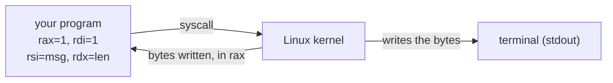

# Hello, world: data and system calls

To print text, a program asks the operating system. In assembly you do that directly with a **system call**.

## Sections

A NASM program is split into **sections**:

- `section .data` holds data with starting values (text, numbers).
- `section .bss` reserves empty space (we'll use it later).
- `section .text` holds the instructions.

## The write system call

Linux system calls take their number in **rax** and their inputs in **rdi, rsi, rdx** (then r10, r8, r9):

<!-- diagram -->


| Call | rax | rdi | rsi | rdx |
|---|---|---|---|---|
| write | 1 | where to write (1 = screen) | address of the text | how many bytes |
| exit | 60 | exit code | | |

The result comes back in rax.

## Hello, world

```nasm
global _start

section .data
msg:    db "Hello, world!", 10    ; the text, then byte 10 = newline
len:    equ $ - msg               ; length = here minus the start of msg

section .text
_start:
    mov rax, 1          ; write
    mov rdi, 1          ; to the screen (standard output)
    mov rsi, msg        ; address of the text
    mov rdx, len        ; number of bytes
    syscall

    mov rax, 60         ; exit
    xor rdi, rdi        ; exit code 0
    syscall
```

```output
Hello, world!
```

Build it the same way as before (`nasm -f elf64 hello.asm -o hello.o && ld hello.o -o hello && ./hello`).

New things here:

- `msg:` is a **label**: a name for an address. `mov rsi, msg` puts the address of the text into rsi, not the text itself.
- `db` means "define bytes". A string in quotes becomes its ASCII bytes. `10` is the newline character.
- `equ $ - msg`: `$` means "the current address". The current address minus the start of msg is the number of bytes in between. `len` is a constant worked out by NASM, not something stored in memory.
- `xor rdi, rdi` sets rdi to 0. Anything XOR itself is 0, and this instruction is shorter than `mov rdi, 0`, so you'll see it everywhere.

## Two lines

You can print several pieces with several write calls:

```nasm
global _start

section .data
line1:  db "Assembly is", 10
len1:   equ $ - line1
line2:  db "not magic.", 10
len2:   equ $ - line2

section .text
_start:
    mov rax, 1
    mov rdi, 1
    mov rsi, line1
    mov rdx, len1
    syscall

    mov rax, 1          ; rax holds the result of the last call, so set it again
    mov rdi, 1
    mov rsi, line2
    mov rdx, len2
    syscall

    mov rax, 60
    xor rdi, rdi
    syscall
```

```output
Assembly is
not magic.
```

Why `mov rax, 1` again? After `syscall`, rax holds the **result** (here, how many bytes were written). The kernel also changes rcx and r11. Never assume a register kept its value across a system call unless the rules say so.

## When it goes wrong

- **Segmentation fault** at the end: you forgot the exit call. Without it the CPU runs on into whatever bytes come next.
- **Strange characters**: the length is wrong. Use `equ $ - label` right after the string.
- `ld: cannot find entry symbol _start`: you forgot `global _start` or misspelled the label.

## A handy build script

Typing three commands each time gets old. Save this as `run.sh` and make it executable with `chmod +x run.sh`:

```bash
#!/bin/sh
# usage: ./run.sh hello   (builds hello.asm and runs it)
nasm -f elf64 "$1.asm" -o "$1.o" && ld "$1.o" -o "$1" && "./$1"
```

## Summary

- System call number in rax, inputs in rdi, rsi, rdx, then `syscall`.
- write is 1, exit is 60.
- A label is an address; `db` stores bytes; `equ $ - label` measures a string.

## Optional videos

The lesson above is complete on its own. These videos go deeper, if you like learning by watching.

**Modern x64 Assembly 1: Beginning Assembly Programming (Creel)**

https://www.youtube.com/watch?v=rxsBghsrvpI

**x86 Assembly Crash Course (Hack@UCF)**

https://www.youtube.com/watch?v=75gBFiFtAb8
