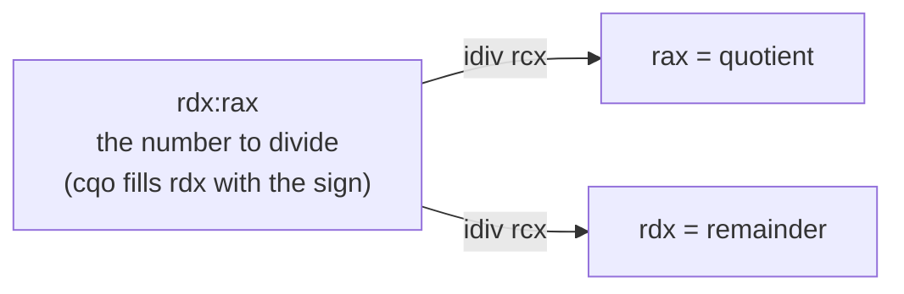

# Moving data and doing math

Most instructions have the form `instruction destination, source`. The result goes into the **left** operand.

## mov

```nasm
mov rax, 5        ; rax = 5          (a constant)
mov rbx, rax      ; rbx = rax        (copy a register)
mov rcx, [num]    ; rcx = the 8 bytes stored at address num
mov [num], rbx    ; store rbx into memory at num
```

Square brackets mean "the memory at this address". Without them you get the address itself. One rule: you **can't** move memory to memory in one instruction; go through a register.

## Printing numbers (a pattern to copy for now)

Printing a number with system calls means turning it into digits first (that's the final project). Until then we'll borrow C's `printf`. Copy this pattern; module 4 explains every line.

```nasm
default rel
global main
extern printf

section .data
fmt:    db "%ld", 10, 0        ; printf format: a number, newline, end of text

section .text
main:
    push rbp                   ; keeps the stack lined up for printf

    mov rax, 6
    add rax, 4                 ; rax = 10

    lea rdi, [fmt]             ; 1st argument: the format
    mov rsi, rax               ; 2nd argument: the number
    xor eax, eax               ; printf rule: say "no float arguments"
    call printf

    pop rbp
    xor eax, eax               ; main returns 0
    ret
```

```output
10
```

This program uses `main` instead of `_start`, so link it with gcc, which adds the C library:

```bash
nasm -f elf64 add.asm -o add.o
gcc -no-pie add.o -o add
./add
```

Newer linkers may print a warning about `.note.GNU-stack`. It's harmless. To silence it, add this line at the end of the file:

```nasm
section .note.GNU-stack noalloc noexec nowrite progbits
```

## Arithmetic

```nasm
add rax, rbx     ; rax = rax + rbx
sub rax, 3       ; rax = rax - 3
inc rcx          ; rcx = rcx + 1
dec rcx          ; rcx = rcx - 1
neg rax          ; rax = -rax
imul rax, rbx    ; rax = rax * rbx   (signed multiply)
imul rax, rbx, 4 ; rax = rbx * 4
```

Here's a small calculation, the price of 3 coffees at 45 plus a 10 delivery fee:

```nasm
default rel
global main
extern printf

section .data
fmt:    db "Total: %ld", 10, 0
price:  dq 45                 ; dq = define a quadword (8 bytes)

section .text
main:
    push rbp

    mov rax, [price]          ; rax = 45
    imul rax, rax, 3          ; rax = 135
    add rax, 10               ; rax = 145

    lea rdi, [fmt]
    mov rsi, rax
    xor eax, eax
    call printf

    pop rbp
    xor eax, eax
    ret
```

```output
Total: 145
```

## Division is different

`idiv` (signed division) uses fixed registers. It divides the 128-bit number in **rdx:rax** by the operand you give:

<!-- diagram -->


- the quotient goes into **rax**
- the remainder goes into **rdx**

Before dividing, fill rdx with the sign of rax using `cqo`. Forgetting `cqo` is the classic bug: whatever was in rdx becomes part of the number.

```nasm
default rel
global main
extern printf

section .data
fmt:    db "%ld r %ld", 10, 0

section .text
main:
    push rbp

    mov rax, 47
    mov rcx, 5
    cqo                 ; rdx:rax = 47 (rdx = 0 because 47 is positive)
    idiv rcx            ; rax = 9, rdx = 2

    lea rdi, [fmt]
    mov rsi, rax        ; quotient
    ; rdx already holds the remainder, and rdx is the 3rd argument
    xor eax, eax
    call printf

    pop rbp
    xor eax, eax
    ret
```

```output
9 r 2
```

The remainder is how you get the last digit of a number (`n % 10`), which you'll use in the project.

## lea: address math without memory

`lea` means "load effective address". It works out an address expression but doesn't read memory. People also use it as a quick calculator:

```nasm
lea rax, [rbx + rbx*2]   ; rax = rbx * 3
lea rax, [rcx + 8]       ; rax = rcx + 8
```

## Summary

- `mov dst, src`; brackets mean memory; no memory-to-memory moves.
- add, sub, inc, dec, neg, imul do what they say.
- idiv divides rdx:rax; quotient in rax, remainder in rdx; use `cqo` first.

## Optional videos

The lesson above is complete on its own. These videos go deeper, if you like learning by watching.

**x86 Assembly Crash Course (Hack@UCF)**

https://www.youtube.com/watch?v=75gBFiFtAb8
