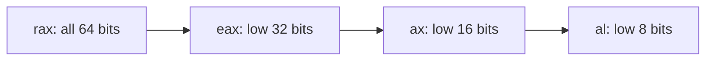

# Data sizes and registers inside registers

Registers are 64 bits, but data often isn't. A character is 1 byte; a C `int` is 4 bytes.

## Sizes

| Name | Bytes | Bits | NASM data | Size keyword |
|---|---|---|---|---|
| byte | 1 | 8 | `db` | `byte` |
| word | 2 | 16 | `dw` | `word` |
| doubleword | 4 | 32 | `dd` | `dword` |
| quadword | 8 | 64 | `dq` | `qword` |

## Smaller names for the same register

Each register has names for its lower parts:

<!-- diagram -->


```text
64 bits  rax                     r8
32 bits        eax               r8d
16 bits             ax           r8w
 8 bits                 al       r8b

|<-------------- rax -------------->|
                  |<---- eax ------>|
                           |<- ax ->|
                               |al  |
```

The same for rbx/ebx/bx/bl, rcx/ecx/cx/cl, rdx/edx/dx/dl, rsi/esi/si/sil, rdi/edi/di/dil.

## The rule that surprises everyone

- Writing a **32-bit** register clears the top 32 bits of the full register. `mov eax, 1` makes rax exactly 1.
- Writing an **8 or 16-bit** register leaves the other bits alone.

That's why `xor eax, eax` is the usual way to zero rax: shorter than `xor rax, rax` and the result is the same.

```nasm
default rel
global main
extern printf

section .data
fmt:    db "rax = %lx", 10, 0      ; %lx prints in hex

section .text
main:
    push rbp

    mov rax, -1          ; all 64 bits set: ffffffffffffffff
    mov al, 0x12         ; only the lowest byte changes
    mov rsi, rax
    lea rdi, [fmt]
    xor eax, eax
    call printf

    mov rax, -1
    mov eax, 0x12        ; 32-bit write: the top half is cleared
    mov rsi, rax
    lea rdi, [fmt]
    xor eax, eax
    call printf

    pop rbp
    xor eax, eax
    ret
```

```output
rax = ffffffffffffff12
rax = 12
```

## Telling NASM the size

When neither side is a register, NASM can't guess the size:

```nasm
mov [count], 5          ; error: operation size not specified
mov dword [count], 5    ; store 5 as 4 bytes
mov byte [flag], 1      ; store 1 as 1 byte
```

## Making small values big: movzx and movsx

To load a small value into a big register, say how to fill the extra bits:

- `movzx` fills with **zeros** (for unsigned values like characters).
- `movsx` copies the **sign bit** (for signed values). `movsxd` does it from 32 bits.

```nasm
default rel
global main
extern printf

section .data
fmt:    db "%ld %ld %ld", 10, 0
small:  db -3               ; one byte: 0xFD
temp:   dd -20              ; four bytes

section .text
main:
    push rbp

    movzx rsi, byte [small] ; as unsigned: 253
    movsx rdx, byte [small] ; as signed: -3
    movsxd rcx, dword [temp]; as signed: -20

    lea rdi, [fmt]
    xor eax, eax
    call printf

    pop rbp
    xor eax, eax
    ret
```

```output
253 -3 -20
```

The same byte, 0xFD, is 253 or -3 depending on how you read it. The CPU doesn't know which you meant; **you** choose by picking the instruction. That's also why there are pairs like `mul` / `imul` and `div` / `idiv`.

## Signed numbers in short

Negative numbers use **two's complement**: flip all bits and add 1. In one byte, -1 is 0xFF, -3 is 0xFD, and 127 is the biggest positive. The nice part: `add` and `sub` work the same for signed and unsigned numbers.

## Reserving space

`section .bss` reserves zeroed space without storing it in the program file:

```nasm
section .bss
buffer:  resb 64     ; 64 bytes
counts:  resq 10     ; 10 quadwords (80 bytes)
```

## Summary

- byte, word, dword, qword = 1, 2, 4, 8 bytes.
- eax, ax, al are the lower parts of rax; a 32-bit write clears the top half.
- Use size keywords when NASM can't tell; movzx and movsx widen values.

## Optional videos

The lesson above is complete on its own. These videos go deeper, if you like learning by watching.

**Twos complement: negative numbers in binary (Ben Eater)**

https://www.youtube.com/watch?v=4qH4unVtJkE
