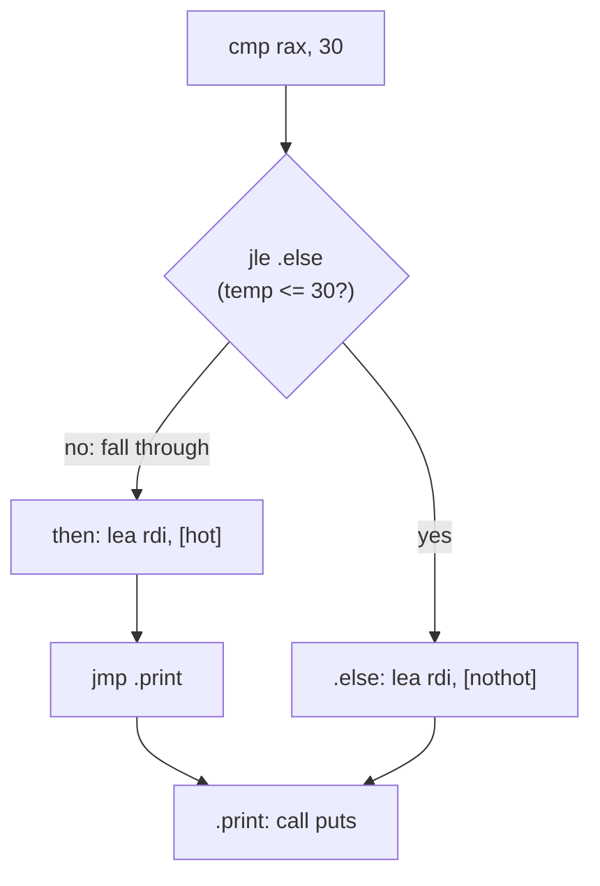

# Decisions and loops: flags and jumps

Assembly has no `if`, `while` or `for`. It has two simpler things: **compare** and **jump**. Every loop and decision in every language is built from these.

## Flags

After most arithmetic, the CPU sets bits in a special **flags** register describing the result:

- **ZF** (zero flag): the result was 0.
- **SF** (sign flag): the result was negative.
- **CF** (carry flag): an unsigned result didn't fit.
- **OF** (overflow flag): a signed result didn't fit.

`cmp a, b` works out `a - b`, sets the flags, and throws the result away. A **conditional jump** then looks at the flags.

## Jumps

`jmp label` always jumps. The conditional ones jump only if their condition holds after `cmp a, b`:

| Jump | Means | Kind |
|---|---|---|
| `je` / `jne` | a == b / a != b | any |
| `jl` / `jle` | a < b / a <= b | signed |
| `jg` / `jge` | a > b / a >= b | signed |
| `jb` / `jae` | a < b / a >= b | unsigned ("below", "above") |

Mixing signed and unsigned jumps is a real bug: -1 is the biggest unsigned number.

## if / else

This C code:

<!-- diagram -->


```c
if (temp > 30) puts("hot"); else puts("not hot");
```

becomes "jump over the part you don't want":

```nasm
default rel
global main
extern puts

section .data
hot:     db "hot", 0
nothot:  db "not hot", 0
temp:    dq 34

section .text
main:
    push rbp

    mov rax, [temp]
    cmp rax, 30
    jle .else          ; the opposite test: skip the "then" part
    lea rdi, [hot]
    jmp .print
.else:
    lea rdi, [nothot]
.print:
    call puts          ; puts prints a text and a newline

    pop rbp
    xor eax, eax
    ret
```

```output
hot
```

Labels starting with a dot (`.else`) are **local**: they belong to the last normal label (`main`), so another function can have its own `.else`.

Notice the trick: you test the **opposite** condition (`jle` for "not greater") and jump past the "then" code.

## A counting loop

Sum 1 + 2 + ... + 10:

```nasm
default rel
global main
extern printf

section .data
fmt:    db "sum = %ld", 10, 0

section .text
main:
    push rbp

    xor eax, eax        ; sum = 0
    mov rcx, 1          ; i = 1
.loop:
    cmp rcx, 10
    jg .done            ; while i <= 10
    add rax, rcx        ; sum += i
    inc rcx             ; i++
    jmp .loop
.done:
    lea rdi, [fmt]
    mov rsi, rax
    xor eax, eax
    call printf

    pop rbp
    xor eax, eax
    ret
```

```output
sum = 55
```

A shorter shape puts the test at the bottom, counting down to zero, because `dec` already sets ZF:

```nasm
    mov rcx, 10
.loop:
    add rax, rcx
    dec rcx
    jnz .loop          ; jump if not zero
```

Compilers love this shape. Use whichever is clearer for you.

## Several conditions: FizzBuzz

Print 1 to 15, but "Fizz" for multiples of 3, "Buzz" for 5, "FizzBuzz" for both.

```nasm
default rel
global main
extern printf

section .data
fnum:   db "%ld", 10, 0
ffizz:  db "Fizz", 10, 0
fbuzz:  db "Buzz", 10, 0
fboth:  db "FizzBuzz", 10, 0

section .text
main:
    push rbx            ; rbx keeps its value across printf (module 4 explains)
    mov rbx, 1
.loop:
    cmp rbx, 15
    jg .done
    mov rax, rbx
    cqo
    mov rcx, 15
    idiv rcx
    test rdx, rdx       ; test sets ZF if rdx is 0
    jz .both
    mov rax, rbx
    cqo
    mov rcx, 3
    idiv rcx
    test rdx, rdx
    jz .fizz
    mov rax, rbx
    cqo
    mov rcx, 5
    idiv rcx
    test rdx, rdx
    jz .buzz
    lea rdi, [fnum]
    mov rsi, rbx
    jmp .print
.both:
    lea rdi, [fboth]
    jmp .print
.fizz:
    lea rdi, [ffizz]
    jmp .print
.buzz:
    lea rdi, [fbuzz]
.print:
    xor eax, eax
    call printf
    inc rbx
    jmp .loop
.done:
    pop rbx
    xor eax, eax
    ret
```

```output
1
2
Fizz
4
Buzz
Fizz
7
8
Fizz
Buzz
11
Fizz
13
14
FizzBuzz
```

Why `push rbx` here and not `push rbp`? Both keep the stack lined up. We use rbx as the counter because printf is allowed to change rcx, rdx and others but must leave rbx alone. More on that in module 4.

`test a, b` is like `and` but only sets flags. `test rdx, rdx` is the usual way to ask "is rdx zero?".

## Summary

- `cmp` sets flags; conditional jumps read them.
- Signed: jl, jg. Unsigned: jb, ja. Equal: je, jne.
- if/else: jump on the opposite condition. Loops: a label, a test, and a jump back.

## Optional videos

The lesson above is complete on its own. These videos go deeper, if you like learning by watching.

**x86 Assembly Crash Course (Hack@UCF)**

https://www.youtube.com/watch?v=75gBFiFtAb8
