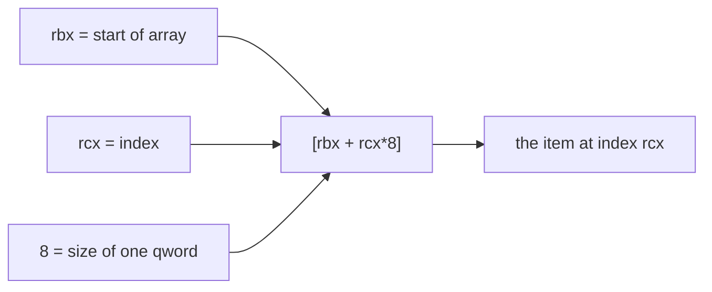

# Memory, arrays and strings

So far we've stored single numbers. Real programs work with lists of things in memory.

## Addressing memory

x86-64 lets you write an address as a small formula inside brackets:

<!-- diagram -->


```text
[ base + index*scale + displacement ]
```

- **base**: a register holding an address
- **index**: a register holding a position
- **scale**: 1, 2, 4 or 8 (the size of each item)
- **displacement**: a constant

```nasm
mov rax, [rbx]            ; the 8 bytes at rbx
mov rax, [rbx + 16]       ; 16 bytes further
mov rax, [rbx + rcx*8]    ; item number rcx of an array of qwords
mov eax, [rbx + rcx*4]    ; item rcx of an array of dwords (C ints)
```

That last form is exactly `a[i]` in C.

## Summing an array

```nasm
default rel
global main
extern printf

section .data
fmt:    db "sum = %ld, max = %ld", 10, 0
nums:   dq 12, 7, 31, 4, 19, 25
count:  equ ($ - nums) / 8      ; 6 items of 8 bytes

section .text
main:
    push rbp

    lea r8, [nums]      ; r8 = address of the array
    xor ecx, ecx        ; i = 0
    xor esi, esi        ; sum = 0
    mov rdx, [r8]       ; max = nums[0]
.loop:
    cmp rcx, count
    jge .done
    mov rax, [r8 + rcx*8]    ; rax = nums[i]
    add rsi, rax
    cmp rax, rdx
    jle .next
    mov rdx, rax             ; new max
.next:
    inc rcx
    jmp .loop
.done:
    lea rdi, [fmt]      ; rsi = sum, rdx = max: already the 2nd and 3rd arguments
    xor eax, eax
    call printf

    pop rbp
    xor eax, eax
    ret
```

```output
sum = 98, max = 31
```

Note `count: equ ($ - nums) / 8`. NASM works out the number of items for you, so adding a number to the list doesn't break the loop.

## Strings are byte arrays

A C-style string is bytes ending with a 0 byte. To find its length, walk until you hit 0:

```nasm
default rel
global main
extern printf

section .data
fmt:    db "length = %ld", 10, 0
text:   db "Cairo is huge", 0

section .text
main:
    push rbp

    lea rdi, [text]
    xor eax, eax          ; length = 0
.loop:
    cmp byte [rdi + rax], 0
    je .done
    inc rax
    jmp .loop
.done:
    lea rdi, [fmt]
    mov rsi, rax
    xor eax, eax
    call printf

    pop rbp
    xor eax, eax
    ret
```

```output
length = 13
```

## Changing a string in place

Lowercase letters 'a' to 'z' are 97 to 122; uppercase are 65 to 90, exactly 32 less. To shout a string, subtract 32 from each lowercase letter:

```nasm
default rel
global main
extern puts

section .data
text:   db "hello from assembly", 0

section .text
main:
    push rbp

    lea rdi, [text]
.loop:
    mov al, [rdi]
    test al, al         ; end of string?
    jz .done
    cmp al, 'a'
    jb .next            ; below 'a': not lowercase
    cmp al, 'z'
    ja .next            ; above 'z': not lowercase
    sub al, 32
    mov [rdi], al       ; write the changed byte back
.next:
    inc rdi             ; move the pointer to the next byte
    jmp .loop
.done:
    lea rdi, [text]
    call puts

    pop rbp
    xor eax, eax
    ret
```

```output
HELLO FROM ASSEMBLY
```

Here we moved a **pointer** (`inc rdi`) instead of using an index. Both are fine; this is `p++` in C.

Characters are unsigned, so this uses `jb` and `ja`, not `jl` and `jg`. NASM turns `'a'` into its number for you.

## Little-endian

x86 stores multi-byte numbers with the **lowest byte first**. The qword 0x0102030405060708 sits in memory as `08 07 06 05 04 03 02 01`. You rarely notice, except when you look at raw memory in a debugger, or read a dword as four separate bytes.

## Summary

- Addresses: `[base + index*scale + disp]`; `[rbx + rcx*8]` is `a[i]` for qwords.
- Strings are bytes ending in 0; walk with an index or a moving pointer.
- Characters are unsigned: compare them with jb and ja.

## Optional videos

The lesson above is complete on its own. These videos go deeper, if you like learning by watching.

**x86 Assembly Crash Course (Hack@UCF)**

https://www.youtube.com/watch?v=75gBFiFtAb8
