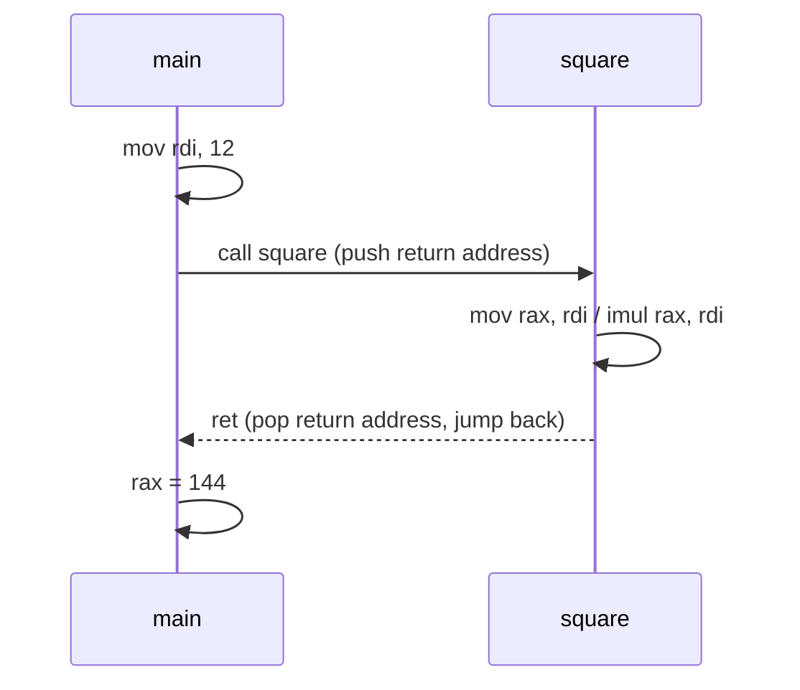

# The stack, call and ret

Functions in every language rely on one simple structure: the **stack**.

## The stack

The stack is a region of memory that grows **downward**, toward smaller addresses. **rsp** always points at the item on top.

- `push rax`: rsp goes down by 8, then rax is stored at [rsp].
- `pop rax`: the value at [rsp] is loaded into rax, then rsp goes up by 8.

```text
before push rax      after push rax       after pop rbx
                     (rax = 42)           (rbx = 42)
 addr                 addr                 addr
 1000 | ...  | <-rsp  1000 | ...  |        1000 | ...  | <-rsp
  992 |      |         992 |  42  | <-rsp   992 |  42  |  (still there,
  984 |      |         984 |      |         984 |      |   just ignored)
```

Last in, first out, like a stack of plates. Push in one order, pop in the reverse order:

```nasm
default rel
global main
extern printf

section .data
fmt:    db "%ld %ld %ld", 10, 0

section .text
main:
    push rbp
    push 1
    push 2
    push 3
    pop rsi          ; 3
    pop rdx          ; 2
    pop rcx          ; 1
    lea rdi, [fmt]
    xor eax, eax
    call printf
    pop rbp
    xor eax, eax
    ret
```

```output
3 2 1
```

## call and ret

- `call label` pushes the address of the next instruction (the **return address**), then jumps to label.
- `ret` pops that address and jumps back to it.

<!-- diagram -->


That's all a function call is. Here's a function that squares rdi and returns the result in rax:

```nasm
default rel
global main
extern printf

section .data
fmt:    db "%ld squared is %ld", 10, 0

section .text
square:                 ; in: rdi   out: rax
    mov rax, rdi
    imul rax, rdi
    ret

main:
    push rbp
    mov rdi, 12
    call square         ; rax = 144
    lea rdi, [fmt]
    mov rsi, 12
    mov rdx, rax
    xor eax, eax
    call printf
    pop rbp
    xor eax, eax
    ret
```

```output
12 squared is 144
```

If a function pushes something and forgets to pop it, `ret` pops the wrong value and jumps to nonsense: an instant crash. **Every push needs a matching pop before ret.**

## Local variables and stack frames

When a function needs memory for its own variables, it makes room on the stack by moving rsp down. The usual opening and closing, called the **prologue** and **epilogue**:

```nasm
myfunc:
    push rbp            ; save the caller's rbp
    mov rbp, rsp        ; rbp marks this function's frame
    sub rsp, 16         ; 16 bytes for local variables
    ; locals are at [rbp - 8] and [rbp - 16]
    ...
    mov rsp, rbp        ; throw the locals away
    pop rbp             ; give the caller its rbp back
    ret
```

```text
higher addresses
| return address |   <- pushed by call
| saved rbp      |   <- rbp points here
| local 1        |   [rbp - 8]
| local 2        |   [rbp - 16]  <- rsp
lower addresses
```

Example: a function that keeps a running total in a local variable while it adds 1 to n:

```nasm
default rel
global main
extern printf

section .data
fmt:    db "1 + ... + %ld = %ld", 10, 0

section .text
sum_to:                     ; in: rdi = n   out: rax
    push rbp
    mov rbp, rsp
    sub rsp, 16
    mov qword [rbp - 8], 0  ; total = 0
    mov rcx, 1
.loop:
    cmp rcx, rdi
    jg .done
    add [rbp - 8], rcx      ; total += i
    inc rcx
    jmp .loop
.done:
    mov rax, [rbp - 8]
    mov rsp, rbp
    pop rbp
    ret

main:
    push rbp
    mov rdi, 100
    call sum_to
    lea rdi, [fmt]
    mov rsi, 100
    mov rdx, rax
    xor eax, eax
    call printf
    pop rbp
    xor eax, eax
    ret
```

```output
1 + ... + 100 = 5050
```

(A register would be faster here. The point is to see a local variable live on the stack. That's where C keeps local variables that don't fit in registers.)

## Recursion works for free

Because each call gets its own return address and its own frame, a function can call itself. Factorial:

```nasm
default rel
global main
extern printf

section .data
fmt:    db "10! = %ld", 10, 0

section .text
fact:                   ; in: rdi = n   out: rax = n!
    cmp rdi, 1
    jg .recurse
    mov eax, 1          ; 0! = 1! = 1
    ret
.recurse:
    push rdi            ; save n: the call below changes rdi
    dec rdi
    call fact           ; rax = (n-1)!
    pop rdi             ; n is back
    imul rax, rdi       ; n * (n-1)!
    ret

main:
    push rbp
    mov rdi, 10
    call fact
    lea rdi, [fmt]
    mov rsi, rax
    xor eax, eax
    call printf
    pop rbp
    xor eax, eax
    ret
```

```output
10! = 3628800
```

If you've ever seen "stack overflow" from endless recursion: each call pushes more, until the stack runs out of room.

## Summary

- The stack grows down; push lowers rsp, pop raises it.
- call pushes the return address; ret pops it. Keep pushes and pops balanced.
- Prologue `push rbp / mov rbp, rsp / sub rsp, N`; locals live at [rbp - ...].

## Optional videos

The lesson above is complete on its own. These videos go deeper, if you like learning by watching.

**Comparing C to machine language (Ben Eater)**

https://www.youtube.com/watch?v=yOyaJXpAYZQ
