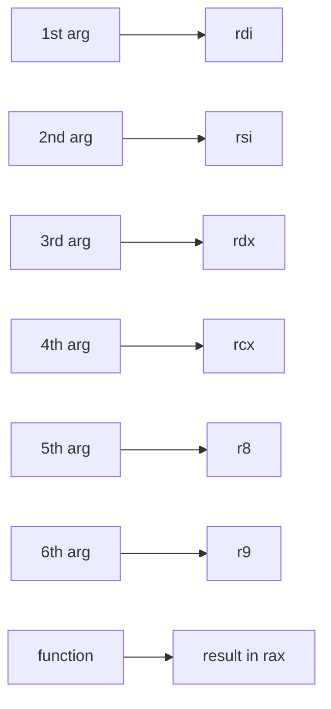

# The calling convention: talking to C

Your functions so far used whatever registers you liked. To call C functions, or let C call yours, both sides must follow the same rules. On Linux, those rules are the **System V AMD64 ABI**.

## The rules

**Arguments** (whole numbers and pointers) go in this order:

<!-- diagram -->


```text
1st   2nd   3rd   4th   5th   6th
rdi   rsi   rdx   rcx   r8    r9      (more go on the stack)
```

**The return value** comes back in **rax**.

**Who saves what:**

| Callee-saved (the function must give them back unchanged) | Caller-saved (a call may change them) |
|---|---|
| rbx, rbp, r12, r13, r14, r15, rsp | rax, rcx, rdx, rsi, rdi, r8, r9, r10, r11 |

So: if you need a value to survive a call, keep it in rbx or r12 to r15 (and save that register yourself first), or push it.

**Stack alignment:** right before a `call`, rsp must be a multiple of 16. When your function starts, the call has just pushed 8 bytes, so rsp is off by 8. One `push` (like `push rbp`) fixes it. That's the mystery line in every `main` so far.

**Variadic functions** like printf want **al** to hold the number of floating-point arguments in vector registers. We pass none, so `xor eax, eax`.

## Now the printf pattern makes sense

```nasm
default rel             ; addresses relative to rip: needed for modern Linux
global main             ; the C library calls main, so make it visible
extern printf           ; printf lives in the C library

section .data
fmt:    db "%s is %ld years old", 10, 0
name:   db "Mona", 0

section .text
main:
    push rbp            ; align the stack to 16
    lea rdi, [fmt]      ; 1st argument
    lea rsi, [name]     ; 2nd argument
    mov rdx, 27         ; 3rd argument
    xor eax, eax        ; no float arguments
    call printf
    pop rbp
    xor eax, eax        ; return 0 from main
    ret
```

```output
Mona is 27 years old
```

`default rel` and `lea` make addresses relative to the current instruction. Programs that use the C library are built that way on most Linux systems today; we also pass `-no-pie` to gcc to keep linking simple.

## Calling several C functions

Values you need after a call go in callee-saved registers. This program uses `strlen` and `printf`, and keeps the string address in rbx:

```nasm
default rel
global main
extern printf
extern strlen

section .data
fmt:    db "'%s' has %ld characters", 10, 0
word1:  db "assembly", 0

section .text
main:
    push rbx            ; we'll use rbx, so save the caller's value (also aligns)
    lea rbx, [word1]
    mov rdi, rbx
    call strlen         ; rax = length; rdi, rsi... may now be anything
    lea rdi, [fmt]
    mov rsi, rbx        ; rbx survived the call
    mov rdx, rax
    xor eax, eax
    call printf
    pop rbx
    xor eax, eax
    ret
```

```output
'assembly' has 8 characters
```

## Writing a function C can call

Put the function in its own file, follow the rules, and mark it `global`:

```nasm
; maxof.asm: long max_of(long *arr, long n)
global max_of

section .text
max_of:
    mov rax, [rdi]          ; best = arr[0]
    mov rcx, 1              ; i = 1
.loop:
    cmp rcx, rsi
    jge .done
    mov rdx, [rdi + rcx*8]
    cmp rdx, rax
    jle .next
    mov rax, rdx
.next:
    inc rcx
    jmp .loop
.done:
    ret

section .note.GNU-stack noalloc noexec nowrite progbits   ; tells the linker: no executable stack needed
```

<!-- skip -->
```c
// main.c
#include <stdio.h>

long max_of(long *arr, long n);   // written in assembly

int main(void) {
    long scores[] = {71, 94, 88, 65, 90};
    printf("best: %ld\n", max_of(scores, 5));
    return 0;
}
```

Build both and link them together:

```bash
nasm -f elf64 maxof.asm -o maxof.o
gcc main.c maxof.o -o scores
./scores
```

```text
best: 94
```

It uses only caller-saved registers (rax, rcx, rdx) and doesn't call anything, so it needs no prologue at all.

## Common crashes and their cause

- **Crash inside printf**: the stack wasn't aligned. Check your pushes: an odd number of 8-byte pushes before the call (counting the return address) is right.
- **A value "randomly" changes after a call**: it was in a caller-saved register. Move it to rbx or r12 to r15.
- **The caller crashes after your function returns**: you changed rbx, rbp or r12 to r15 without saving and restoring them.

## Summary

- Arguments: rdi, rsi, rdx, rcx, r8, r9. Return: rax.
- Keep rbx, rbp, r12 to r15 unchanged (push/pop them if you use them).
- rsp must be a multiple of 16 at each call; al = 0 before printf.

## Optional videos

The lesson above is complete on its own. These videos go deeper, if you like learning by watching.

**Comparing C to machine language (Ben Eater)**

https://www.youtube.com/watch?v=yOyaJXpAYZQ

**Modern x64 Assembly 1: Beginning Assembly Programming (Creel)**

https://www.youtube.com/watch?v=rxsBghsrvpI
