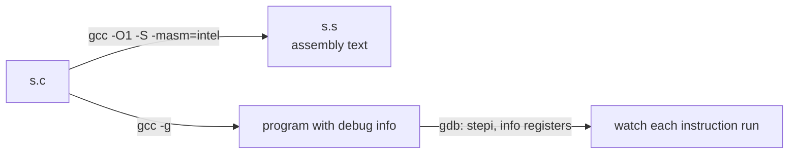

# Reading compiler output and using a debugger

Two skills turn assembly from a classroom subject into a real tool: reading what your compiler produced, and stepping through a program instruction by instruction.

## Ask gcc for its assembly

Save this as `s.c`:

<!-- diagram -->


```c
long square(long x) {
    return x * x;
}

long sum(long *a, long n) {
    long total = 0;
    for (long i = 0; i < n; i++)
        total += a[i];
    return total;
}
```

Then:

```bash
gcc -O1 -S -masm=intel s.c -o s.s
```

- `-S` stops after making assembly (the file `s.s`).
- `-masm=intel` uses the same operand order as NASM (destination first). Without it you get AT&T syntax, which reverses operands and adds `%` and `$` everywhere.
- `-O1` turns on basic optimizing. With `-O0` the output is long and stores everything on the stack; with `-O2` it can get clever.

Here's the part that matters (directives starting with `.` removed):

```text
square:
	imul	rdi, rdi
	mov	rax, rdi
	ret

sum:
	test	rsi, rsi
	jle	.L5
	mov	rax, rdi
	lea	rcx, [rdi+rsi*8]
	mov	edx, 0
.L4:
	add	rdx, QWORD PTR [rax]
	add	rax, 8
	cmp	rax, rcx
	jne	.L4
.L2:
	mov	rax, rdx
	ret
.L5:
	mov	edx, 0
	jmp	.L2
```

You can read all of this now:

- `square`: x arrives in rdi (1st argument); the result goes out in rax. No stack, no frame.
- `sum`: a is in rdi, n in rsi. `test rsi, rsi / jle` handles n <= 0. Then gcc turned the index loop into a **pointer loop**: rax walks from a to the end address `a + n*8` (in rcx), and rdx keeps the total. `QWORD PTR [rax]` is how gcc writes NASM's `qword [rax]`.

The compiler rewrote your `i` loop into something different but equivalent. That's what optimizing means.

## Compiler Explorer

[godbolt.org](https://godbolt.org) does this in the browser: C, C++ or Rust on the left, assembly on the right, with matching lines coloured. Pick "x86-64 gcc", add `-O1` in the options box, and hover over any instruction for an explanation. It's the fastest way to answer "what does this line of C really cost?".

Try these and predict the output first:

- `return x * 8;` (hint: look for a shift, `shl`, or `lea`)
- `return x / 2;` for a signed `long`
- a `switch` with many cases (look for a jump table)

## gdb: watch the CPU work

Build with debug info. For a `_start` program:

```bash
nasm -f elf64 -g -F dwarf hello.asm -o hello.o
ld hello.o -o hello
gdb ./hello
```

Inside gdb:

```text
(gdb) break _start        stop at the first instruction
(gdb) run
(gdb) layout asm          show the instructions (layout regs adds registers)
(gdb) stepi               run one instruction (si for short)
(gdb) info registers rax rdi rsi
(gdb) p/x $rax            print rax in hex
(gdb) x/s &msg            show memory at msg as a string
(gdb) x/4gx $rsp          show 4 qwords on the stack, in hex
(gdb) continue
(gdb) quit
```

`x` means "examine memory": `/4gx` is 4 items, **g**iant (8-byte), in he**x**; `/s` is a string; `/8xb` would be 8 bytes.

## A debugging routine that works

1. Break where things are still fine.
2. `stepi` through the code, checking registers after each step against what you **expect**.
3. The first instruction where reality differs from your expectation is the bug.

When a program crashes, just `run` it in gdb. It stops at the crashing instruction; `info registers` and `x` show you which address was bad, and `bt` shows how you got there.

## Summary

- `gcc -O1 -S -masm=intel` shows what the compiler made; godbolt.org does it live.
- You can now read argument registers, loops and pointer walks in real compiler output.
- gdb: break, run, stepi, info registers, x. Compare every step with what you expected.

## Optional videos

The lesson above is complete on its own. These videos go deeper, if you like learning by watching.

**What Has My Compiler Done for Me Lately? (Matt Godbolt, CppCon 2017)**

https://www.youtube.com/watch?v=bSkpMdDe4g4

**Debugging: GDB tutorial (Chris Bourke)**

https://www.youtube.com/watch?v=bWH-nL7v5F4
