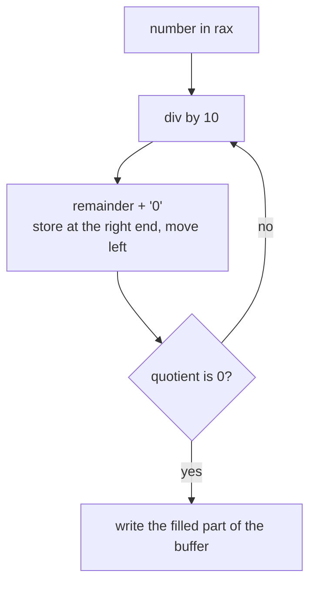

# Project: printing numbers with no C library

Time to drop printf. You'll write your own number printer using only system calls, the way the very lowest layers of software do it.

## The plan

To print 4071, you need the bytes `'4' '0' '7' '1'`. The digits come out of the number **last digit first**:

<!-- diagram -->


```text
4071 / 10 = 407  remainder 1   -> '1'
 407 / 10 =  40  remainder 7   -> '7'
  40 / 10 =   4  remainder 0   -> '0'
   4 / 10 =   0  remainder 4   -> '4'   stop: the number is 0
```

So fill a buffer **from the right end** going left. A digit d becomes its character with `d + '0'` (48).

Negative numbers: remember the sign, work with the positive value, then put `'-'` in front. Zero needs no special case if the loop runs at least once (a "do while" loop).

## The full program

```nasm
global _start

section .bss
buf:    resb 32                 ; room for the digits

section .text

; print_num: prints rdi as a signed number and a newline
print_num:
    push rbx
    mov rax, rdi                ; the number to split up
    lea rsi, [buf + 31]         ; start at the right end
    mov byte [rsi], 10          ; the last byte is a newline
    mov rbx, 10                 ; the divisor
    xor r8d, r8d                ; r8 = 1 if negative
    test rax, rax
    jns .digits                 ; jns: jump if the sign flag is clear (not negative)
    neg rax
    mov r8d, 1
.digits:
    xor edx, edx                ; unsigned divide: rdx must be 0
    div rbx                     ; rax = rax / 10, rdx = last digit
    add dl, '0'
    dec rsi
    mov [rsi], dl
    test rax, rax
    jnz .digits                 ; keep going while something is left
    test r8, r8
    jz .write
    dec rsi
    mov byte [rsi], '-'
.write:
    lea rdx, [buf + 32]
    sub rdx, rsi                ; length = end - start
    mov rax, 1                  ; write
    mov rdi, 1                  ; to the screen
    syscall                     ; rsi already points at the first character
    pop rbx
    ret

_start:
    mov rdi, 4071
    call print_num
    mov rdi, 0
    call print_num
    mov rdi, -42
    call print_num

    ; and something computed: 1 + 2 + ... + 1000
    xor edi, edi
    mov rcx, 1000
.sum:
    add rdi, rcx
    dec rcx
    jnz .sum
    call print_num

    mov rax, 60
    xor edi, edi
    syscall
```

```output
4071
0
-42
500500
```

Build it like the first programs, with ld and no C library:

```bash
nasm -f elf64 numbers.asm -o numbers.o
ld numbers.o -o numbers
./numbers
```

## Walk through it

- `lea rsi, [buf + 31]` points at the last byte; the newline goes there.
- In the loop, `div rbx` divides rdx:rax by 10. We use **unsigned** `div` because the value is already positive, so rdx is simply set to 0 (no `cqo`).
- `dec rsi` then `mov [rsi], dl`: step left, store the digit.
- At the end rsi points at the first character, and `buf + 32 - rsi` is the length. Those are exactly the inputs write needs, so no copying.
- rbx is callee-saved, so the function pushes and pops it.

Check it in gdb: break at `.write` and run `x/s $rsi` to see the finished text.

## Your turn

Pick one or more:

1. **Times table.** Print 7 x 1 up to 7 x 10, one result per line, using print_num.
2. **Without the newline.** Split print_num into `print_num` (no newline) and `print_char`, then print `7 x 3 = 21` style lines.
3. **Reading input.** Use the read system call (rax = 0, rdi = 0, rsi = buffer, rdx = size) to read a number typed by the user, turn the digits into a value (`value = value*10 + (char - '0')`), and print its double.
4. **Hex.** Write `print_hex`, dividing by 16 and using the digits `0123456789abcdef` from a table: `mov dl, [hexdigits + rdx]`.

## Where to go next

You now know what C, C++ and Rust compile down to. Next in the systems path is **C++**, where you'll see how classes, references and destructors turn into the same registers, calls and stack frames you've just used. Keep godbolt.org open while you learn it.

## Summary

- Split a number with repeated division by 10; fill the buffer from the right.
- Handle the sign separately; a do-while loop handles zero for free.
- With write and exit you need nothing from the C library.

## Optional videos

The lesson above is complete on its own. These videos go deeper, if you like learning by watching.

**Twos complement: negative numbers in binary (Ben Eater)**

https://www.youtube.com/watch?v=4qH4unVtJkE
