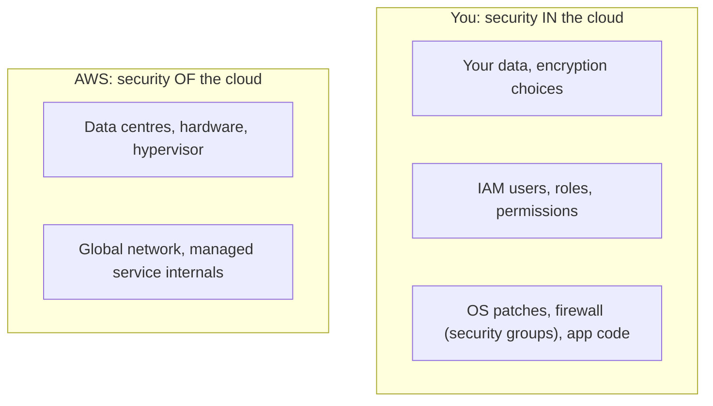

# Start here: what the cloud really is

"The cloud" is someone else's data centres, rented by the second through an API. Under it are the things you already know: Linux servers, virtual machines, disks, networks, all from the earlier courses.

## Service models

| Model | You manage | Provider manages | AWS examples |
|---|---|---|---|
| **IaaS** | OS, runtime, app, data | Hardware, virtualization, network | EC2, EBS, VPC |
| **PaaS** | App and data | Everything below | Elastic Beanstalk, RDS, Lambda |
| **SaaS** | Your use of it | Everything | WorkMail, QuickSight |

## The shared responsibility model

Almost every cloud breach in the news is on **your** side: a public S3 bucket, leaked access keys, an open database port, overly broad IAM permissions.

## Why companies move

- Pay for what you use instead of buying servers years ahead.
- Get capacity in minutes, in many countries.
- Managed services (databases, queues, load balancers) remove whole jobs of maintenance.
- The trade-off: you must design for failure and for **cost**: the cloud bills every hour you forget to turn something off.

## Before you touch anything

1. Create an AWS account and **turn on MFA for the root user**; then stop using root.
2. Create an admin user through IAM Identity Center (Day 2) for daily work.
3. **Set a budget alert** (Billing → Budgets → e.g. $10/month, email at 80%). Do this today.
4. Most labs fit the free tier; delete what you create when a lab ends.

The optional full-length course below is Andrew Brown's free AWS Cloud Practitioner course: watch the parts that match each day if you want a second explanation or are preparing for that exam.

## Optional videos

The lesson above is complete on its own. These go deeper, if you like learning by watching.

**Andrew Brown (freeCodeCamp): AWS Certified Cloud Practitioner full course**

https://www.youtube.com/watch?v=NhDYbskXRgc
