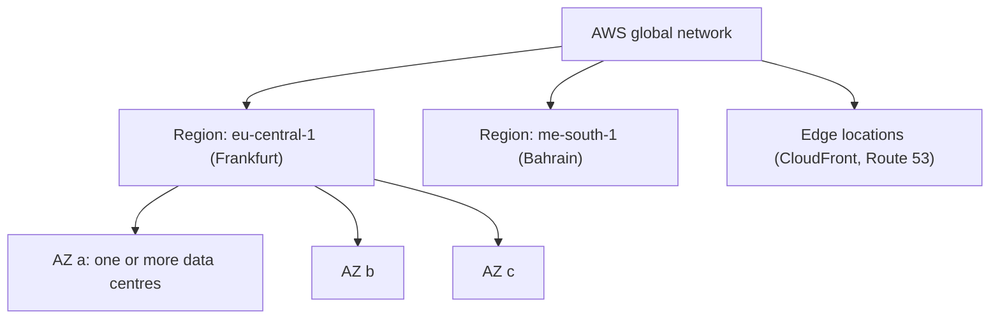

# Regions, Availability Zones and pricing



| Concept | Is | Why it matters |
|---|---|---|
| **Region** | A geographic area with its own copy of most services | Latency to users, data residency laws, price differs by region |
| **Availability Zone (AZ)** | Separate data centres in a region, with their own power and network, close enough for fast links | Run in **two or more AZs** to survive one failing |
| **Edge location** | Small sites near users | Caching (CloudFront) and DNS |

Most resources live in one region; **IAM** and **Route 53** are global. A classic mistake: "my instances disappeared!" (the console is showing another region).

## How you pay

| Option | For |
|---|---|
| **On-demand** | Pay per second; flexible; most expensive per hour |
| **Savings Plans / Reserved** | Commit 1 or 3 years: up to ~70% cheaper for steady workloads |
| **Spot** | Spare capacity at up to ~90% off, but can be taken back with 2 minutes' notice: batch jobs, CI runners |
| **Free tier** | Small amounts free for new accounts (check the current limits) |

The hidden costs people forget: **data transfer out** to the internet, **NAT gateways** (hourly plus per GB), idle load balancers, unattached disks and old snapshots, public IPv4 addresses (charged per hour since 2024).

```bash
aws configure                         # or: aws configure sso
aws sts get-caller-identity           # who am I in AWS?
aws ec2 describe-regions --output table
```
