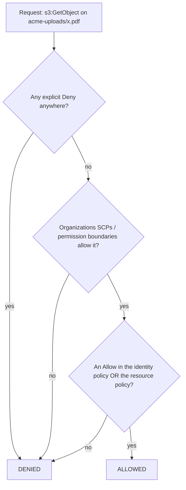

# How AWS decides: policy evaluation

When a request arrives, AWS gathers every policy that applies and decides:

Three rules to remember:

1. **Everything is denied by default.**
2. **An explicit Deny always wins.**
3. An action needs an **Allow** somewhere that applies (identity or resource policy).

## Identity vs resource policies

| | Identity policy | Resource policy |
|---|---|---|
| Attached to | A user, group or role | A bucket, queue, key, etc. |
| Says | "This identity may do X to these resources" | "These principals may do X to me" |
| Needed for cross-account | Plus the resource policy | Yes |

## Debugging AccessDenied

1. Read the error: it usually names the action and resource (and sometimes which policy type denied).
2. `aws sts get-caller-identity`: are you who you think you are (right role, right account)?
3. Check for explicit Denies (SCPs, bucket policies, permission boundaries).
4. The **IAM Policy Simulator** and **IAM Access Analyzer** show what a principal can really do, and Access Analyzer can generate a least-privilege policy from CloudTrail history.

## Optional videos

The lesson above is complete on its own. These go deeper, if you like learning by watching.

**AWS re:Invent 2023: IAM Access Analyzer on the journey to least privilege (SEC238)**

https://www.youtube.com/watch?v=JpemUkU8INA
