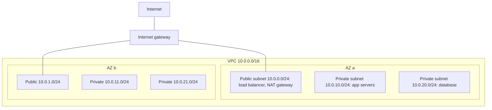

# VPC: your private network in AWS

A **VPC** is your own isolated network: you pick its address range and split it into **subnets** (Networking Fundamentals, Day 3).

## What makes a subnet "public"

Only its **route table**:

| Route table | Routes | Effect |
|---|---|---|
| Public | `0.0.0.0/0 -> internet gateway` | Instances with public IPs are reachable from (and can reach) the internet |
| Private | `0.0.0.0/0 -> NAT gateway` (in a public subnet) | Instances can reach out (updates) but can't be reached from outside |
| Isolated | No default route | No internet at all (databases often) |

## Building blocks

| Piece | Job |
|---|---|
| **Internet gateway** | The VPC's door to the internet |
| **NAT gateway** | Lets private instances start outbound connections (NAT from Networking Fundamentals). Costs per hour and per GB |
| **Route tables** | One per subnet; longest prefix match like any router |
| **VPC endpoints** | Reach S3, DynamoDB and other AWS APIs privately, without the NAT gateway (cheaper, safer) |
| **Peering / Transit Gateway** | Connect VPCs to each other (ranges must not overlap) |

Every new account has a **default VPC** with public subnets everywhere: fine for experiments, not for production.

## Optional videos

The lesson above is complete on its own. These go deeper, if you like learning by watching.

**AWS re:Invent 2023: AWS networking foundations (NTA307)**

https://www.youtube.com/watch?v=8nNurTFy-h4
