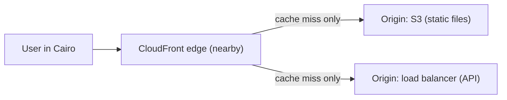

# DNS and content delivery: Route 53 and CloudFront

## Route 53

AWS's DNS service (Networking Fundamentals, Day 6, in the cloud):

- **Hosted zones** hold a domain's records; public ones for the internet, private ones visible only inside your VPCs (`db.internal`).
- **Alias records**: point a name (even the bare `example.com`) straight at an AWS load balancer, CloudFront or S3 website. Free queries, and they follow the target's IPs automatically.
- **Health checks** and **routing policies**:

| Policy | Sends users |
|---|---|
| Simple | To one answer |
| Weighted | 90% to v1, 10% to v2 (canary releases) |
| Latency | To the region that's fastest for them |
| Failover | To the backup when the primary's health check fails |
| Geolocation | By the user's country |

```bash
aws route53 list-hosted-zones
dig +short app.example.com
```

## CloudFront

A CDN with hundreds of edge locations: caches your content near users, terminates HTTPS, and protects your origin.



Benefits: lower latency, less load and data-transfer cost on your servers, free TLS certificates via **ACM**, and **AWS WAF** rules at the edge. Certificates for CloudFront must be created in `us-east-1`, a classic gotcha.

## Optional videos

The lesson above is complete on its own. These go deeper, if you like learning by watching.

**AWS re:Invent 2023: What can networking do for your application? (NET203)**

https://www.youtube.com/watch?v=tUh26i8uY9Q
