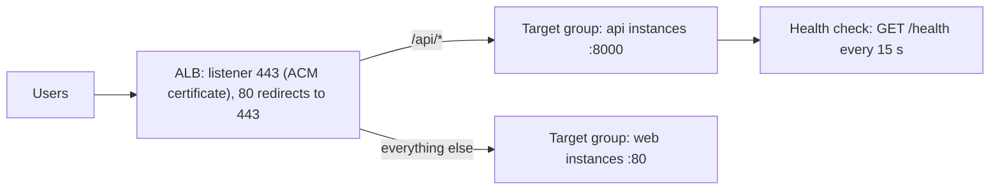

# Load balancers

**Elastic Load Balancing** spreads traffic over healthy targets in several AZs.

| Type | Works at | Use for |
|---|---|---|
| **Application LB (ALB)** | HTTP/HTTPS (layer 7) | Websites and APIs: routing by path or host, HTTPS, redirects, WebSockets |
| **Network LB (NLB)** | TCP/UDP/TLS (layer 4) | Extreme throughput, static IPs, non-HTTP protocols |
| Gateway LB | Layer 3 | Inserting firewall appliances |

## Pieces

- **Listener**: a port and protocol (443 HTTPS), with rules.
- **Target group**: instances, IPs or containers, plus a **health check**. Unhealthy targets stop getting traffic.
- **Security groups**: the ALB's allows 443 from the internet; targets' allow traffic **only from the ALB's security group**.

## Things that bite

- Health check path returns 301/401/500 -> every target "unhealthy" -> 503 for everyone. Give the app a simple `/health` endpoint that returns 200.
- The app sees the ALB's IP as the client; the real one is in the `X-Forwarded-For` header.
- Idle timeout (60 s default) cuts long requests: raise it or use streaming/WebSockets properly.

## Optional videos

The lesson above is complete on its own. These go deeper, if you like learning by watching.

**AWS re:Invent 2023: Enhance your app's security and availability with Elastic Load Balancing (NET318)**

https://www.youtube.com/watch?v=6iO6wtDOKGM
