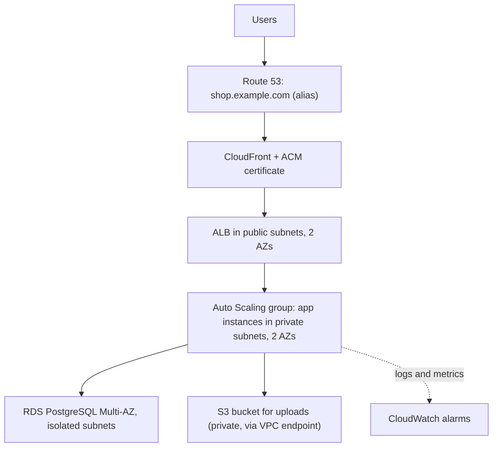

# Capstone: design a three-tier web app on AWS

Design (and, if your budget allows, build and then delete) this:

## Your design document

1. **VPC plan**: CIDR, six subnets (public/app/db x 2 AZs), route tables, NAT gateway(s) or VPC endpoints.
2. **Security groups**: ALB, app, database, each referencing the one before it.
3. **IAM**: the app instances' role, with exactly the S3 actions on exactly the bucket it needs. Humans via Identity Center with MFA.
4. **Availability**: what happens if one AZ fails? (ALB and ASG shift; RDS fails over.)
5. **Backups and recovery**: RDS retention, S3 versioning, how you'd restore.
6. **Monitoring**: three alarms you'd set and who they notify.
7. **Cost estimate** with the AWS Pricing Calculator, and what you'd turn off at night in a dev account.

## The Well-Architected lens

Check your design against AWS's six pillars: **operational excellence, security, reliability, performance efficiency, cost optimization, sustainability**. For each, write one thing your design does well and one risk.

## Build it by hand, then never again

Clicking through the console once teaches you the pieces. The Cloud Linux Administration course runs servers in it; the Infrastructure as Code course rebuilds the whole thing from Terraform in minutes. **Delete everything when you finish** (the NAT gateway and RDS especially), and check the bill the next day.
