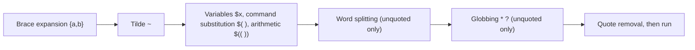

# Quoting, expansion and command substitution

Most bash bugs are quoting bugs. Learn the rule once.

## The rule

**Put double quotes around every variable and every `$(...)`**, unless you have a reason not to.

```bash
file="My Report.pdf"
rm $file        # WRONG: bash splits it into two words: "My" and "Report.pdf"
rm "$file"      # right: one argument
```

Without quotes, bash does **word splitting** (on spaces, tabs, newlines) and **globbing** (`*` turns into file names) on the variable's value. That's how a file name with a space, or an empty variable, turns a harmless script into a disaster.

## What bash does to a line, in order



Double quotes stop the last two steps but keep variables working. Single quotes stop everything.

| You write | You get |
|---|---|
| `"$HOME/x"` | `/home/sara/x` |
| `'$HOME/x'` | `$HOME/x` literally |
| `"Today: $(date +%F)"` | `Today: 2026-11-17` |
| `"$(( 7 * 6 ))"` | `42` |

## Command substitution and arithmetic

```bash
today=$(date +%F)
disk_used=$(df --output=pcent / | tail -1 | tr -d ' %')
files=$(ls /etc | wc -l)
echo "Root is ${disk_used}% full, /etc has $files entries"

(( disk_used > 85 )) && echo "Warning: disk almost full"
total=$(( 1024 * 1024 * 5 ))
```

Use `$(...)`, not old backticks: it nests and reads better.

## Default values

```bash
backup_dir="${BACKUP_DIR:-/var/backups}"   # use the environment variable, or this default
: "${API_KEY:?API_KEY must be set}"        # stop with an error if it's missing
```

## See exactly what bash runs

```bash
bash -x ./script.sh        # print every command after expansion, prefixed with +
set -x; ...; set +x        # the same for part of a script
```

## Optional videos

The lesson above is complete on its own. These go deeper, if you like learning by watching.

**freeCodeCamp Bash Scripting for Beginners: variables**

https://www.youtube.com/watch?v=tK9Oc6AEnR4&t=689&end=895
