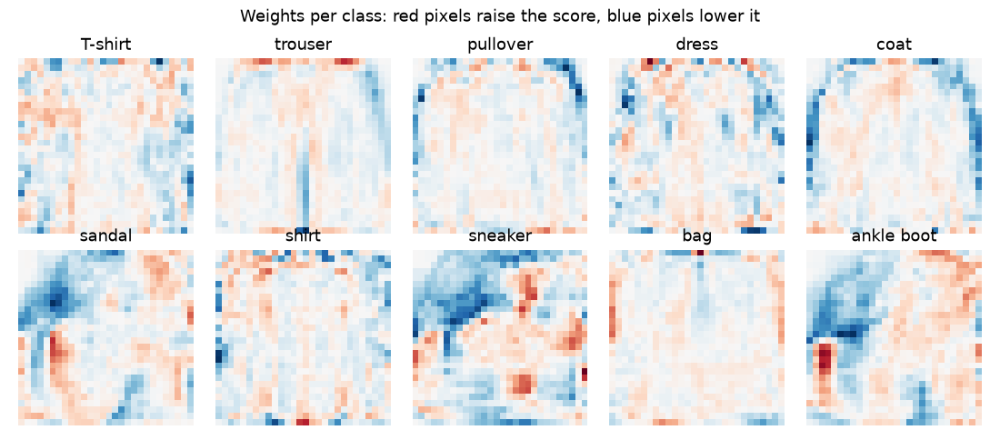
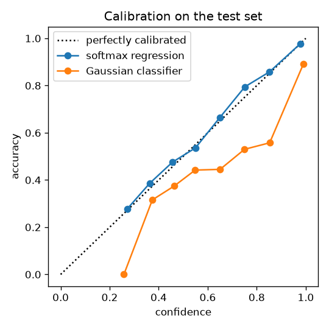

# Clothes classifier

A 10-class image classifier for Fashion-MNIST (70,000 photos of clothes) built in PyTorch with two models from
chapter 5: a generative Gaussian classifier and softmax regression. Includes a calibration check and a reject option.



## Results (10,000 test images, used once)

| model | validation accuracy | test accuracy | calibration error |
|---|---|---|---|
| Gaussian classifier (shared covariance) | 0.803 | | 0.123 |
| softmax regression (15 epochs, Adam) | 0.853 | **0.845** | **0.009** |

Reject option (softmax regression): refusing the 10% least confident images raises accuracy to 0.887; refusing 30%
raises it to 0.950. Hardest class: shirt (0.58), most often confused with T-shirt.



## Run it

```bash
pip install -r requirements.txt
python train.py          # fit both models, validation results
python evaluate.py       # test set: accuracy, confusions, calibration, reject option
python show_weights.py   # what each class's weights look for
```

## What I learned

- Discriminative models usually beat generative ones when the generative assumptions (Gaussian classes) are wrong.
- Accuracy isn't the whole story: calibrated probabilities make a reject option possible.
- A linear model can't tell a shirt from a T-shirt; that needs the non-linear features of deep networks.

Based on chapter 5 of *Deep Learning: Foundations and Concepts* (Bishop & Bishop, 2024).
