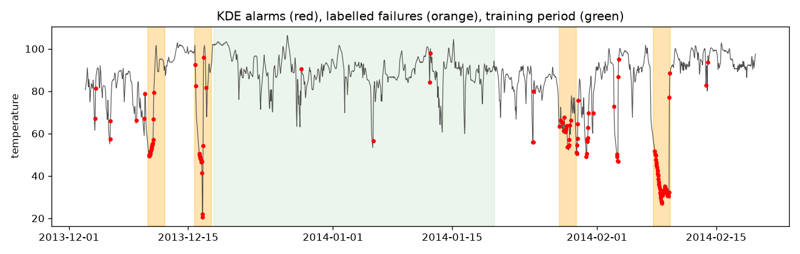

# Machine failure detector

Detects failures of a large industrial machine from its temperature sensor, by learning what "normal" looks like with
density models in PyTorch and raising an alarm when an hour is too unlikely. Data: the Numenta Anomaly Benchmark
(11 weeks of readings every 5 minutes, with four failure periods labelled by engineers).



## Results

Models are fitted on 33 days of normal operation only. Threshold: the alarm level that 0.5% of normal hours reach.

| model | failures found | false alarms per day |
|---|---|---|
| Gaussian, independent features | 2 / 4 | 0.13 |
| Gaussian, full covariance | 2 / 4 | 0.16 |
| kernel density estimate (width chosen on held-out hours) | 4 / 4 | 0.90 |

A single Gaussian only knows "far from the average". The kernel density estimate follows the real shape of normal
behaviour and catches all four failures, at the cost of more false alarms.

## Run it

```bash
pip install -r requirements.txt
python detect.py
```

## What I learned

- Anomaly detection is density estimation: unusual means low probability under a model of normal data.
- Model choice matters more than tuning: a Gaussian's single peak missed half the failures.
- The alarm threshold is a trade-off between missed failures and false alarms, and must be set on normal data only.

Based on chapter 3 of *Deep Learning: Foundations and Concepts* (Bishop & Bishop, 2024).
