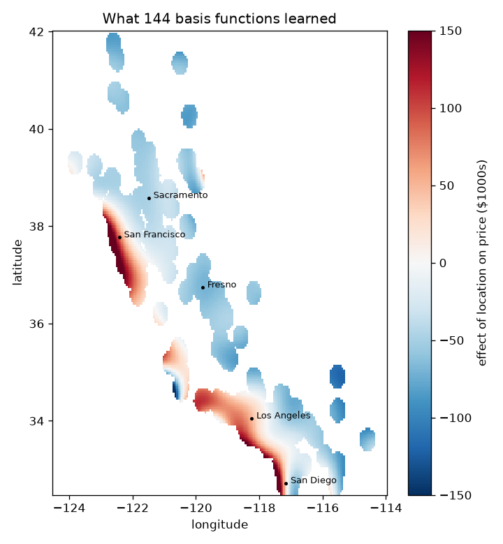

# California house prices

Predicts the median house value of 20,433 California districts (1990 census) with linear regression in PyTorch. The
key idea: 144 Gaussian basis functions over latitude and longitude let a linear model learn a price map of the state.



## Results

| model | RMSE |
|---|---|
| always guess the average (validation) | $115.2k |
| linear in 5 district features (validation) | $74.6k |
| + latitude and longitude as plain inputs (validation) | $68.3k |
| + 144 location basis functions, lambda = 0.01 (validation) | $61.4k |
| same, final model on the **test set** | **$61.0k** |

Without regularization (lambda = 0) the least-squares problem has no unique solution: 25 of the basis functions sit
over the ocean or empty desert and never touch a district.

The same model trained with mini-batch SGD and a cosine learning-rate schedule reaches $62.4k in 30 epochs.

## Run it

```bash
pip install -r requirements.txt
python train.py        # compare models, choose lambda, test once (saves model.pt)
python sgd.py          # train the same model with stochastic gradient descent
python price_map.py    # draw the learned location effect
```

## What I learned

- Basis functions make a linear model flexible while keeping an exact, closed-form solution.
- Regularization isn't only against over-fitting: it also makes an ill-posed problem solvable.
- Location alone is worth about +$96k in San Francisco and -$63k in Fresno, other things being equal.

Based on chapter 4 of *Deep Learning: Foundations and Concepts* (Bishop & Bishop, 2024).
