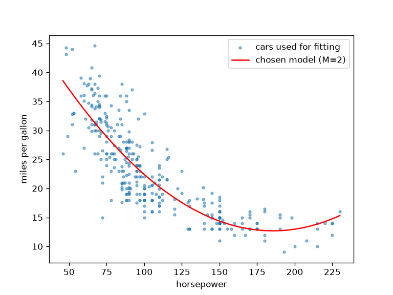

# Fuel-use predictor

Predicts a car's fuel use (miles per gallon) from its horsepower with polynomial regression in PyTorch,
and chooses the model's complexity honestly with 5-fold cross-validation.



## Results

| model | test RMSE (mpg) |
|---|---|
| always guess the average | 8.02 |
| polynomial, degree 2, lambda 0.1 (chosen by cross-validation) | 5.28 |

With only 20 training cars, a degree-8 polynomial reaches a cross-validation error of thousands of mpg:
a clear case of over-fitting, fixed by choosing a lower degree or a larger penalty.

## Run it

```bash
pip install -r requirements.txt
python select_model.py            # choose the degree and lambda, report the test error
python select_model.py --n-train 20
python predict.py 70 150
```

## What I learned

- Training error always prefers the most flexible model; only held-out data can choose.
- Cross-validation uses every car for both fitting and checking, which matters when data is scarce.
- When several models score the same, the simplest one is the safer choice.

Based on chapter 1 of *Deep Learning: Foundations and Concepts* (Bishop & Bishop, 2024).
