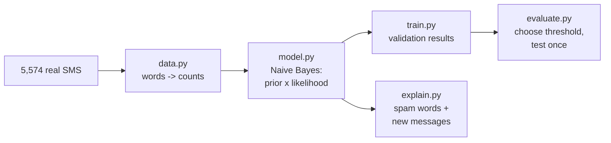

# Module project: build an SMS spam filter

Today's reading gave you Bayes' theorem and maximum likelihood. In this project you turn them into a working spam filter
for text messages, written from scratch in PyTorch, trained on 5,574 real messages. No machine-learning library does the
thinking for you: the whole model is about 20 lines.

A reference version is in this course's files (`projects/sms-spam-filter`). Build your own first.


## Attachments and data

- **Notebook**: `project-2-sms-spam-filter.ipynb`, attached to this lesson. It builds and runs the whole project; on the course's web page it opens in Google Colab.
- **Finished code**: the `projects/sms-spam-filter` folder in the course files, to check your work.
- **Data**: SMS Spam Collection (UCI). Source: [https://huggingface.co/datasets/ucirvine/sms_spam](https://huggingface.co/datasets/ucirvine/sms_spam) · about: [https://archive.ics.uci.edu/dataset/228/sms+spam+collection](https://archive.ics.uci.edu/dataset/228/sms+spam+collection) · licence: CC BY 4.0. `data.py` downloads it the first time you run it and keeps it in `data/`: `sms_spam.parquet`, 315 KB.
- **All datasets in one zip**: [bishop-datasets.zip](https://github.com/mahmoudyosrimahmoud13/inpace-library/releases/download/bishop-datasets-v1/bishop-datasets.zip). Unzip it and copy the files of `sms-spam` into your project's `data/` folder; `data.py` then skips the download. Useful offline, or if a source moves.

## What you'll build



The idea, straight from section 2.1: for a message, compare

```text
p(spam | message) ∝ p(message | spam) · p(spam)
p(ham  | message) ∝ p(message | ham)  · p(ham)
```

and normalize so the two add up to 1. ("Ham" is the usual name for a real, wanted message.) The only hard part is
`p(message | class)`. The **naive** assumption makes it easy: given the class, each word is drawn independently from
that class's word distribution, so the probability of a message is a product over its words. It's obviously false
(words come in phrases), and the filter still works very well. You'll see why at the end.

## Set up the project

```bash
mkdir sms-spam-filter && cd sms-spam-filter
python -m venv .venv && source .venv/bin/activate
pip install torch pandas pyarrow
git init
```

```text
sms-spam-filter/
    .gitignore
    README.md
    data.py
    evaluate.py
    explain.py
    model.py
    requirements.txt
    train.py
    data/        (downloaded the first time you run it)
```

<!-- skip -->
```text
torch
pandas
pyarrow
```

<!-- skip -->
```text
data/
__pycache__/
.venv/
```

## Step 1: from messages to word counts

The data comes from the Hugging Face hub as a parquet file (a compact table format, which is why we install `pyarrow`).
Each message becomes a row of word counts, a "bag of words": order is thrown away, only how often each word appears is
kept.

Two details protect you from fooling yourself:

- The vocabulary is built from **training** messages only. A word that appears only in the test set is simply ignored,
  exactly as it would be for a message arriving tomorrow.
- Words seen only once are dropped (`min_count=2`): they're mostly typos and phone numbers, and they can't be estimated
  from one example anyway.

<!-- skip -->
```python
# file: data.py
"""Download the SMS Spam Collection (5,574 real text messages) and split it."""
from pathlib import Path
import re
import pandas as pd
import torch

URL = "https://huggingface.co/api/datasets/ucirvine/sms_spam/parquet/plain_text/train/0.parquet"
CACHE = Path("data/sms_spam.parquet")


def load_table():
    if not CACHE.exists():
        CACHE.parent.mkdir(exist_ok=True)
        pd.read_parquet(URL).to_parquet(CACHE)
    return pd.read_parquet(CACHE)                # columns: sms (the text), label (1 = spam)


def tokenize(text):
    """Lower-case words and numbers. 'FREE entry!! Call 0800' -> ['free', 'entry', 'call', '0800']"""
    return re.findall(r"[a-z0-9£$']+", text.lower())


def load_splits(seed=0):
    table = load_table()
    order = torch.randperm(len(table), generator=torch.Generator().manual_seed(seed)).tolist()
    n_train, n_val = int(0.6 * len(order)), int(0.2 * len(order))
    pick = lambda idx: (table.sms.iloc[idx].tolist(), torch.tensor(table.label.iloc[idx].values))
    return pick(order[:n_train]), pick(order[n_train:n_train + n_val]), pick(order[n_train + n_val:])


class Vocabulary:
    """Maps words to columns. Only words seen at least `min_count` times in TRAINING messages are kept."""

    def __init__(self, texts, min_count=2):
        counts = {}
        for text in texts:
            for w in tokenize(text):
                counts[w] = counts.get(w, 0) + 1
        self.words = sorted(w for w, c in counts.items() if c >= min_count)
        self.index = {w: i for i, w in enumerate(self.words)}

    def counts(self, texts):
        """Bag of words: one row per message, one column per word, entry = how many times it appears."""
        X = torch.zeros(len(texts), len(self.words))
        for row, text in enumerate(texts):
            for w in tokenize(text):
                if w in self.index:
                    X[row, self.index[w]] += 1
        return X


if __name__ == "__main__":
    (train_x, train_t), (val_x, val_t), (test_x, test_t) = load_splits()
    print(f"train {len(train_x)}, val {len(val_x)}, test {len(test_x)} messages")
    print(f"spam share in training: {train_t.float().mean():.1%}")
    vocab = Vocabulary(train_x)
    print(f"vocabulary: {len(vocab.words)} words")
    spam = next(x for x, t in zip(train_x, train_t) if t == 1).strip()
    print("a spam message:", spam[:70])
    print("its tokens:    ", tokenize(spam)[:10])
```

```bash
python data.py
```

```output
train 3344, val 1114, test 1116 messages
spam share in training: 13.2%
vocabulary: 3182 words
a spam message: Ringtone Club: Get the UK singles chart on your mobile each week and c
its tokens:     ['ringtone', 'club', 'get', 'the', 'uk', 'singles', 'chart', 'on', 'your', 'mobile']
```

## Step 2: the model

`fit` estimates three things by counting:

- the **prior** `p(spam)`: the share of training messages that are spam;
- for each class, the **word distribution** `p(word | class)`: how often each word appears in that class, divided by the
  total number of words in that class;
- a **pseudo-count** `alpha` added to every word count first. Keep it in mind; step 3 shows why it's there.

`prob_spam` then applies Bayes' theorem. Multiplying hundreds of small probabilities would underflow to 0, so everything
happens in log space: products become sums, and `softmax` does the normalization (it is exactly
`exp(a_k) / Σ exp(a_j)`, computed safely).

<!-- skip -->
```python
# file: model.py
"""Naive Bayes, written with nothing but Bayes' theorem and counting (Bishop, sections 2.1 and 2.3).

p(spam | message) = p(message | spam) p(spam) / p(message)

'Naive' assumption: given the class, each word is drawn independently, so
log p(message | class) = sum over words of  count(word) * log p(word | class).
"""
import torch


class NaiveBayes:
    def __init__(self, alpha=1.0):
        self.alpha = alpha            # pseudo-count added to every word (alpha = 0 is plain maximum likelihood)

    def fit(self, X, t):
        """X: (messages, words) word counts. t: 0 = ham, 1 = spam."""
        self.log_prior = torch.log(torch.stack([(t == c).float().mean() for c in (0, 1)]))
        word_counts = torch.stack([X[t == c].sum(0) for c in (0, 1)]) + self.alpha        # (2, words)
        self.log_word = torch.log(word_counts / word_counts.sum(1, keepdim=True))          # log p(word | class)
        return self

    def log_joint(self, X):
        """log p(message, class) for both classes: shape (messages, 2)."""
        return X @ self.log_word.T + self.log_prior

    def prob_spam(self, X):
        """Bayes' theorem: normalize the joint over the two classes (done safely in log space)."""
        return torch.softmax(self.log_joint(X), dim=1)[:, 1]
```

## Step 3: train it, and break it

<!-- skip -->
```python
# file: train.py
"""Train the spam filter and measure it on the validation set."""
import argparse
import torch
from data import load_splits, Vocabulary
from model import NaiveBayes


def report(name, p_spam, t, threshold=0.5):
    guess = (p_spam > threshold).long()
    tp = ((guess == 1) & (t == 1)).sum().item()
    fp = ((guess == 1) & (t == 0)).sum().item()
    fn = ((guess == 0) & (t == 1)).sum().item()
    acc = (guess == t).float().mean().item()
    undefined = torch.isnan(p_spam).sum().item()
    if undefined:
        print(f"  warning: p(spam) is undefined (nan) for {undefined} of {len(t)} messages")
    print(f"{name}: accuracy {acc:.3f} | spam caught {tp}/{tp + fn} | real messages lost {fp}/{(t == 0).sum().item()}")


if __name__ == "__main__":
    ap = argparse.ArgumentParser()
    ap.add_argument("--alpha", type=float, default=1.0)
    args = ap.parse_args()
    (train_x, train_t), (val_x, val_t), _ = load_splits()
    vocab = Vocabulary(train_x)
    X_train, X_val = vocab.counts(train_x), vocab.counts(val_x)

    baseline = torch.zeros_like(val_t)              # "nothing is spam"
    print(f"baseline (call everything real): accuracy {(baseline == val_t).float().mean():.3f}")
    model = NaiveBayes(alpha=args.alpha).fit(X_train, train_t)
    report(f"naive Bayes, alpha={args.alpha:g}", model.prob_spam(X_val), val_t)
```

```bash
python train.py
```

```output
baseline (call everything real): accuracy 0.866
naive Bayes, alpha=1: accuracy 0.983 | spam caught 136/149 | real messages lost 6/965
```

The baseline matters: since 87% of messages are real, a "filter" that lets everything through already scores 0.866. The
Naive Bayes filter reaches 0.983, catching 136 of 149 spams.

Now set `alpha` to 0, which gives the plain maximum-likelihood estimates of section 2.3:

```bash
python train.py --alpha 0
```

```output
baseline (call everything real): accuracy 0.866
  warning: p(spam) is undefined (nan) for 1114 of 1114 messages
naive Bayes, alpha=0: accuracy 0.866 | spam caught 0/149 | real messages lost 0/965
```

Every single prediction is undefined. Here's why. Maximum likelihood says that a word never seen in spam during training
has `p(word | spam) = 0`. Its log is `-∞`. In the matrix product `X @ log_word.T`, a message that doesn't contain that word
multiplies its count 0 by `-∞`, and in floating point `0 × (-∞)` is `nan`. Every message is poisoned by some word it
doesn't even contain.

The deeper problem remains even if you code around the `nan`: a message containing **one** word never seen in spam would
get `p(spam) = 0` exactly, whatever else it says. This is the over-fitting of maximum likelihood from section 2.3 in its
most extreme form: the estimate trusts a finite sample completely. Adding a pseudo-count of 1 to every word ("Laplace
smoothing") says "nothing is impossible, just rare". You'll meet the principled version of this idea, a prior over the
parameters, in later chapters.

## Step 4: choose the threshold, then test once

A spam filter has two kinds of mistakes, and they don't cost the same. A spam in your inbox is annoying. A real message
in the spam folder (maybe from your bank or a job offer) can be costly. So instead of the default threshold of 0.5, we
choose the threshold on the validation set with a rule: **at most 1 real message in 500 may be lost**, and catch as much
spam as possible under that rule. Then the test set is used once.

<!-- skip -->
```python
# file: evaluate.py
"""Choose the decision threshold on the validation set, then measure the final filter ONCE on the test set.

Losing a real message is much worse than letting a spam through, so we demand that at most
1 in 500 real messages is sent to the spam folder, and catch as much spam as possible under that rule.
"""
import torch
from data import load_splits, Vocabulary
from model import NaiveBayes
from train import report

(train_x, train_t), (val_x, val_t), (test_x, test_t) = load_splits()
vocab = Vocabulary(train_x)
model = NaiveBayes(alpha=1.0).fit(vocab.counts(train_x), train_t)

p_val = model.prob_spam(vocab.counts(val_x))
max_lost = (val_t == 0).sum().item() // 500
for threshold in [0.5, 0.9, 0.99, 0.999, 0.9999]:
    lost = ((p_val > threshold) & (val_t == 0)).sum().item()
    caught = ((p_val > threshold) & (val_t == 1)).float().sum() / (val_t == 1).sum()
    print(f"threshold {threshold:<7g}: real messages lost {lost}, spam caught {caught:.1%}")
    if lost <= max_lost:
        break
print(f"\nchosen threshold: {threshold} (at most {max_lost} lost real messages on validation)\n")

report("TEST, threshold 0.5    ", model.prob_spam(vocab.counts(test_x)), test_t)
report(f"TEST, threshold {threshold:<7g}", model.prob_spam(vocab.counts(test_x)), test_t, threshold)
```

```bash
python evaluate.py
```

```output
threshold 0.5    : real messages lost 6, spam caught 91.3%
threshold 0.9    : real messages lost 1, spam caught 87.9%

chosen threshold: 0.9 (at most 1 lost real messages on validation)

TEST, threshold 0.5    : accuracy 0.984 | spam caught 147/157 | real messages lost 8/959
TEST, threshold 0.9    : accuracy 0.988 | spam caught 146/157 | real messages lost 2/959
```

On the test set, raising the threshold to 0.9 cut the lost real messages from 8 to 2, and cost only one extra spam getting
through. Chapter 5 turns this idea into a general method: decision theory with a loss matrix.

## Step 5: look inside

A model you can explain is a model you can trust (and talk about in an interview):

<!-- skip -->
```python
# file: explain.py
"""Which words give spam away, and what does the filter think of a few new messages?"""
import sys
import torch
from data import load_splits, Vocabulary
from model import NaiveBayes

(train_x, train_t), _, _ = load_splits()
vocab = Vocabulary(train_x)
model = NaiveBayes(alpha=1.0).fit(vocab.counts(train_x), train_t)

# log p(word | spam) - log p(word | ham): how many times more likely the word is in spam (in log units)
ratio = model.log_word[1] - model.log_word[0]
print("most spam-like words:", ", ".join(vocab.words[i] for i in ratio.argsort(descending=True)[:12]))
print("most real-like words:", ", ".join(vocab.words[i] for i in ratio.argsort()[:12]))

messages = sys.argv[1:] or ["Are we still on for dinner tonight?",
                            "URGENT! You have won a 1 week FREE membership. Call now to claim your prize",
                            "Call me when you get this"]
print()
for text, p in zip(messages, model.prob_spam(vocab.counts(messages))):
    print(f"p(spam) = {p:.4f}  {text}")
```

```bash
python explain.py
```

```output
most spam-like words: claim, 150p, tone, prize, won, 18, www, cs, guaranteed, £1, awarded, 150ppm
most real-like words: lt, gt, got, come, he, but, i'll, lor, later, da, she, my

p(spam) = 0.0001  Are we still on for dinner tonight?
p(spam) = 1.0000  URGENT! You have won a 1 week FREE membership. Call now to claim your prize
p(spam) = 0.0074  Call me when you get this
```

The spam words are exactly what you'd expect: prizes, claims, premium-rate prices like 150p. The "real" side contains
`lt` and `gt`, which come from `&lt;#&gt;` markers in the raw data where numbers were hidden. Noise like this is normal in
real data sets, and finding it is part of the job.

Why does a "naive" model work so well? Because a classifier only needs the **right side of the threshold**, not the right
probability. The independence assumption makes the probabilities far too confident (notice the 1.0000), but the ranking
of spam above ham survives.

## Step 6: write the README and publish

<!-- skip -->
````markdown
# SMS spam filter

A Naive Bayes spam filter written from scratch in PyTorch: Bayes' theorem, word counts and nothing else.
Trained and tested on the SMS Spam Collection (5,574 real text messages, 13% spam).

## Results (test set, 1,116 messages, used once)

| filter | accuracy | spam caught | real messages lost |
|---|---|---|---|
| call everything real | 0.859 | 0 / 157 | 0 / 959 |
| Naive Bayes, threshold 0.5 | 0.984 | 147 / 157 | 8 / 959 |
| Naive Bayes, threshold 0.9 (chosen on validation) | 0.988 | 146 / 157 | 2 / 959 |

Raising the threshold cut lost real messages from 8 to 2 at the cost of 1 spam.

Most spam-like words: claim, 150p, tone, prize, won, www, guaranteed, awarded.

## Run it

```bash
pip install -r requirements.txt
python train.py               # validation results
python train.py --alpha 0     # see why plain maximum likelihood fails
python evaluate.py            # choose the threshold, then test once
python explain.py "Your text here"
```

## What I learned

- A classifier can be built directly from Bayes' theorem: prior times likelihood, normalized.
- Maximum likelihood gives probability zero to any word never seen in a class, and one such word then decides everything.
  Adding a pseudo-count (alpha = 1) fixes it.
- Accuracy alone hides what matters: the threshold should reflect that losing a real message costs more than missing a spam.

Based on chapter 2 of *Deep Learning: Foundations and Concepts* (Bishop & Bishop, 2024).
````

```bash
git add .
git commit -m "Naive Bayes SMS spam filter from scratch"
git branch -M main
git remote add origin git@github.com:YOUR-USERNAME/sms-spam-filter.git
git push -u origin main
```

## Make it yours

- **Clean the data.** Replace `&lt;#&gt;` with a token like `<num>` before tokenizing. Does it change the top words or
  the test results?
- **Bernoulli instead of counts.** Use "does the word appear?" (0/1) instead of how often. Which works better on short
  messages?
- **A tiny web app.** Wrap `explain.py` in a 20-line Gradio or Streamlit page where anyone can paste a message.
- **Your own language.** Collect 200 messages from your own phone (labelled by you, with private details removed) and see
  how the filter does on them. Arabic text needs a different tokenizer: try splitting on spaces only.

## On your CV

> **SMS spam filter** (PyTorch): Naive Bayes classifier implemented from scratch on 5,574 real messages; 98.8% test
> accuracy, with a cost-aware threshold that reduced lost legitimate messages from 8 to 2 per 959.
> github.com/YOUR-USERNAME/sms-spam-filter

## Check yourself

- [ ] You can derive `prob_spam` from Bayes' theorem on paper.
- [ ] You can explain why `alpha = 0` fails, in two sentences.
- [ ] The vocabulary uses training messages only.
- [ ] The threshold was chosen on validation data, and the test set was used once.
