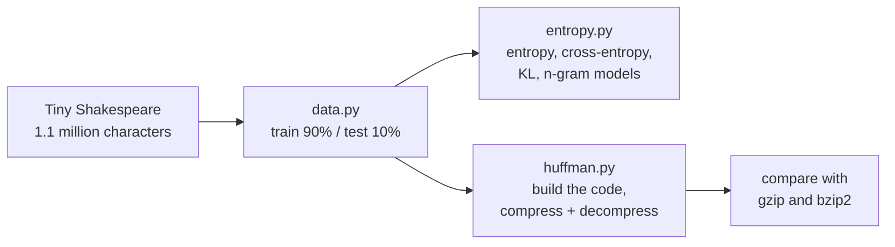

# Module project: build a text compressor

Information theory can sound abstract: entropy, cross-entropy, KL divergence. In this project you make every one of them
a number you measured yourself on a million characters of Shakespeare, and you build a real compressor that turns the
text into bits and back again. At the end you'll compare it with gzip and bzip2, and understand why they win.

This lesson comes with a notebook (attached above) that builds and runs the whole project, and the reference code is in
the course files under `projects/text-compressor`. Build your own first.


## Attachments and data

- **Notebook**: `project-3-text-compressor.ipynb`, attached to this lesson. It builds and runs the whole project; on the course's web page it opens in Google Colab.
- **Finished code**: the `projects/text-compressor` folder in the course files, to check your work.
- **Data**: Tiny Shakespeare (from Andrej Karpathy's char-rnn). Source: [https://raw.githubusercontent.com/karpathy/char-rnn/master/data/tinyshakespeare/input.txt](https://raw.githubusercontent.com/karpathy/char-rnn/master/data/tinyshakespeare/input.txt) · about: [https://github.com/karpathy/char-rnn](https://github.com/karpathy/char-rnn) · licence: public-domain text (Shakespeare); repository MIT. `data.py` downloads it the first time you run it and keeps it in `data/`: `shakespeare.txt`, 1.1 MB.
- **All datasets in one zip**: [bishop-datasets.zip](https://github.com/mahmoudyosrimahmoud13/inpace-library/releases/download/bishop-datasets-v1/bishop-datasets.zip). Unzip it and copy the files of `tiny-shakespeare` into your project's `data/` folder; `data.py` then skips the download. Useful offline, or if a source moves.

## What you'll build



The question behind it all, from section 2.5: **how many bits does one character need, on average?** A plain text file
uses 8 (one byte). The answer depends on how well you can predict the next character, and that link between prediction
and compression is the main idea of this project.

## Set up the project

```bash
mkdir text-compressor && cd text-compressor
python -m venv .venv && source .venv/bin/activate
pip install torch
git init
```

```text
text-compressor/
    .gitignore
    README.md
    data.py
    entropy.py
    huffman.py
    requirements.txt
    data/        (downloaded the first time you run it)
```

<!-- skip -->
```text
torch
```

<!-- skip -->
```text
data/
__pycache__/
.venv/
```

## Step 1: the text

We keep the first 90% of the plays for "training" (counting frequencies) and the last 10% as a test text that our
models have never seen.

<!-- skip -->
```python
# file: data.py
"""Download Tiny Shakespeare (about 1.1 million characters) and split it into a training and a test part."""
from pathlib import Path
from urllib.request import urlopen

URL = "https://raw.githubusercontent.com/karpathy/char-rnn/master/data/tinyshakespeare/input.txt"
CACHE = Path("data/shakespeare.txt")


def load_text():
    if not CACHE.exists():
        CACHE.parent.mkdir(exist_ok=True)
        CACHE.write_bytes(urlopen(URL).read())
    return CACHE.read_text(encoding="utf-8")


def load_splits():
    text = load_text()
    cut = int(0.9 * len(text))
    return text[:cut], text[cut:]       # the last 10% of the plays is the test text


if __name__ == "__main__":
    train, test = load_splits()
    print(f"training text: {len(train):,} characters, test text: {len(test):,} characters")
    print(f"alphabet: {len(set(train))} different characters")
    print(repr(test[:80]))
```

```bash
python data.py
```

```output
training text: 1,003,854 characters, test text: 111,540 characters
alphabet: 65 different characters
'?\n\nGREMIO:\nGood morrow, neighbour Baptista.\n\nBAPTISTA:\nGood morrow, neighbour Gr'
```

## Step 2: measure the information

`entropy.py` measures, in order:

1. The **uniform** code: 65 possible characters need `log2 65 = 6.02` bits each if you treat them as equally likely.
2. The **entropy** of the character distribution, `H = -Σ p log2 p` (equation 2.81): the minimum
   average bits for characters drawn independently from `p`.
3. The **cross-entropy** on the test text: the average of `-log2 p(c)` over the test characters, where `p` comes from
   training. This is the cost of using our model on new data.
4. The **KL divergence** between the test text's own distribution and the model (section 2.5.5): the bits wasted
   because the model isn't exactly right. We check numerically that cross-entropy = entropy + KL.
5. **Bigram** and **trigram** models, `p(next | previous one or two characters)`: their cross-entropy is the
   conditional entropy of section 2.5.6, estimated on new text.

<!-- skip -->
```python
# file: entropy.py
"""How many bits does one character of Shakespeare really need? (Bishop, section 2.5)"""
import torch
from data import load_splits

train, test = load_splits()
chars = sorted(set(train) | set(test))
index = {c: i for i, c in enumerate(chars)}
encode = lambda s: torch.tensor([index[c] for c in s])
x_train, x_test = encode(train), encode(test)
V = len(chars)


def entropy_bits(p):
    p = p[p > 0]
    return -(p * torch.log2(p)).sum().item()


# 1. Unigram model: every character drawn independently from p(c)
counts = torch.bincount(x_train, minlength=V).float() + 1            # +1: no character is impossible
p = counts / counts.sum()
print(f"{'uniform over ' + str(V) + ' characters':34s} {torch.log2(torch.tensor(float(V))):.3f} bits/char")
print(f"{'entropy of the unigram model':34s} {entropy_bits(p):.3f} bits/char")

# Cross-entropy: the average number of bits the TRAINING model needs for the TEST text
cross_uni = -torch.log2(p[x_test]).mean().item()
print(f"{'unigram cross-entropy on test':34s} {cross_uni:.3f} bits/char")

# KL divergence between the test text's own distribution and the model: the bits wasted by using the wrong one
q = torch.bincount(x_test, minlength=V).float() / len(x_test)
kl = (q[q > 0] * torch.log2(q[q > 0] / p[q > 0])).sum().item()
print(f"{'KL(test || train model)':34s} {kl:.3f} bits/char   (= cross-entropy - entropy of test text {cross_uni - entropy_bits(q):.3f})")

# 2. Bigram model: p(next char | previous char). Conditional entropy H[next | previous] (section 2.5.6)
pair = torch.zeros(V, V)
pair.index_put_((x_train[:-1], x_train[1:]), torch.ones(len(x_train) - 1), accumulate=True)
pair += 0.1                                                         # a small pseudo-count
cond = pair / pair.sum(1, keepdim=True)
cross_bi = -torch.log2(cond[x_test[:-1], x_test[1:]]).mean().item()
print(f"{'bigram cross-entropy on test':34s} {cross_bi:.3f} bits/char")

# 3. Trigram model: p(next | two previous characters)
tri = torch.zeros(V * V, V)
tri.index_put_((x_train[:-2] * V + x_train[1:-1], x_train[2:]), torch.ones(len(x_train) - 2), accumulate=True)
tri += 0.01
cond3 = tri / tri.sum(1, keepdim=True)
cross_tri = -torch.log2(cond3[x_test[:-2] * V + x_test[1:-1], x_test[2:]]).mean().item()
print(f"{'trigram cross-entropy on test':34s} {cross_tri:.3f} bits/char")
```

```bash
python entropy.py
```

```output
uniform over 65 characters         6.022 bits/char
entropy of the unigram model       4.774 bits/char
unigram cross-entropy on test      4.829 bits/char
KL(test || train model)            0.014 bits/char   (= cross-entropy - entropy of test text 0.014)
bigram cross-entropy on test       3.583 bits/char
trigram cross-entropy on test      2.980 bits/char
```

Read the numbers from the top:

- Knowing that "e" is common and "Z" is rare saves more than a bit per character (6.02 → 4.77).
- The KL divergence is tiny (0.014 bits): the last 10% of the plays uses characters in the same proportions as the rest.
- Context helps far more: knowing **one** previous character drops the cost to 3.58 bits, two characters to 2.98. After
  "q", the next letter is almost certainly "u"; after a newline, probably a capital letter.

The pseudo-counts (`+ 1`, `+ 0.1`, `+ 0.01`) play the same role as in the spam filter: a pair of characters never seen in
training must not get probability zero, or the cross-entropy would be infinite.

## Step 3: a real compressor

Entropy is a **limit**. Shannon's noiseless coding theorem (section 2.5.1) says no code can average fewer bits than the
entropy. A Huffman code comes within one bit of it, and it's simple to build: keep joining the two rarest groups of
characters, adding one bit to each of their codes, until one group is left. Frequent characters end up with short codes.

<!-- skip -->
```python
# file: huffman.py
"""A real compressor: a Huffman code built from the training text's character frequencies.
Shannon's theorem (section 2.5.1) says no code can average fewer bits than the entropy; Huffman gets within 1 bit."""
import bz2
import gzip
import heapq
import torch
from data import load_splits


def huffman_code(freqs):
    """freqs: {char: count}. Returns {char: '0101...'} with frequent characters getting short codes."""
    heap = [(f, i, {c: ""}) for i, (c, f) in enumerate(freqs.items())]
    heapq.heapify(heap)
    tie = len(heap)
    while len(heap) > 1:
        f1, _, left = heapq.heappop(heap)          # the two rarest groups ...
        f2, _, right = heapq.heappop(heap)
        merged = {c: "0" + code for c, code in left.items()} | {c: "1" + code for c, code in right.items()}
        heapq.heappush(heap, (f1 + f2, tie, merged))  # ... are joined, adding one bit to each of their codes
        tie += 1
    return heap[0][2]


def encode(text, code):
    return "".join(code[c] for c in text)


def decode(bits, code):
    back, out, current = {v: k for k, v in code.items()}, [], ""
    for b in bits:
        current += b
        if current in back:                         # no code is the start of another, so this is unambiguous
            out.append(back[current])
            current = ""
    return "".join(out)


if __name__ == "__main__":
    train, test = load_splits()
    alphabet = sorted(set(train) | set(test))
    freqs = {c: train.count(c) + 1 for c in alphabet}
    code = huffman_code(freqs)
    for c in [" ", "e", "t", "z", "Z", "&"]:
        print(f"{c!r:5s} appears {freqs[c] - 1:7,d} times -> code {code[c]}")

    bits = encode(test, code)
    assert decode(bits, code) == test, "decoding must give back the exact text"
    print(f"\ndecoded the test text back perfectly: {len(test):,} characters")
    counts = torch.tensor([freqs[c] for c in alphabet], dtype=torch.float)
    p = counts / counts.sum()
    entropy = -(p * torch.log2(p)).sum().item()
    print(f"{'entropy of the character distribution':40s} {entropy:.3f} bits/char")
    print(f"{'Huffman code on the test text':40s} {len(bits) / len(test):.3f} bits/char")
    raw = test.encode()
    print(f"{'gzip':40s} {8 * len(gzip.compress(raw, 9)) / len(test):.3f} bits/char")
    print(f"{'bzip2':40s} {8 * len(bz2.compress(raw, 9)) / len(test):.3f} bits/char")
    print(f"{'plain text file (1 byte per char)':40s} {8.0:.3f} bits/char")
```

```bash
python huffman.py
```

```output
' '   appears 153,275 times -> code 110
'e'   appears  85,496 times -> code 1111
't'   appears  60,384 times -> code 1000
'z'   appears     320 times -> code 101100110101
'Z'   appears     161 times -> code 1001110110111
'&'   appears       3 times -> code 1001110110110001

decoded the test text back perfectly: 111,540 characters
entropy of the character distribution    4.774 bits/char
Huffman code on the test text            4.868 bits/char
gzip                                     3.191 bits/char
bzip2                                    2.635 bits/char
plain text file (1 byte per char)        8.000 bits/char
```

Look at the codes first: the space gets 3 bits, "e" 4, and "&" (seen 3 times) 16. The `assert` checks that decoding gives
back the exact text: always test a compressor that way.

The Huffman code reaches 4.87 bits per character, just above the 4.77 limit for a character-by-character code. Then gzip
and bzip2 beat it easily. Have they broken Shannon's limit? No: they use **context**, like the bigram and trigram models.
The 4.77 bits is the limit only for codes that ignore context. The trigram model's 2.98 bits shows how much more is
available, and bzip2 (2.64) captures even longer patterns.

This is the deepest lesson of the project: **a better predictor is a better compressor.** The cross-entropy in bits per
character is the standard way language models are compared. In chapter 12 you'll train a small transformer on this same
text and watch it go well below these numbers.

## Step 4: write the README and publish

<!-- skip -->
````markdown
# Shakespeare text compressor

Measures how much information one character of Shakespeare carries, with entropy, cross-entropy and KL divergence,
and builds a working Huffman compressor in Python and PyTorch. Compared with gzip and bzip2.

## Results (test text: the last 111,540 characters of the plays)

| method | bits per character |
|---|---|
| plain text file | 8.000 |
| uniform code over 65 characters | 6.022 |
| Huffman code (from training frequencies) | 4.868 |
| gzip -9 | 3.191 |
| bigram model, cross-entropy | 3.583 |
| bzip2 -9 | 2.635 |
| trigram model, cross-entropy | 2.980 |

The Huffman code sits just above the character entropy (4.774), as Shannon's theorem predicts. Real compressors win
because they use context: a model that knows the previous two characters needs only 2.98 bits per character.

## Run it

```bash
pip install -r requirements.txt
python entropy.py     # entropy, cross-entropy, KL, n-gram models
python huffman.py     # build the code, compress, decompress, compare with gzip and bzip2
```

## What I learned

- Entropy is a hard lower limit on the average code length for a given model of the data.
- Cross-entropy measures a model on new data; the gap to the data's own entropy is the KL divergence.
- Better predictions are better compression: the same idea scores today's language models (bits per character).

Based on chapter 2 of *Deep Learning: Foundations and Concepts* (Bishop & Bishop, 2024).
````

```bash
git add .
git commit -m "Shakespeare entropy measurements and Huffman compressor"
git branch -M main
git remote add origin git@github.com:YOUR-USERNAME/text-compressor.git
git push -u origin main
```

## Make it yours

- **Pack the bits.** `encode` returns a string of "0" and "1" characters, which is 8 times bigger than the real bits.
  Pack them into bytes (8 per byte), write a `.huff` file, and read it back. Is the file really about 61% of the original?
- **Arithmetic coding.** Huffman wastes up to one bit per character. Arithmetic coding doesn't, and it can use the
  trigram model's predictions. Can you get close to 2.98 bits per character and beat gzip?
- **Another language.** Run `entropy.py` on Arabic text (for example a Wikipedia article saved as UTF-8). How do the
  numbers compare with English? Why does the alphabet size matter?
- **Words instead of characters.** Treat each word as one symbol. What's the entropy per word, and per character?

## On your CV

> **Text compressor** (Python, PyTorch): measured entropy, cross-entropy and KL divergence of 1.1M characters of
> Shakespeare with unigram to trigram models; implemented a Huffman encoder/decoder (4.87 bits/char, 39% smaller than
> raw text) and benchmarked it against gzip and bzip2. github.com/YOUR-USERNAME/text-compressor

## Check yourself

- [ ] Decoding gives back the exact test text.
- [ ] You can explain why gzip doesn't break Shannon's theorem.
- [ ] You can say what the KL divergence measures, using your own numbers.
- [ ] Your README has the results table.
