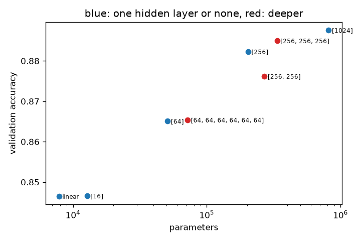

# Fashion-MNIST: how wide, how deep?

A study of multilayer perceptrons on Fashion-MNIST in PyTorch: eight architectures, from no hidden layer to six,
trained the same way and compared, then the best one tested against a linear model class by class.



## Results

| hidden layers | parameters | validation accuracy (8 epochs) |
|---|---|---|
| none (softmax regression) | 7,850 | 0.846 |
| [64] | 50,890 | 0.864 |
| [256] | 203,530 | 0.882 |
| [1024] | 814,090 | 0.886 |
| [256, 256, 256] | 335,114 | 0.884 |
| [64] x 6 | 71,690 | 0.865 |

Final model, one hidden layer of 1024 units, 15 epochs: **0.885 test accuracy** (linear: 0.845).
Shirts improved most (0.58 to 0.73), coats 0.74 to 0.87; pullovers got worse (0.74 to 0.66).

## Run it

```bash
pip install -r requirements.txt
python sweep.py                                  # compare 8 architectures
python train.py --hidden 1024 --epochs 15        # train the final model
python evaluate.py                               # test it, class by class
```

## What I learned

- A hidden layer learns its own features, which is what a linear model on pixels can't do.
- Width helped more than depth on this task; depth isn't free, and narrow deep networks trained worse.
- Overall accuracy can improve while one class gets worse: always look at per-class results.

Based on chapter 6 of *Deep Learning: Foundations and Concepts* (Bishop & Bishop, 2024).
