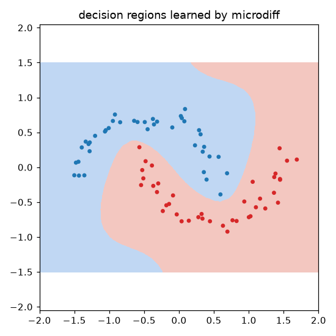
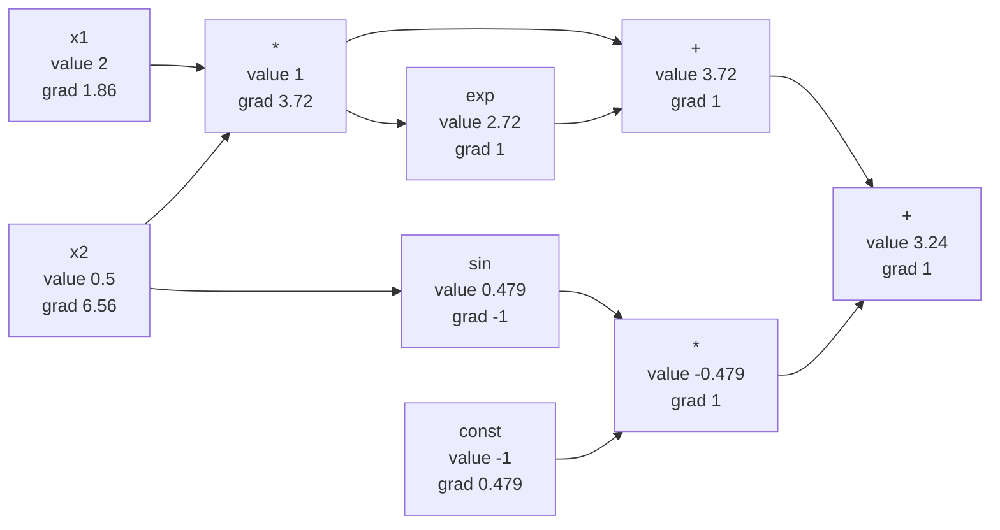

# microdiff

A small automatic-differentiation engine in pure Python, with both modes of section 8.2: reverse mode (a computation
graph with `backward()`, like PyTorch) and forward mode (dual numbers). It draws its own computation graphs as Mermaid
diagrams, and trains a small neural network.



## Results

| check | result |
|---|---|
| book example f = x1 x2 + exp(x1 x2) - sin(x2): reverse mode, forward mode, PyTorch | identical to 6 decimals |
| gradients of a 105-parameter network vs PyTorch (float64) | largest difference 6e-16 |
| two-moons classification, 2-8-8-1 tanh network, 150 steps | 100% training accuracy |

## The computation graph of the example



## Run it

```bash
pip install -r requirements.txt
python demo.py     # the book's example, three ways, and its graph
python train.py    # a neural network made of Value objects (about 30 seconds)
```

## What I learned

- Reverse mode gets all the derivatives of one output in a single backward pass, which is why it trains networks;
  forward mode needs one pass per input.
- Each operation only needs to know its own local derivative; the chain rule does the rest.
- Working one number at a time is very slow in Python. Real frameworks apply the same idea to whole tensors.

Based on section 8.2 of *Deep Learning: Foundations and Concepts* (Bishop & Bishop, 2024).
