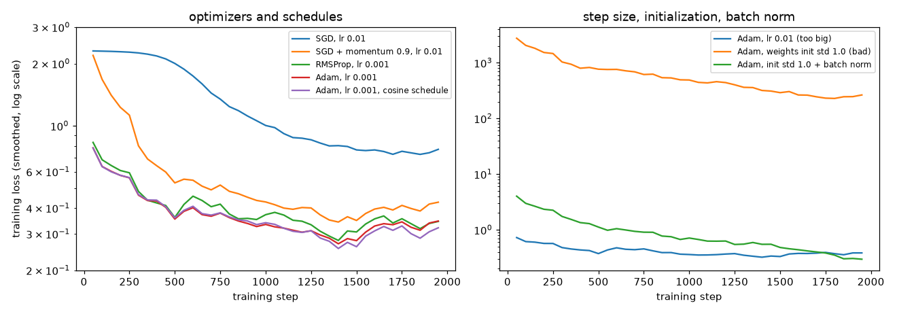

# Optimizer benchmark

A controlled benchmark of how neural networks are trained: the same 3-hidden-layer network on Fashion-MNIST, the same
5-epoch budget, and eight training setups (optimizers, learning-rate schedules, initialization, batch normalization),
in PyTorch.



## Results

| setup | final training loss | validation accuracy |
|---|---|---|
| SGD, lr 0.01 | 0.749 | 0.741 |
| SGD + momentum 0.9 | 0.409 | 0.857 |
| RMSProp, lr 0.001 | 0.337 | 0.860 |
| Adam, lr 0.001 | 0.343 | 0.874 |
| Adam + cosine schedule | **0.317** | **0.878** |
| Adam, lr 0.01 (too big) | 0.401 | 0.853 |
| Adam, weights initialized with std 1.0 | 242.8 | 0.804 |
| same bad initialization + batch norm | 0.347 | 0.839 |

## Run it

```bash
pip install -r requirements.txt
python benchmark.py   # about 3 minutes on a laptop CPU
python plot.py
```

## What I learned

- Plain SGD with a fixed step is slow; momentum alone closes most of the gap to Adam.
- A cosine learning-rate schedule gave the best result for free.
- A bad initialization can make the loss explode by a factor of a thousand; batch normalization rescued it.

Based on chapter 7 of *Deep Learning: Foundations and Concepts* (Bishop & Bishop, 2024).
