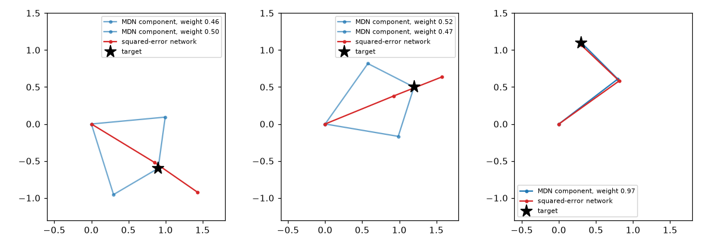

# Robot arm inverse kinematics with a mixture density network

Learns which joint angles put a two-link robot arm's hand at a given point. The problem has two answers for most
points (elbow up or elbow down), so a network trained with squared error averages them into an arm that misses. A
mixture density network (PyTorch) learns the whole distribution of answers instead.



## Results (2,000 new target points; arm reach 1.7)

| model | median miss | 90th percentile miss |
|---|---|---|
| network trained with squared error | 0.120 | 0.801 |
| mixture density network, 3 components | **0.003** | **0.012** |

## Run it

```bash
pip install -r requirements.txt
python train.py    # train both networks (about a minute on a laptop)
python show.py     # draw their arms for three targets
```

## What I learned

- Squared error assumes one Gaussian peak; when the true answer has two, the network predicts their average, which can
  be no answer at all.
- An MDN outputs mixing weights, means and widths, and is trained by the mixture's negative log likelihood.
- Measure what matters: here, where the hand actually ends up, not the error in the angles.

Based on section 6.5 of *Deep Learning: Foundations and Concepts* (Bishop & Bishop, 2024).
