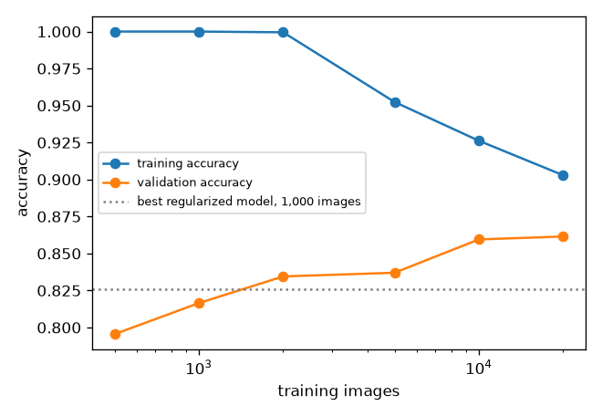

# Regularization with little data: what actually helps?

An ablation study in PyTorch: a 2-hidden-layer network trained on only 1,000 Fashion-MNIST images, with each
regularizer from chapter 9 switched on alone, then all together, plus model averaging, a convolutional network, and a
learning curve showing what more data would give.



## Results

| setup (1,000 training images) | validation accuracy |
|---|---|
| no regularization | 0.821 (3 other seeds: 0.814 to 0.818) |
| weight decay 0.1 | 0.821 |
| dropout 0.5 | 0.813 |
| early stopping | 0.823 |
| data augmentation (2-pixel shifts) | 0.785 |
| all of the above | 0.803 |
| small CNN | 0.824 |
| average of 5 dropout networks | **0.826** |

Test set (used once): no regularization 0.808, ensemble 0.817, small CNN 0.823.
For comparison, the same network trained on 2,000 images reaches 0.835 validation accuracy, and on 10,000, 0.859.

## Run it

```bash
pip install -r requirements.txt
python study.py            # about 3 minutes
python learning_curve.py   # about 1 minute
```

## What I learned

- Regularizers are not free improvements: on this problem none of them gained more than about 1%, which is close to
  the seed-to-seed noise.
- An augmentation must match the real data: Fashion-MNIST images are centred, so random shifts made the task harder.
- More data beat every trick. Measuring that with a learning curve tells you where to spend effort.

Based on chapter 9 of *Deep Learning: Foundations and Concepts* (Bishop & Bishop, 2024).
