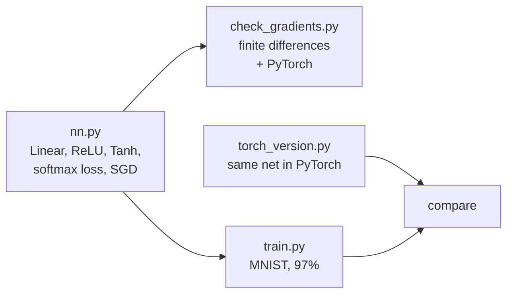

# Module project: write your own neural network library

Today you read how backpropagation works. Now you'll implement it: a small neural-network library in plain NumPy where
**you** write every gradient, test them the way professionals do, and train a network that reads handwritten digits
with over 97% accuracy. Then you'll check that PyTorch, given the same network and settings, lands in the same place.

"I implemented backpropagation from scratch and verified it against PyTorch" is one of the most convincing lines a
junior machine-learning CV can have, because it can't be faked in an interview. The notebook attached above builds and
runs the whole project; the reference code is in the course files under `projects/numpy-net`.


## Attachments and data

- **Notebook**: `project-4-numpy-net.ipynb`, attached to this lesson and saved on your device with the course. It builds and runs the whole project. Open it in one click in Google Colab (free, nothing to install): [Open in Colab](https://colab.research.google.com/github/mahmoudyosrimahmoud13/inpace-library/blob/main/courses/bishop-dl-2-deep-networks/files/project-4-numpy-net.ipynb). Or open the saved copy on your device with Jupyter or VS Code.
- **Finished code**: the `projects/numpy-net` folder in the course files, to check your work.
- **Data**: MNIST handwritten digits (Hugging Face: ylecun/mnist). Source: [https://huggingface.co/datasets/ylecun/mnist](https://huggingface.co/datasets/ylecun/mnist) · about: [http://yann.lecun.com/exdb/mnist/](http://yann.lecun.com/exdb/mnist/) · licence: CC BY-SA 3.0. `data.py` downloads it the first time you run it and keeps it in `data/`: `mnist_test.npz`, `mnist_train.npz`, 11.0 MB.

## What you'll build



## Set up the project

```bash
mkdir numpy-net && cd numpy-net
python -m venv .venv && source .venv/bin/activate
pip install numpy torch pandas pyarrow pillow
git init
```

PyTorch is only used to check your work; the library itself is pure NumPy.

```text
numpy-net/
    .gitignore
    README.md
    check_gradients.py
    data.py
    nn.py
    requirements.txt
    torch_version.py
    train.py
    data/        (downloaded the first time you run it)
```

<!-- skip -->
```text
numpy
torch
pandas
pyarrow
pillow
```

<!-- skip -->
```text
data/
__pycache__/
.venv/
```

## Step 1: the data

MNIST: 70,000 handwritten digits, 28 × 28 pixels, the "hello world" of deep learning. The Hugging Face hub stores the
images as PNG files inside a parquet table, so `data.py` decodes them once and caches them as a compressed NumPy file.

<!-- skip -->
```python
# file: data.py
"""MNIST handwritten digits (70,000 images, 28x28) from the Hugging Face hub, as NumPy arrays."""
from pathlib import Path
import io
import numpy as np
import pandas as pd
from PIL import Image

URL = "https://huggingface.co/api/datasets/ylecun/mnist/parquet/mnist/{}/0.parquet"


def load(split):
    cache = Path(f"data/mnist_{split}.npz")
    if not cache.exists():
        cache.parent.mkdir(exist_ok=True)
        table = pd.read_parquet(URL.format(split))
        X = np.stack([np.array(Image.open(io.BytesIO(img["bytes"]))) for img in table["image"]])
        np.savez_compressed(cache, X=X, y=table["label"].values)
    d = np.load(cache)
    return d["X"].reshape(len(d["X"]), -1).astype(np.float32) / 255, d["y"].astype(np.int64)


if __name__ == "__main__":
    X, y = load("train")
    print(X.shape, y[:10], f"pixel range {X.min()}..{X.max()}")
```

```bash
python data.py
```

```output
(60000, 784) [5 0 4 1 9 2 1 3 1 4] pixel range 0.0..1.0
```

## Step 2: the library

Each layer follows one contract: `forward(x)` computes the output and **remembers** what the backward pass will need,
and `backward(g)` receives `g = ∂E/∂(output)`, stores the gradients of its own parameters, and returns `∂E/∂(input)` for
the layer below. That's all of section 8.1.2, in code:

- **Linear**: the weight gradient is `xᵀ g`, the input at one end of each weight times the δ at the other (equation
  8.10). The gradient passed down is `g Wᵀ`: the δ's flow back through the same weights (equation 8.13).
- **Activations** multiply the incoming δ's by their derivative `h'(a)`: for ReLU 1 or 0, for tanh `1 - tanh²`.
- **Softmax with cross-entropy** has the famously simple δ = y − t (equation 8.11), divided by the batch size
  because we average the loss.
- **Network.backward** calls the layers in **reverse** order. That reversal is the whole "back" in backpropagation.

<!-- skip -->
```python
# file: nn.py
"""numpy-net: a tiny neural network library with backpropagation written by hand (Bishop, section 8.1).

Every layer has two methods:
  forward(x)      computes the output, and remembers what backward will need
  backward(g)     g = dE/d(output); stores dE/d(parameters) and returns dE/d(input)
"""
import numpy as np


class Linear:
    def __init__(self, n_in, n_out, rng):
        self.W = rng.normal(0, np.sqrt(2 / n_in), (n_in, n_out)).astype(np.float32)   # He initialization
        self.b = np.zeros(n_out, dtype=np.float32)

    def forward(self, x):
        self.x = x
        return x @ self.W + self.b

    def backward(self, g):
        self.dW = self.x.T @ g              # equation 8.10: (input z at one end) x (delta at the other end)
        self.db = g.sum(0)
        return g @ self.W.T                 # equation 8.13: deltas flow back through the same weights

    def params(self):
        return [(self.W, self.dW), (self.b, self.db)]


class ReLU:
    def forward(self, x):
        self.mask = x > 0
        return x * self.mask

    def backward(self, g):
        return g * self.mask                # h'(a) is 1 where a > 0, else 0

    def params(self):
        return []


class Tanh:
    def forward(self, x):
        self.y = np.tanh(x)
        return self.y

    def backward(self, g):
        return g * (1 - self.y ** 2)        # tanh'(a) = 1 - tanh(a)^2

    def params(self):
        return []


class SoftmaxCrossEntropy:
    """Softmax output + cross-entropy error, averaged over the batch. Its delta is (y - t) / N (equation 8.11)."""
    def forward(self, a, labels):
        a = a - a.max(1, keepdims=True)
        self.y = np.exp(a) / np.exp(a).sum(1, keepdims=True)
        self.labels = labels
        return -np.log(self.y[np.arange(len(labels)), labels] + 1e-12).mean()

    def backward(self):
        g = self.y.copy()
        g[np.arange(len(self.labels)), self.labels] -= 1
        return g / len(self.labels)


class Network:
    def __init__(self, *layers):
        self.layers = layers
        self.loss_fn = SoftmaxCrossEntropy()

    def forward(self, x):
        for layer in self.layers:
            x = layer.forward(x)
        return x

    def loss(self, x, labels):
        return self.loss_fn.forward(self.forward(x), labels)

    def backward(self):
        g = self.loss_fn.backward()
        for layer in reversed(self.layers):     # backward: the same layers, in the opposite order
            g = layer.backward(g)

    def params(self):
        return [p for layer in self.layers for p in layer.params()]


class SGD:
    def __init__(self, net, lr=0.1, momentum=0.9):
        self.net, self.lr, self.momentum = net, lr, momentum
        self.velocity = {}

    def step(self):
        for i, (p, grad) in enumerate(self.net.params()):
            v = self.momentum * self.velocity.get(i, 0) - self.lr * grad
            self.velocity[i] = v
            p += v                              # in place: the layer's own array changes
```

Notice the batch dimension: `x` is a whole mini-batch, shape (batch, features), so `xᵀ g` sums the gradient over the
batch in a single matrix product.

## Step 3: never trust a hand-written gradient

A wrong gradient doesn't crash: the network still trains, just worse, and you may never notice. So we check every
gradient two ways:

1. **Finite differences** (section 8.1.4): nudge one parameter by ±ε, measure the change in the loss, divide by 2ε.
   Slow (two forward passes per parameter) but simple and independent of our code. We switch to float64 for it,
   because float32 isn't precise enough for tiny nudges.
2. **PyTorch's autograd**, on the same network with the same weights.

<!-- skip -->
```python
# file: check_gradients.py
"""Never trust hand-written gradients. Check them two ways: finite differences (section 8.1.4), and PyTorch."""
import sys
import numpy as np
import torch
from nn import Linear, Tanh, ReLU, Network

if "--bug" in sys.argv:                       # plant a classic mistake: forget the square in tanh's derivative
    Tanh.backward = lambda self, g: g * (1 - self.y)
    print("(with a planted bug in Tanh.backward)")

rng = np.random.default_rng(0)
net = Network(Linear(5, 4, rng), Tanh(), Linear(4, 3, rng), ReLU(), Linear(3, 3, rng))
x = rng.normal(size=(8, 5)).astype(np.float32)
labels = rng.integers(0, 3, 8)

net.loss(x, labels)
net.backward()
ours = [g.copy() for _, g in net.params()]

# 1. Finite differences, in float64, one parameter at a time: (E(w + eps) - E(w - eps)) / (2 eps)
for layer in net.layers:
    for name in ("W", "b"):
        if hasattr(layer, name):
            setattr(layer, name, getattr(layer, name).astype(np.float64))
x64 = x.astype(np.float64)
worst = 0.0
for (p, _), g in zip(net.params(), ours):
    for idx in np.ndindex(p.shape):
        old = p[idx]
        p[idx] = old + 1e-6; up = net.loss(x64, labels)
        p[idx] = old - 1e-6; down = net.loss(x64, labels)
        p[idx] = old
        numeric = (up - down) / 2e-6
        worst = max(worst, abs(numeric - g[idx]) / max(1e-8, abs(numeric) + abs(g[idx])))
print(f"finite differences: worst relative error {worst:.1e} over {sum(p.size for p, _ in net.params())} parameters")

# 2. PyTorch autograd on the same network with the same weights
params = [torch.tensor(p, requires_grad=True) for p, _ in net.params()]
W1, b1, W2, b2, W3, b3 = params
h = torch.relu(torch.tanh(torch.tensor(x64) @ W1 + b1) @ W2 + b2) @ W3 + b3
torch.nn.functional.cross_entropy(h, torch.tensor(labels)).backward()
diff = max((p.grad.numpy() - g).__abs__().max() for p, g in zip(params, ours))
print(f"PyTorch autograd:   largest difference {diff:.1e}")
```

```bash
python check_gradients.py
```

```output
finite differences: worst relative error 7.4e-06 over 51 parameters
PyTorch autograd:   largest difference 2.2e-08
```

Relative error around 1e-5 against finite differences and 1e-8 against PyTorch: the gradients are right. Now plant a
classic bug, `1 - y` instead of `1 - y²` in tanh's derivative, and run the check again:

```bash
python check_gradients.py --bug
```

```output
(with a planted bug in Tanh.backward)
finite differences: worst relative error 1.0e+00 over 51 parameters
PyTorch autograd:   largest difference 1.1e+00
```

Errors of order 1: caught immediately. This is why gradient checking belongs in every project that writes its own
gradients, and why frameworks have it built in (`torch.autograd.gradcheck`).

## Step 4: train it

A 784-128-64-10 network, ReLU, SGD with momentum, mini-batches of 64, five epochs:

<!-- skip -->
```python
# file: train.py
"""Train a numpy-net network on MNIST and test it."""
import numpy as np
from data import load
from nn import Linear, ReLU, Network, SGD

X, y = load("train")
X_test, y_test = load("test")
rng = np.random.default_rng(0)
net = Network(Linear(784, 128, rng), ReLU(), Linear(128, 64, rng), ReLU(), Linear(64, 10, rng))
opt = SGD(net, lr=0.05, momentum=0.9)


def accuracy(X, y):
    return (net.forward(X).argmax(1) == y).mean()


for epoch in range(1, 6):
    order = rng.permutation(len(X))
    total = 0.0
    for start in range(0, len(X), 64):
        idx = order[start:start + 64]
        total += net.loss(X[idx], y[idx]) * len(idx)
        net.backward()
        opt.step()
    print(f"epoch {epoch}: training loss {total / len(X):.4f}, training accuracy {accuracy(X, y):.4f}")
print(f"TEST accuracy: {accuracy(X_test, y_test):.4f} on {len(y_test):,} digits it never saw")
```

```bash
python train.py
```

```output
epoch 1: training loss 0.2441, training accuracy 0.9643
epoch 2: training loss 0.1089, training accuracy 0.9780
epoch 3: training loss 0.0794, training accuracy 0.9806
epoch 4: training loss 0.0595, training accuracy 0.9852
epoch 5: training loss 0.0494, training accuracy 0.9858
TEST accuracy: 0.9719 on 10,000 digits it never saw
```

<!-- skip -->
```python
# file: torch_version.py
"""The same network, optimizer and settings in PyTorch: if numpy-net is right, the results should be close."""
import numpy as np
import torch
from torch import nn
from data import load

torch.manual_seed(0)
X, y = map(torch.tensor, load("train"))
X_test, y_test = map(torch.tensor, load("test"))
net = nn.Sequential(nn.Linear(784, 128), nn.ReLU(), nn.Linear(128, 64), nn.ReLU(), nn.Linear(64, 10))
opt = torch.optim.SGD(net.parameters(), lr=0.05, momentum=0.9)
for epoch in range(1, 6):
    order = torch.randperm(len(X))
    for start in range(0, len(X), 64):
        idx = order[start:start + 64]
        loss = nn.functional.cross_entropy(net(X[idx]), y[idx])
        opt.zero_grad(); loss.backward(); opt.step()
with torch.no_grad():
    print(f"PyTorch, same settings: TEST accuracy {(net(X_test).argmax(1) == y_test).float().mean():.4f}")
```

```bash
python torch_version.py
```

```output
PyTorch, same settings: TEST accuracy 0.9729
```

97.19% for your library, 97.29% for PyTorch with the same settings. The small difference comes from different random
initial weights and shuffling, not from the gradients, which you've already checked. Your library works.

## Step 5: write the README and publish

<!-- skip -->
````markdown
# numpy-net

A small neural network library in plain NumPy, with backpropagation written by hand: linear layers, ReLU and tanh,
softmax cross-entropy, and SGD with momentum. Gradients are verified against finite differences and PyTorch autograd,
and a network trained with it reaches 97.2% on MNIST.

## Results

| check | result |
|---|---|
| gradients vs finite differences (float64) | worst relative error 7e-6 |
| gradients vs PyTorch autograd | largest difference 2e-8 |
| same check with a planted bug in tanh's derivative | error ~1 (caught) |
| MNIST test accuracy, 784-128-64-10, 5 epochs | **97.19%** |
| same network and settings in PyTorch | 97.29% |

## Run it

```bash
pip install -r requirements.txt
python check_gradients.py          # verify every gradient
python check_gradients.py --bug    # watch the check catch a mistake
python train.py                    # train on MNIST (about 10 seconds)
python torch_version.py            # the same in PyTorch
```

## What I learned

- Backpropagation is two rules: a weight's gradient is (input) x (delta), and deltas flow back through the same weights
  multiplied by the activation's derivative.
- Hand-written gradients must be tested: a one-character bug still trains, just worse, and only a gradient check shows it.
- A framework like PyTorch does exactly this, automatically, for any network.

Based on section 8.1 of *Deep Learning: Foundations and Concepts* (Bishop & Bishop, 2024).
````

```bash
git add .
git commit -m "numpy-net: neural network library with hand-written backprop, gradient-checked"
git branch -M main
git remote add origin git@github.com:YOUR-USERNAME/numpy-net.git
git push -u origin main
```

## Make it yours

- **Add a layer type.** Implement `Sigmoid` or `Dropout` (forward and backward), and add it to the gradient check.
- **Adam.** Write the Adam optimizer (section 7.3.3) in `nn.py` and compare it with SGD on MNIST.
- **Unit tests.** Turn `check_gradients.py` into `pytest` tests that run every layer type, and add a GitHub Actions
  workflow that runs them on every push. A green badge on your README says a lot.
- **Save and load.** Add `save(path)` and `load(path)` with `np.savez`, and a `predict.py` that classifies a 28 × 28
  image you drew yourself.

## On your CV

> **numpy-net** (Python, NumPy): neural network library with hand-implemented backpropagation (linear, ReLU, tanh,
> softmax cross-entropy, SGD with momentum); gradients verified against finite differences and PyTorch autograd
> (max error 2e-8); 97.2% MNIST test accuracy, matching PyTorch. github.com/YOUR-USERNAME/numpy-net

## Check yourself

- [ ] Your gradient check passes for every layer type you wrote.
- [ ] You can explain why `Network.backward` goes through the layers in reverse.
- [ ] You can derive `xᵀ g` and `g Wᵀ` for a linear layer on paper.
