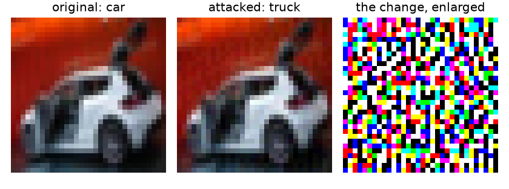
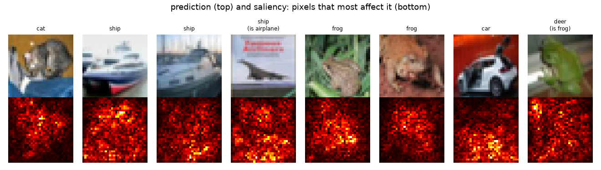

# Inside a CNN, and how to fool it

Opens up a CIFAR-10 convolutional network (79.6% test accuracy, PyTorch): its first-layer filters, gradient saliency
maps showing which pixels drive each prediction, and the fast gradient sign method (FGSM), an adversarial attack that
changes every pixel by an invisible amount and makes the network wrong.



## Results: FGSM on 2,000 test photos

| change per pixel (out of 255) | accuracy |
|---|---|
| 0 (original) | 0.800 |
| 1 | 0.440 |
| 2 | 0.228 |
| 4 | 0.085 |
| 8 | 0.045 |

A change of 1/255 per pixel, below what a screen can show, roughly halves the accuracy.



## Run it

```bash
pip install -r requirements.txt
python train.py --epochs 6    # or copy cnn.pt from the cifar-cnn project
python inspect_cnn.py         # filters and saliency maps
python attack.py              # FGSM attack
```

## What I learned

- The gradient of a class score with respect to the input pixels says which pixels matter, but plain gradients are noisy.
- The same gradient, used against the network, finds tiny changes that break it: accuracy 0.80 -> 0.09 at 4/255.
- High accuracy on normal data says nothing about robustness.

Based on section 10.3 of *Deep Learning: Foundations and Concepts* (Bishop & Bishop, 2024).
