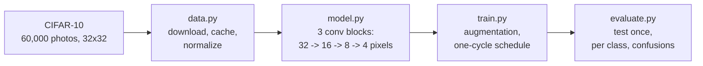

# Module project: build an image classifier for CIFAR-10

Chapter 10 explains why convolutional networks suit images: small filters that detect local patterns (section 10.2.1),
the same filters used everywhere in the image (translation equivariance, section 10.2.2), pooling to grow the receptive
field (section 10.2.6), and stacks of layers that build edges into textures into parts (section 10.2.7). In this project
you build such a network in PyTorch and train it on **CIFAR-10**, 60,000 small colour photos of planes, cars, birds, cats
and six other classes: the standard first real computer-vision project.

It trains on an ordinary laptop CPU in a few minutes per epoch, or in seconds on a free Colab GPU. The notebook attached
above builds and runs the whole project; the reference code is in the course files under `projects/cifar-cnn`.


## Attachments and data

- **Notebook**: `project-1-cifar-cnn.ipynb`, attached to this lesson and saved on your device with the course. It builds and runs the whole project. Open it in one click in Google Colab (free, nothing to install): [Open in Colab](https://colab.research.google.com/github/mahmoudyosrimahmoud13/inpace-library/blob/main/courses/bishop-dl-3-architectures/files/project-1-cifar-cnn.ipynb). Or open the saved copy on your device with Jupyter or VS Code.
- **Finished code**: the `projects/cifar-cnn` folder in the course files, to check your work.
- **Data**: CIFAR-10 (University of Toronto; Hugging Face: uoft-cs/cifar10). Source: [https://huggingface.co/datasets/uoft-cs/cifar10](https://huggingface.co/datasets/uoft-cs/cifar10) · about: [https://www.cs.toronto.edu/~kriz/cifar.html](https://www.cs.toronto.edu/~kriz/cifar.html) · licence: free for research and teaching (see the CIFAR page). `data.py` downloads it the first time you run it and keeps it in `data/`: `cifar10_test.npz`, `cifar10_train.npz`, 176.2 MB.

## What you'll build



## Set up the project

```bash
mkdir cifar-cnn && cd cifar-cnn
python -m venv .venv && source .venv/bin/activate
pip install torch pandas pyarrow pillow matplotlib
git init
```

```text
cifar-cnn/
    .gitignore
    README.md
    cnn.pt
    data.py
    evaluate.py
    model.py
    requirements.txt
    train.py
    data/        (downloaded the first time you run it)
```

<!-- skip -->
```text
torch
pandas
pyarrow
pillow
matplotlib
```

<!-- skip -->
```text
data/
outputs/
__pycache__/
*.pt
.venv/
```

## Step 1: the data

The Hugging Face hub stores CIFAR-10 as PNG images in a parquet table. `data.py` decodes them once into a NumPy file
(about 185 MB) and keeps them as bytes (`uint8`). Each mini-batch is turned into floats and **normalized** per colour
channel (section 7.4.1) only when it's needed, which keeps memory low.

<!-- skip -->
```python
# file: data.py
"""CIFAR-10: 60,000 colour photos, 32x32 pixels, 10 classes (Hugging Face hub)."""
from pathlib import Path
import io
import numpy as np
import pandas as pd
import torch
from PIL import Image

URL = "https://huggingface.co/api/datasets/uoft-cs/cifar10/parquet/plain_text/{}/0.parquet"
CLASSES = ["airplane", "car", "bird", "cat", "deer", "dog", "frog", "horse", "ship", "truck"]
MEAN = torch.tensor([0.491, 0.482, 0.447]).view(1, 3, 1, 1)
STD = torch.tensor([0.247, 0.243, 0.262]).view(1, 3, 1, 1)


def load(split):
    """split: 'train' (50,000) or 'test' (10,000). Returns uint8 images (N, 3, 32, 32) and labels."""
    cache = Path(f"data/cifar10_{split}.npz")
    if not cache.exists():
        cache.parent.mkdir(exist_ok=True)
        table = pd.read_parquet(URL.format(split))
        X = np.stack([np.array(Image.open(io.BytesIO(img["bytes"])).convert("RGB")) for img in table["img"]])
        np.savez(cache, X=X.transpose(0, 3, 1, 2), y=table["label"].values)
    d = np.load(cache)
    return torch.from_numpy(d["X"]), torch.from_numpy(d["y"]).long()


def normalize(x_uint8):
    """uint8 images -> floats with mean 0 and standard deviation 1 per colour channel (section 7.4.1)."""
    return (x_uint8.float() / 255 - MEAN) / STD


def load_splits():
    X, y = load("train")
    order = torch.randperm(len(X), generator=torch.Generator().manual_seed(0))
    val, train = order[:5000], order[5000:]
    return (X[train], y[train]), (X[val], y[val]), load("test")


if __name__ == "__main__":
    (xtr, ytr), (xva, yva), (xte, yte) = load_splits()
    print(f"train {tuple(xtr.shape)}, validation {len(xva)}, test {len(xte)}")
    print("per class in training:", torch.bincount(ytr).tolist())
```

```bash
python data.py
```

```output
train (45000, 3, 32, 32), validation 5000, test 10000
per class in training: [4525, 4523, 4526, 4477, 4500, 4500, 4506, 4470, 4503, 4470]
```

## Step 2: the network

Three blocks, each with two 3 × 3 convolutions, batch normalization, ReLU and a 2 × 2 max-pooling. The image shrinks
from 32 × 32 to 16, 8 and finally 4 pixels across, while the number of channels grows from 3 to 16, 32 and 64: the
network trades **where** for **what**, as section 10.2.7 describes. A single linear layer reads the final 64 × 4 × 4
features. With `width=16` the whole network has about 83,000 parameters, ten times fewer than part 2's best MLP
for Fashion-MNIST.

<!-- skip -->
```python
# file: model.py
"""A small convolutional network (Bishop, sections 10.2.6 to 10.2.8): stacks of 3x3 convolutions, pooling, then a classifier."""
from torch import nn


def block(c_in, c_out):
    return nn.Sequential(nn.Conv2d(c_in, c_out, 3, padding=1), nn.BatchNorm2d(c_out), nn.ReLU(),
                         nn.Conv2d(c_out, c_out, 3, padding=1), nn.BatchNorm2d(c_out), nn.ReLU(),
                         nn.MaxPool2d(2))                       # 32x32 -> 16x16 -> 8x8 -> 4x4


class SmallCNN(nn.Module):
    def __init__(self, width=32, n_classes=10):
        super().__init__()
        self.features = nn.Sequential(block(3, width), block(width, 2 * width), block(2 * width, 4 * width))
        self.classifier = nn.Sequential(nn.Flatten(), nn.Dropout(0.3), nn.Linear(4 * width * 4 * 4, n_classes))

    def forward(self, x):
        return self.classifier(self.features(x))
```

## Step 3: train

Two things beyond what you've done before:

- **Data augmentation that fits the data** (section 9.1.3). A car seen in a mirror is still a car, so random horizontal
  flips are safe here, unlike for the centred Fashion-MNIST images of part 2. Small random crops (shifts of up to 4
  pixels) teach the same thing as convolution's translation equivariance, for the whole network.
- **A one-cycle learning-rate schedule**: the learning rate rises, then falls to almost zero. It's a good default for
  short training runs.

<!-- skip -->
```python
# file: train.py
"""Train the CNN on CIFAR-10. On a laptop CPU an epoch takes about a minute; on a GPU (or free Colab), seconds.
Example: python train.py --epochs 6"""
import argparse
import torch
import torch.nn.functional as F
from data import load_splits, normalize
from model import SmallCNN


def augment(x):
    """Random horizontal flips and random crops of 4-pixel padded images (section 9.1.3).
    A car seen in a mirror is still a car, so here, unlike Fashion-MNIST, flips are safe."""
    flip = torch.rand(len(x)) < 0.5
    x = torch.where(flip[:, None, None, None], x.flip(3), x)
    padded = F.pad(x, (4, 4, 4, 4), mode="reflect")
    i, j = torch.randint(0, 9, (2,))
    return padded[:, :, i:i + 32, j:j + 32]                     # one random crop per mini-batch, for speed


def evaluate(model, x, y, batch=1000):
    model.eval()
    with torch.no_grad():
        guesses = torch.cat([model(normalize(x[i:i + batch])).argmax(1) for i in range(0, len(x), batch)])
    return (guesses == y).float().mean().item()


if __name__ == "__main__":
    ap = argparse.ArgumentParser()
    ap.add_argument("--epochs", type=int, default=6)
    ap.add_argument("--width", type=int, default=16)
    ap.add_argument("--no-augment", action="store_true")
    args = ap.parse_args()
    torch.manual_seed(0)
    (xtr, ytr), (xva, yva), _ = load_splits()
    model = SmallCNN(args.width)
    print(f"{sum(p.numel() for p in model.parameters()):,} parameters")
    steps = args.epochs * (len(xtr) // 128)
    opt = torch.optim.AdamW(model.parameters(), lr=3e-3, weight_decay=5e-4)
    sched = torch.optim.lr_scheduler.OneCycleLR(opt, max_lr=3e-3, total_steps=steps)
    for epoch in range(1, args.epochs + 1):
        model.train()
        order = torch.randperm(len(xtr))
        for start in range(0, len(xtr) - 127, 128):
            idx = order[start:start + 128]
            x = normalize(xtr[idx])
            if not args.no_augment:
                x = augment(x)
            loss = F.cross_entropy(model(x), ytr[idx])
            opt.zero_grad(); loss.backward(); opt.step(); sched.step()
        print(f"epoch {epoch}: last loss {loss.item():.3f}, validation accuracy {evaluate(model, xva, yva):.3f}")
    torch.save({"width": args.width, "state": model.state_dict()}, "cnn.pt")
```

```bash
python train.py --epochs 6
```

```output
82,778 parameters
epoch 1: last loss 1.300, validation accuracy 0.519
epoch 2: last loss 0.917, validation accuracy 0.637
epoch 3: last loss 0.852, validation accuracy 0.692
epoch 4: last loss 0.873, validation accuracy 0.735
epoch 5: last loss 0.710, validation accuracy 0.790
epoch 6: last loss 0.598, validation accuracy 0.801
```

Validation accuracy climbs from 0.52 after one epoch to **0.80** after six. The jump in the last two epochs is the
one-cycle schedule at work: as the learning rate falls, the network settles into a better minimum. Training loss is
still falling at the end, so more epochs would help; on a laptop CPU each epoch takes a few minutes, which is why six is
the default here (see **Make it yours** for a GPU run).

For scale: random guessing scores 0.10, and the linear and MLP models of parts 1 and 2 typically reach only about 0.40
to 0.55 on CIFAR-10. Colour photos of real objects, in any position and pose, are far harder than centred clothes on a
black background, and this is exactly where convolutions pay off.

## Step 4: test once

<!-- skip -->
```python
# file: evaluate.py
"""Test the trained network once: overall, per class, and its most common confusions."""
import torch
from data import load, normalize, CLASSES
from model import SmallCNN

saved = torch.load("cnn.pt")
model = SmallCNN(saved["width"]); model.load_state_dict(saved["state"]); model.eval()
X, y = load("test")
with torch.no_grad():
    guess = torch.cat([model(normalize(X[i:i + 1000])).argmax(1) for i in range(0, len(X), 1000)])
print(f"TEST accuracy: {(guess == y).float().mean():.3f} on {len(y):,} photos (random guessing: 0.100)\n")
confusion = torch.zeros(10, 10, dtype=torch.long)
confusion.index_put_((y, guess), torch.ones_like(y), accumulate=True)
acc = confusion.diag().float() / confusion.sum(1)
for k in acc.argsort():
    worst = confusion[k].clone(); worst[k] = 0
    print(f"{CLASSES[k]:9s} {acc[k]:.2f}   most often mistaken for {CLASSES[worst.argmax()]} ({worst.max().item()} times)")
```

```bash
python evaluate.py
```

```output
TEST accuracy: 0.796 on 10,000 photos (random guessing: 0.100)

cat       0.64   most often mistaken for dog (153 times)
bird      0.67   most often mistaken for deer (71 times)
dog       0.73   most often mistaken for cat (144 times)
deer      0.75   most often mistaken for bird (60 times)
horse     0.81   most often mistaken for dog (56 times)
airplane  0.82   most often mistaken for ship (49 times)
frog      0.86   most often mistaken for cat (53 times)
truck     0.87   most often mistaken for car (66 times)
ship      0.89   most often mistaken for airplane (47 times)
car       0.92   most often mistaken for truck (44 times)
```

**0.796** on the 10,000 test photos, close to validation, as it should be. The per-class results tell a story:

- **Vehicles are easy**: cars 0.92, ships 0.89, trucks 0.87. Rigid shapes, typical backgrounds (sea, road).
- **Animals are hard**, and the confusions are the ones a person might make at 32 × 32 pixels: cats and dogs are
  mistaken for each other about 300 times in total; birds and deer, both small and brown on green backgrounds, are
  mixed up too.
- **Airplanes and ships** confuse each other: both often sit on a flat blue background, sky or sea. The network has
  partly learned "blue background", not only "wings". The saliency maps of the next project let you check that.

## Step 5: write the README and publish

<!-- skip -->
````markdown
# CIFAR-10 image classifier

A convolutional network written in PyTorch and trained from scratch on CIFAR-10 (60,000 colour photos, 10 classes):
three blocks of 3x3 convolutions with batch normalization and max-pooling, flip and crop augmentation, and a one-cycle
learning-rate schedule.

## Results

| | |
|---|---|
| parameters | 82,778 |
| training | 6 epochs, laptop CPU (about 15 minutes) |
| validation accuracy | 0.801 |
| **test accuracy** | **0.796** |

Easiest classes: car 0.92, ship 0.89, truck 0.87. Hardest: cat 0.64 (mistaken for dog 153 times), bird 0.67.

## Run it

```bash
pip install -r requirements.txt
python train.py --epochs 6     # --width 32 and more epochs on a GPU for higher accuracy
python evaluate.py
```

## What I learned

- Convolutions share small filters across the image, which suits photos far better than fully connected layers.
- Augmentation must fit the data: mirror images of cars are still cars, so flips help here.
- Per-class errors show what the model really learned: confusions between cats and dogs, and between planes and ships.

Based on chapter 10 of *Deep Learning: Foundations and Concepts* (Bishop & Bishop, 2024).
````

```bash
git add .
git commit -m "CIFAR-10 CNN classifier in PyTorch"
git branch -M main
git remote add origin git@github.com:YOUR-USERNAME/cifar-cnn.git
git push -u origin main
```

## Make it yours

- **Train longer on a GPU.** Open the notebook in Colab, switch to a GPU, and train for 30 epochs with `--width 32`.
  How far can you push the test accuracy?
- **Ablation.** Train with `--no-augment`. How big is the gap in validation accuracy, and when does over-fitting start?
- **Residual connections** (section 9.5). Add a skip connection around each block's second convolution. Does a deeper
  network now train better?
- **Your own photos.** Resize 10 of your own photos to 32 × 32 and classify them. Which classes does the model get right,
  and why is it hard?

## On your CV

> **CIFAR-10 image classifier** (PyTorch): convolutional network (3 conv blocks, batch norm, 83k parameters) trained
> from scratch with flip and crop augmentation and a one-cycle learning-rate schedule; 79.6% test accuracy after 6
> epochs on a laptop CPU, with per-class error analysis. github.com/YOUR-USERNAME/cifar-cnn

## Check yourself

- [ ] You can compute the shape of the data after each block by hand.
- [ ] You can explain why flips are a safe augmentation here but shifts hurt for Fashion-MNIST.
- [ ] The test set was used once, at the end.
