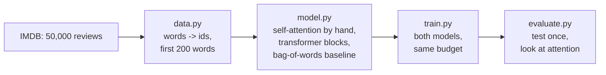

# Module project: build a transformer that reads movie reviews

Section 12.1 builds self-attention from first principles: queries, keys, values, scaled dot products, several heads, then
residual connections and layer normalization around it. In this project you write all of it yourself in PyTorch, with no
`nn.Transformer`, and train it to tell positive movie reviews from negative ones.

You'll also do something many tutorials skip: compare it with a simple baseline, and report honestly when the simple
model wins. Knowing **when** a transformer is worth it is worth more in an interview than another 1% of accuracy. The
notebook attached above builds and runs the whole project; the reference code is in the course files under
`projects/imdb-transformer`.


## Attachments and data

- **Notebook**: `project-3-imdb-transformer.ipynb`, attached to this lesson. It builds and runs the whole project; on the course's web page it opens in Google Colab.
- **Finished code**: the `projects/imdb-transformer` folder in the course files, to check your work.
- **Data**: IMDB movie reviews (Stanford; Hugging Face: stanfordnlp/imdb). Source: [https://huggingface.co/datasets/stanfordnlp/imdb](https://huggingface.co/datasets/stanfordnlp/imdb) · about: [https://ai.stanford.edu/~amaas/data/sentiment/](https://ai.stanford.edu/~amaas/data/sentiment/) · licence: free for research (see the Stanford page). `data.py` downloads it the first time you run it and keeps it in `data/`: `imdb_test.parquet`, `imdb_train.parquet`, 38.7 MB.
- **All datasets in one zip**: [bishop-datasets.zip](https://github.com/mahmoudyosrimahmoud13/inpace-library/releases/download/bishop-datasets-v1/bishop-datasets.zip). Unzip it and copy the files of `imdb` into your project's `data/` folder; `data.py` then skips the download. Useful offline, or if a source moves.

## What you'll build



## Set up the project

```bash
mkdir imdb-transformer && cd imdb-transformer
python -m venv .venv && source .venv/bin/activate
pip install torch pandas pyarrow
git init
```

```text
imdb-transformer/
    .gitignore
    README.md
    data.py
    evaluate.py
    model.py
    models.pt
    requirements.txt
    train.py
    data/        (downloaded the first time you run it)
```

<!-- skip -->
```text
torch
pandas
pyarrow
```

<!-- skip -->
```text
data/
__pycache__/
*.pt
.venv/
```

## Step 1: from reviews to numbers

Each review becomes a list of word ids: the 20,000 most common training words get an id, everything else becomes
`<unk>` (unknown), and every review is cut or padded to 200 words. Id 0 is padding, which the models must learn to
ignore. Section 12.2 discusses better ways to split text (sub-word tokens); a word vocabulary keeps this project simple.

<!-- skip -->
```python
# file: data.py
"""IMDB movie reviews: 50,000 reviews labelled positive or negative (Stanford, via the Hugging Face hub)."""
from pathlib import Path
import re
from collections import Counter
import pandas as pd
import torch

URL = "https://huggingface.co/api/datasets/stanfordnlp/imdb/parquet/plain_text/{}/0.parquet"
MAX_LEN = 200                                     # keep the first 200 words of each review


def load_table(split):
    cache = Path(f"data/imdb_{split}.parquet")
    if not cache.exists():
        cache.parent.mkdir(exist_ok=True)
        pd.read_parquet(URL.format(split)).to_parquet(cache)
    return pd.read_parquet(cache)                  # columns: text, label (1 = positive)


def words(text):
    return re.findall(r"[a-z']+", text.lower().replace("<br />", " "))


class Vocab:
    """The 20,000 most common training words get an id; 0 is padding, 1 is 'unknown word'."""
    def __init__(self, texts, size=20000):
        counts = Counter(w for t in texts for w in words(t))
        self.itos = ["<pad>", "<unk>"] + [w for w, _ in counts.most_common(size - 2)]
        self.stoi = {w: i for i, w in enumerate(self.itos)}

    def encode(self, texts):
        ids = torch.zeros(len(texts), MAX_LEN, dtype=torch.long)
        for row, t in enumerate(texts):
            seq = [self.stoi.get(w, 1) for w in words(t)][:MAX_LEN]
            ids[row, :len(seq)] = torch.tensor(seq, dtype=torch.long)
        return ids


def load_splits():
    train, test = load_table("train"), load_table("test")
    order = torch.randperm(len(train), generator=torch.Generator().manual_seed(0)).tolist()
    tr, va = train.iloc[order[2500:]], train.iloc[order[:2500]]
    vocab = Vocab(tr.text)
    pack = lambda t: (vocab.encode(t.text.tolist()), torch.tensor(t.label.values))
    return vocab, pack(tr), pack(va), pack(test)


if __name__ == "__main__":
    vocab, (xtr, ytr), (xva, yva), (xte, yte) = load_splits()
    print(f"train {len(xtr)}, validation {len(xva)}, test {len(xte)} reviews; positive share {ytr.float().mean():.2f}")
    print("first review, first 12 words:", " ".join(vocab.itos[i] for i in xtr[0, :12]))
    print(f"words outside the vocabulary in test: {(xte == 1).sum() / (xte > 0).sum():.1%}")
```

```bash
python data.py
```

```output
train 22500, validation 2500, test 25000 reviews; positive share 0.50
first review, first 12 words: impressed this is the worst srk movie and one of the worst
words outside the vocabulary in test: 3.3%
```

## Step 2: the transformer, by hand

Read `SelfAttention` next to section 12.1:

- One linear layer produces queries, keys and values for all heads at once, then `reshape` and `permute` split them into
  4 heads of 16 dimensions each (multi-head attention, section 12.1.6).
- `q @ kᵀ / √dk` gives every word's score for every other word, scaled as in equation 12.14 so the softmax doesn't
  saturate.
- Padding positions get a score of `-∞`, so after the softmax they receive exactly zero attention.
- `Block` wraps attention and a small MLP, each with layer normalization and a residual connection (section 12.1.7).
- Attention by itself doesn't know word order, so we add a learned **position embedding** to each word (section 12.1.9).

To turn 200 word vectors into one prediction, the model uses **attention pooling**: it scores each word, softmaxes the
scores, and takes the weighted average. That also gives us something to look at later.

The baseline, `BagOfWords`, simply averages the word embeddings: no order, no context, no attention.

<!-- skip -->
```python
# file: model.py
"""A transformer encoder for text, with self-attention written out by hand (Bishop, section 12.1)."""
import math
import torch
from torch import nn


class SelfAttention(nn.Module):
    """Multi-head self-attention (sections 12.1.3 to 12.1.6): every word looks at every other word."""
    def __init__(self, d, heads):
        super().__init__()
        self.heads, self.dk = heads, d // heads
        self.qkv = nn.Linear(d, 3 * d)             # queries, keys and values, all heads at once
        self.out = nn.Linear(d, d)

    def forward(self, x, pad_mask):
        B, N, d = x.shape
        q, k, v = self.qkv(x).reshape(B, N, 3, self.heads, self.dk).permute(2, 0, 3, 1, 4)   # each (B, heads, N, dk)
        scores = q @ k.transpose(-2, -1) / math.sqrt(self.dk)          # scaled dot products (equation 12.14)
        scores = scores.masked_fill(pad_mask[:, None, None, :], float("-inf"))   # never attend to padding
        attn = scores.softmax(-1)
        return self.out((attn @ v).transpose(1, 2).reshape(B, N, d))


class Block(nn.Module):
    """Attention + a small MLP, each with a residual connection and layer normalization (section 12.1.7)."""
    def __init__(self, d, heads):
        super().__init__()
        self.ln1, self.ln2 = nn.LayerNorm(d), nn.LayerNorm(d)
        self.attn = SelfAttention(d, heads)
        self.mlp = nn.Sequential(nn.Linear(d, 4 * d), nn.GELU(), nn.Linear(4 * d, d))

    def forward(self, x, pad_mask):
        x = x + self.attn(self.ln1(x), pad_mask)
        return x + self.mlp(self.ln2(x))


class SentimentTransformer(nn.Module):
    def __init__(self, vocab_size, d=64, heads=4, layers=2, max_len=200):
        super().__init__()
        self.embed = nn.Embedding(vocab_size, d, padding_idx=0)
        self.pos = nn.Parameter(torch.zeros(1, max_len, d))           # learned positions (section 12.1.9)
        self.blocks = nn.ModuleList(Block(d, heads) for _ in range(layers))
        self.pool_query = nn.Linear(d, 1)                              # attention pooling: a score per word
        self.head = nn.Linear(d, 2)

    def forward(self, ids, return_weights=False):
        pad = ids == 0
        x = self.embed(ids) + self.pos[:, :ids.shape[1]]
        for block in self.blocks:
            x = block(x, pad)
        w = self.pool_query(x).squeeze(-1).masked_fill(pad, float("-inf")).softmax(-1)   # which words matter
        logits = self.head((w[..., None] * x).sum(1))
        return (logits, w) if return_weights else logits


class BagOfWords(nn.Module):
    """Baseline: average the word embeddings, ignoring order and context completely."""
    def __init__(self, vocab_size, d=64):
        super().__init__()
        self.embed = nn.Embedding(vocab_size, d, padding_idx=0)
        self.head = nn.Linear(d, 2)

    def forward(self, ids):
        mask = (ids > 0).float()[..., None]
        return self.head((self.embed(ids) * mask).sum(1) / mask.sum(1).clamp(min=1))
```

## Step 3: train both, same budget

<!-- skip -->
```python
# file: train.py
"""Train the bag-of-words baseline and the transformer, and compare them on the validation reviews."""
import torch
import torch.nn.functional as F
from data import load_splits
from model import SentimentTransformer, BagOfWords

vocab, (xtr, ytr), (xva, yva), _ = load_splits()


def accuracy(model, x, y):
    model.eval()
    with torch.no_grad():
        return torch.cat([model(x[i:i + 500]).argmax(1) for i in range(0, len(x), 500)]).eq(y).float().mean().item()


def fit(model, epochs, lr):
    torch.manual_seed(0)
    opt = torch.optim.AdamW(model.parameters(), lr=lr, weight_decay=0.01)
    steps = epochs * (len(xtr) // 64)
    sched = torch.optim.lr_scheduler.OneCycleLR(opt, max_lr=lr, total_steps=steps)
    for epoch in range(1, epochs + 1):
        model.train()
        order = torch.randperm(len(xtr))
        for s in range(0, len(xtr) - 63, 64):
            idx = order[s:s + 64]
            loss = F.cross_entropy(model(xtr[idx]), ytr[idx])
            opt.zero_grad(); loss.backward(); opt.step(); sched.step()
        print(f"  epoch {epoch}: validation accuracy {accuracy(model, xva, yva):.3f}")
    return model


print("bag of words (order ignored):")
torch.manual_seed(0)
bow = fit(BagOfWords(len(vocab.itos)), epochs=3, lr=3e-3)
print("transformer (2 layers, 4 heads, d = 64):")
torch.manual_seed(0)
tf = fit(SentimentTransformer(len(vocab.itos)), epochs=3, lr=1e-3)
print(f"parameters: bag of words {sum(p.numel() for p in bow.parameters()):,}, "
      f"transformer {sum(p.numel() for p in tf.parameters()):,}")
torch.save({"bow": bow.state_dict(), "tf": tf.state_dict()}, "models.pt")
```

```bash
python train.py
```

```output
bag of words (order ignored):
  epoch 1: validation accuracy 0.821
  epoch 2: validation accuracy 0.861
  epoch 3: validation accuracy 0.866
transformer (2 layers, 4 heads, d = 64):
  epoch 1: validation accuracy 0.808
  epoch 2: validation accuracy 0.841
  epoch 3: validation accuracy 0.845
parameters: bag of words 1,280,130, transformer 1,392,963
```

The bag of words reaches 0.866 on validation; the transformer 0.845, with about the same number of parameters (most of
both are the 20,000 × 64 word embeddings). The transformer also takes far longer to train.

This isn't a bug. Sentiment is mostly carried by **which** words appear ("worst", "wasted", "brilliant"), and the bag
of words captures that directly. A transformer can in principle learn more ("not good", irony, contrast), but with only
22,500 reviews and no pre-training, it can't learn enough of it to win. This is why real systems pre-train large
language models on billions of words first (section 12.3.5) and only then fine-tune them on a task like this one.

## Step 4: test once, and look inside

<!-- skip -->
```python
# file: evaluate.py
"""Test both models once, then look at which words the transformer's attention pooling relied on."""
import torch
from data import load_splits
from model import SentimentTransformer, BagOfWords

vocab, _, _, (xte, yte) = load_splits()
saved = torch.load("models.pt")
bow, tf = BagOfWords(len(vocab.itos)), SentimentTransformer(len(vocab.itos))
bow.load_state_dict(saved["bow"]); tf.load_state_dict(saved["tf"])
bow.eval(); tf.eval()

with torch.no_grad():
    for name, m in [("bag of words", bow), ("transformer", tf)]:
        guess = torch.cat([m(xte[i:i + 500]).argmax(1) for i in range(0, len(xte), 500)])
        print(f"TEST accuracy, {name}: {(guess == yte).float().mean():.3f} on {len(yte):,} reviews")

    # Short test reviews are easiest to read: two negative and two positive ones,
    # with the 4 words that got the largest attention-pooling weight in [brackets]
    lengths = (xte > 0).sum(1)
    short = lambda label: torch.nonzero((lengths < 45) & (yte == label)).flatten()[:2].tolist()
    for i in short(0) + short(1):
        logits, w = tf(xte[i:i + 1], return_weights=True)
        n = lengths[i].item()
        top = w[0, :n].topk(4).indices.sort().values
        p = logits.softmax(-1)[0, 1].item()
        print(f"\n{'positive' if yte[i] else 'negative'} review, model says p(positive) = {p:.2f}")
        print("  " + " ".join(f"[{vocab.itos[t]}]" if k in top else vocab.itos[t] for k, t in enumerate(xte[i, :n].tolist())))
```

```bash
python evaluate.py
```

```output
TEST accuracy, bag of words: 0.852 on 25,000 reviews
TEST accuracy, transformer: 0.830 on 25,000 reviews

negative review, model says p(positive) = 0.27
  widow hires a psychopath as a <unk> sloppy film noir [thriller] which [doesn't] make much of its [tension] promising set [up]

negative review, model says p(positive) = 0.00
  i [found] this movie really hard to sit through [my] attention kept wandering [off] the tv as far as romantic movies go this one is the worst [i've] seen don't bother with it

positive review, model says p(positive) = 1.00
  while the romance in this film is an important aspect it is largely about the role of responsibility and [duty] in modern indian all of the [major] characters were well fleshed out [and] had their own [inner] life i recommend this strongly

positive review, model says p(positive) = 0.84
  this short deals with a severely critical writing teacher whose <unk> criticism extends into [his] everyday life when he learns why that's not a [good] [idea] we learn a bit about the beautiful craft of writing that [he's] been <unk> on
```

On the test set, 0.852 against 0.830: the same ranking as on validation.

The bracketed words are those the attention pooling weighted most. Sometimes they make sense ("tension", "doesn't",
"duty"); often they're words like "my", "and" or "his" that the earlier layers have filled with information from their
neighbours. That's a general lesson: **attention weights are a clue, not an explanation**.

Look closely at the last review. It's positive, and the model agrees (0.84), but the words it weighted most include
"good idea", from the phrase "that's **not** a good idea". Whether the model understood the negation or simply liked the
word "good", the weights can't tell you. Testing it on sentences you write yourself can (see **Make it yours**).

## Step 5: write the README and publish

<!-- skip -->
````markdown
# Movie review sentiment: transformer vs bag of words

A transformer encoder written from scratch in PyTorch (multi-head self-attention, residual connections, layer norm,
learned positions, attention pooling) trained to read IMDB movie reviews, compared honestly with a bag-of-words baseline.

## Results (25,000 test reviews)

| model | parameters | test accuracy |
|---|---|---|
| bag of words (average of word embeddings) | 1.28M | **0.852** |
| transformer, 2 layers, 4 heads, d = 64 | 1.39M | 0.830 |

Trained on 22,500 reviews for 3 epochs on a laptop CPU. The simpler model wins: on this task, which words appear
matters far more than their order, and a transformer needs much more data (or pre-training) to pay off.

## Run it

```bash
pip install -r requirements.txt
python train.py      # about 10 minutes on a laptop CPU, under a minute on a GPU
python evaluate.py   # test both, and show which words the attention pooling used
```

## What I learned

- How self-attention works in code: queries, keys and values, scaled dot products, masking the padding.
- A strong baseline is essential: without it, 0.83 would have looked like a success.
- Attention weights hint at what the model uses, but they are not a full explanation.

Based on chapter 12 of *Deep Learning: Foundations and Concepts* (Bishop & Bishop, 2024).
````

```bash
git add .
git commit -m "Transformer from scratch for IMDB sentiment, vs bag-of-words baseline"
git branch -M main
git remote add origin git@github.com:YOUR-USERNAME/imdb-transformer.git
git push -u origin main
```

## Make it yours

- **Find the limits of the baseline.** Write 10 reviews with negation and contrast ("not bad at all", "I wanted to love
  it, but..."). Which model handles them better?
- **Pre-trained embeddings.** Start the embedding layer from GloVe word vectors instead of random. Does the transformer
  catch up?
- **A pre-trained transformer.** Fine-tune a small pre-trained model from Hugging Face (for example DistilBERT) on the same
  split. How big is the jump, and what does it cost in time?
- **Longer reviews.** Use 400 words instead of 200. Attention's cost grows with the square of the length
  (section 12.1.8): measure the training time.

## On your CV

> **Movie review sentiment** (PyTorch): transformer encoder implemented from scratch (multi-head self-attention, residual
> connections, layer norm, attention pooling) trained on IMDB; benchmarked against a bag-of-words baseline (83.0% vs
> 85.2% test accuracy) and analysed why order-aware models need pre-training to win on small data.
> github.com/YOUR-USERNAME/imdb-transformer

## Check yourself

- [ ] You can explain each line of `SelfAttention.forward`, including the shapes.
- [ ] You can explain why the padding mask uses `-∞` and not 0.
- [ ] Your README reports the baseline winning, and why.
