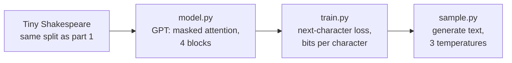

# Module project: train a GPT on Shakespeare

Section 12.3 describes the model behind ChatGPT: a **decoder-only transformer** trained for one thing only, predicting
the next token. In this project you build a small one from scratch in PyTorch, train it on the complete plays of
Shakespeare, one character at a time, and make it write.

There's a twist that makes this project yours rather than a copy of a tutorial: in part 1 you measured the same text
with entropy, n-gram models, gzip and bzip2, in **bits per character**. A language model's loss is measured in exactly the
same unit, so you'll see precisely where a transformer beats them. The notebook attached above builds and runs the whole
project; the reference code is in the course files under `projects/shakespeare-gpt`.


## Attachments and data

- **Notebook**: `project-4-shakespeare-gpt.ipynb`, attached to this lesson. It builds and runs the whole project; on the course's web page it opens in Google Colab.
- **Finished code**: the `projects/shakespeare-gpt` folder in the course files, to check your work.
- **Data**: Tiny Shakespeare (from Andrej Karpathy's char-rnn). Source: [https://raw.githubusercontent.com/karpathy/char-rnn/master/data/tinyshakespeare/input.txt](https://raw.githubusercontent.com/karpathy/char-rnn/master/data/tinyshakespeare/input.txt) · about: [https://github.com/karpathy/char-rnn](https://github.com/karpathy/char-rnn) · licence: public-domain text (Shakespeare); repository MIT. `data.py` downloads it the first time you run it and keeps it in `data/`: `shakespeare.txt`, 1.1 MB.
- **All datasets in one zip**: [bishop-datasets.zip](https://github.com/mahmoudyosrimahmoud13/inpace-library/releases/download/bishop-datasets-v1/bishop-datasets.zip). Unzip it and copy the files of `tiny-shakespeare` into your project's `data/` folder; `data.py` then skips the download. Useful offline, or if a source moves.

## What you'll build



## Set up the project

```bash
mkdir shakespeare-gpt && cd shakespeare-gpt
python -m venv .venv && source .venv/bin/activate
pip install torch
git init
```

Copy `data.py` from your part 1 text compressor: same text, same 90/10 split, so the numbers are comparable.

```text
shakespeare-gpt/
    .gitignore
    README.md
    data.py
    gpt.pt
    model.py
    requirements.txt
    sample.py
    train.py
    data/        (downloaded the first time you run it)
```

<!-- skip -->
```text
torch
```

<!-- skip -->
```text
data/
__pycache__/
*.pt
.venv/
```

<!-- skip -->
```python
# file: data.py
"""Download Tiny Shakespeare (about 1.1 million characters) and split it into a training and a test part."""
from pathlib import Path
from urllib.request import urlopen

URL = "https://raw.githubusercontent.com/karpathy/char-rnn/master/data/tinyshakespeare/input.txt"
CACHE = Path("data/shakespeare.txt")


def load_text():
    if not CACHE.exists():
        CACHE.parent.mkdir(exist_ok=True)
        CACHE.write_bytes(urlopen(URL).read())
    return CACHE.read_text(encoding="utf-8")


def load_splits():
    text = load_text()
    cut = int(0.9 * len(text))
    return text[:cut], text[cut:]       # the last 10% of the plays is the test text


if __name__ == "__main__":
    train, test = load_splits()
    print(f"training text: {len(train):,} characters, test text: {len(test):,} characters")
    print(f"alphabet: {len(set(train))} different characters")
    print(repr(test[:80]))
```

## Step 1: the model

The blocks are the ones you wrote for the IMDB project, with one essential change: a **causal mask**. When predicting the
character at position t, the model may look at positions 0 to t but never at the future, otherwise it could simply copy
the answer. The mask sets those attention scores to `-∞` before the softmax (section 12.3.1).

Two consequences make GPTs efficient to train: one sequence of 128 characters gives 128 training examples at once (predict
character 2 from 1, 3 from 1–2, and so on), and the output at every position is a softmax over the 65 possible
characters.

`generate` (sections 12.2.4 and 12.3.2) samples one character, appends it, and feeds the longer text back in. **Temperature**
divides the scores before the softmax: below 1 it sharpens the distribution, above 1 it flattens it. **Top-k** keeps only
the k most likely characters.

<!-- skip -->
```python
# file: model.py
"""A small GPT: a decoder-only transformer that predicts the next character (Bishop, section 12.3.1)."""
import math
import torch
from torch import nn


class CausalSelfAttention(nn.Module):
    def __init__(self, d, heads, ctx):
        super().__init__()
        self.heads = heads
        self.qkv, self.out = nn.Linear(d, 3 * d), nn.Linear(d, d)
        # the mask: position t may only look at positions 0..t, never at the future (section 12.3.1)
        self.register_buffer("future", torch.triu(torch.ones(ctx, ctx, dtype=torch.bool), diagonal=1))

    def forward(self, x):
        B, N, d = x.shape
        q, k, v = self.qkv(x).reshape(B, N, 3, self.heads, d // self.heads).permute(2, 0, 3, 1, 4)
        att = (q @ k.transpose(-2, -1)) / math.sqrt(d // self.heads)
        att = att.masked_fill(self.future[:N, :N], float("-inf")).softmax(-1)
        return self.out((att @ v).transpose(1, 2).reshape(B, N, d))


class Block(nn.Module):
    def __init__(self, d, heads, ctx):
        super().__init__()
        self.ln1, self.ln2 = nn.LayerNorm(d), nn.LayerNorm(d)
        self.attn = CausalSelfAttention(d, heads, ctx)
        self.mlp = nn.Sequential(nn.Linear(d, 4 * d), nn.GELU(), nn.Linear(4 * d, d))

    def forward(self, x):
        x = x + self.attn(self.ln1(x))
        return x + self.mlp(self.ln2(x))


class GPT(nn.Module):
    def __init__(self, vocab, d=128, heads=4, layers=4, ctx=128):
        super().__init__()
        self.ctx = ctx
        self.tok, self.pos = nn.Embedding(vocab, d), nn.Embedding(ctx, d)
        self.blocks = nn.Sequential(*[Block(d, heads, ctx) for _ in range(layers)])
        self.ln, self.head = nn.LayerNorm(d), nn.Linear(d, vocab)

    def forward(self, idx):
        x = self.tok(idx) + self.pos(torch.arange(idx.shape[1]))
        return self.head(self.ln(self.blocks(x)))              # logits for the next character at every position

    @torch.no_grad()
    def generate(self, idx, n, temperature=1.0, top_k=None, generator=None):
        """Sample one character at a time and feed it back in (sections 12.2.4 and 12.3.2)."""
        for _ in range(n):
            logits = self(idx[:, -self.ctx:])[:, -1] / temperature
            if top_k:
                kth = logits.topk(top_k).values[:, -1:]
                logits = logits.masked_fill(logits < kth, float("-inf"))
            nxt = torch.multinomial(logits.softmax(-1), 1, generator=generator)
            idx = torch.cat([idx, nxt], 1)
        return idx
```

## Step 2: train, measured in bits

Training is the same loop as always: random windows of 128 characters, cross-entropy against the same window shifted by one,
AdamW with a one-cycle schedule, and gradient clipping, a standard guard against occasional huge gradients in
transformers. Dividing the cross-entropy by ln 2 turns nats into bits.

<!-- skip -->
```python
# file: train.py
"""Train the GPT on Tiny Shakespeare and measure it in bits per character, like the compressors of part 1."""
import argparse
import math
import torch
import torch.nn.functional as F
from data import load_splits
from model import GPT

ap = argparse.ArgumentParser()
ap.add_argument("--steps", type=int, default=1500)
args = ap.parse_args()

torch.manual_seed(0)
train, test = load_splits()
chars = sorted(set(train + test))
stoi = {c: i for i, c in enumerate(chars)}
encode = lambda s: torch.tensor([stoi[c] for c in s])
tr, te = encode(train), encode(test)
model = GPT(len(chars))
print(f"{sum(p.numel() for p in model.parameters()):,} parameters, context {model.ctx} characters")


def batch(data, size=32):
    i = torch.randint(0, len(data) - model.ctx - 1, (size,))
    x = torch.stack([data[j:j + model.ctx] for j in i])
    return x, torch.stack([data[j + 1:j + model.ctx + 1] for j in i])     # targets: the same text, shifted by one


@torch.no_grad()
def bits_per_char(data, n=20):
    model.eval()
    g = torch.Generator().manual_seed(1)
    losses = []
    for _ in range(n):
        i = torch.randint(0, len(data) - model.ctx - 1, (32,), generator=g)
        x = torch.stack([data[j:j + model.ctx] for j in i]); y = torch.stack([data[j + 1:j + model.ctx + 1] for j in i])
        losses.append(F.cross_entropy(model(x).flatten(0, 1), y.flatten()).item())
    model.train()
    return sum(losses) / n / math.log(2)                     # cross-entropy in nats -> bits


opt = torch.optim.AdamW(model.parameters(), lr=3e-3, weight_decay=0.1)
sched = torch.optim.lr_scheduler.OneCycleLR(opt, max_lr=3e-3, total_steps=args.steps)
for step in range(1, args.steps + 1):
    x, y = batch(tr)
    loss = F.cross_entropy(model(x).flatten(0, 1), y.flatten())
    opt.zero_grad(); loss.backward()
    torch.nn.utils.clip_grad_norm_(model.parameters(), 1.0)
    opt.step(); sched.step()
    if step % 300 == 0 or step == 1:
        print(f"step {step:5d}: test {bits_per_char(te):.3f} bits/char")
torch.save({"model": model.state_dict(), "chars": chars}, "gpt.pt")
```

```bash
python train.py
```

```output
826,433 parameters, context 128 characters
step     1: test 6.116 bits/char
step   300: test 3.323 bits/char
step   600: test 2.698 bits/char
step   900: test 2.442 bits/char
step  1200: test 2.334 bits/char
step  1500: test 2.301 bits/char
```


Put your part 1 numbers next to these:

| method | bits per character on the same test text |
|---|---|
| uniform over 65 characters | 6.02 |
| character frequencies (unigram entropy) | 4.77 |
| gzip | 3.19 |
| trigram model | 2.98 |
| bzip2 | 2.64 |
| **your GPT, 1,500 steps** | **2.30** |

At step 1 the model is near the uniform 6 bits. By step 300 it beats gzip, by step 900 bzip2. It ends at 2.30 bits per
character, well below the trigram model: it uses up to 128 characters of context, not 2, and it has learned words,
spelling and the shape of a play. A larger model trained longer goes well below 2 bits (try it on a GPU). "A better
predictor is a better compressor": you've now measured it from both sides.

## Step 3: make it write

<!-- skip -->
```python
# file: sample.py
"""Generate new 'Shakespeare' with the trained GPT, at different temperatures (section 12.3.2)."""
import torch
from model import GPT

saved = torch.load("gpt.pt")
chars = saved["chars"]
model = GPT(len(chars))
model.load_state_dict(saved["model"])
model.eval()
stoi = {c: i for i, c in enumerate(chars)}
prompt = "ROMEO:\n"

for temperature, top_k, n in [(0.8, 10, 400), (0.3, None, 150), (1.5, None, 150)]:
    g = torch.Generator().manual_seed(0)
    start = torch.tensor([[stoi[c] for c in prompt]])
    out = model.generate(start, n, temperature=temperature, top_k=top_k, generator=g)
    label = f"temperature {temperature}" + (f", top-{top_k}" if top_k else "")
    print(f"----- {label} -----")
    print("".join(chars[i] for i in out[0].tolist()))
    print()
```

```bash
python sample.py
```

```output
----- temperature 0.8, top-10 -----
ROMEO:
Thou must what self I do thee hath a sword, then
Thou would for me in his death being some on
For that he lords appear.
As your forfence mother of well your brief him:
To the heaven the wife death for my france,
And look of the say fight, and fleshes bless'd.

GLOUCESTER:
So to the pon corfection: and the word heard done?

Servingman:
My sometime and as hear is more fullow'd saint are the
sound fo

----- temperature 0.3 -----
ROMEO:
There house of the field of the courts of the world
And so distraight the death of the seat of the watcher
Which be man of the courable that the selfs

----- temperature 1.5 -----
ROMEO:
Tybreah, dissins:
LeWHo'cal expail, iddextle etgMy
of word bunty here hath good beievinBy.

Shepherdationy:
Whiles Rachars is eaf trunk-day, thy deven
```

- At **temperature 0.8 with top-10**, the text has the shape of a play: speaker names in capitals, line breaks, archaic words
  ("thou", "hath", "bless'd"), mostly real words, and almost no meaning. The model has learned the **form** of Shakespeare,
  not his sense.
- At **0.3** it plays safe and repeats itself ("the field of the courts of the world").
- At **1.5** it takes so many risks that words fall apart ("LeWHo'cal expail").

That trade-off between safe and varied is section 12.3.2's, and the same knob exists in every chatbot.

## Step 4: write the README and publish

<!-- skip -->
````markdown
# A character-level GPT trained on Shakespeare

A small decoder-only transformer (4 layers, 4 heads, 826k parameters, written in PyTorch with masked self-attention)
trained to predict the next character of Shakespeare's plays, then used to generate new text at different temperatures.
Measured in bits per character on held-out text and compared with classic compressors.

## Results (held-out text: the last 10% of the plays)

| model | bits per character |
|---|---|
| unigram character frequencies (entropy) | 4.77 |
| gzip -9 | 3.19 |
| trigram model | 2.98 |
| bzip2 -9 | 2.64 |
| **this GPT, 1,500 steps on a laptop CPU** | **2.30** |

(Earlier rows from my [text-compressor](https://github.com/YOUR-USERNAME/text-compressor) project, same text and split.)

Sample, temperature 0.8, top-10:

```text
ROMEO:
Thou must what self I do thee hath a sword, then
Thou would for me in his death being some on
For that he lords appear.
```

## Run it

```bash
pip install -r requirements.txt
python train.py     # about 25 minutes on a laptop CPU, a couple of minutes on a GPU
python sample.py
```

## What I learned

- A GPT is a stack of masked self-attention blocks trained only to predict the next token.
- Cross-entropy in bits per character connects language models to compression: better prediction, shorter codes.
- Temperature trades safety for variety: low is repetitive, high is gibberish.

Based on chapter 12 of *Deep Learning: Foundations and Concepts* (Bishop & Bishop, 2024).
````

```bash
git add .
git commit -m "Character-level GPT trained on Shakespeare"
git branch -M main
git remote add origin git@github.com:YOUR-USERNAME/shakespeare-gpt.git
git push -u origin main
```

## Make it yours

- **Scale it up on a GPU.** In Colab, train with `d=384`, 6 layers and 5,000 steps. How low do the bits per character go?
  Plot test bits against the number of parameters.
- **Your own text.** Train on another author, song lyrics you've written yourself, or Python code. Which is easiest to
  predict, in bits per character?
- **Arabic.** Train on an Arabic text. Compare the bits per character with English, and think about why the alphabet and
  the writing system matter.
- **Sub-word tokens.** Replace characters with a small byte-pair-encoding vocabulary (section 12.2). Measure the loss
  per character so the comparison stays fair.

## On your CV

> **Shakespeare GPT** (PyTorch): decoder-only transformer (826k parameters, masked multi-head self-attention) trained
> from scratch on Tiny Shakespeare; 2.30 bits/char on held-out text versus 2.64 for bzip2 and 2.98 for a trigram model;
> text generation with temperature and top-k sampling. github.com/YOUR-USERNAME/shakespeare-gpt

## Check yourself

- [ ] You can explain what the causal mask prevents, and what would happen without it.
- [ ] You can convert a cross-entropy in nats to bits per character.
- [ ] You can explain what temperature does to the softmax.
